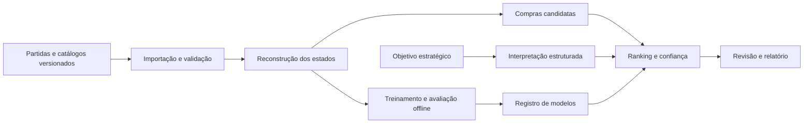

# RiftLab

Sistema acadêmico de aprendizagem estratégica por revisão pós-partida de decisões de compra em League of Legends, desenvolvido para a disciplina de Análise e Projeto de Sistemas.

## Problema e proposta

Uma build frequente não descreve todas as necessidades de uma partida. Composição das equipes, função, inventário e estágio do jogo influenciam quais compras merecem consideração. O RiftLab propõe recuperar pontos de decisão e comparar até três alternativas com evidências e limites de confiança.

O público prioritário são iniciantes e jogadores de elos mais baixos. O objetivo é desenvolver autonomia: observar ameaças, identificar necessidades, comparar custos e justificar escolhas antes de receber feedback. A recomendação é uma estimativa contextual, não uma garantia de vitória nem uma demonstração de que a alternativa teria mudado o resultado.

## Experiência prevista

1. Importar uma partida concluída ou abrir uma demonstração.
2. Selecionar um participante dentro do recorte suportado.
3. Percorrer a linha do tempo das decisões de compra.
4. Consultar inventário, composição, momento e qualidade dos dados disponíveis.
5. Escolher uma alternativa e justificar o raciocínio antes de revelar a comparação.
6. Consultar pistas graduais, comparar consequências e tentar um novo cenário sem ajuda.
7. Exportar um relatório com versões, evidências e limitações.

A interface distinguirá recomendação disponível, suporte limitado, estado incompatível e evidência insuficiente. Ouro estimado e ouro informado manualmente terão identificação própria.

## Escopo inicial

- Análise exclusivamente pós-partida, Summoner’s Rift, fila ranqueada solo/duo.
- Região inicial BR1; roteamento regional Americas.
- Uma função e três campeões, escolhidos após auditoria da amostra.
- Próximo item completo em pontos anteriores ao primeiro ou segundo item principal; componentes existentes considerados no custo restante.
- Ranking supervisionado, comparação com baselines, análise de confiança e experimento de agrupamento de contextos.
- Interpretação de objetivos em linguagem natural por modelo pré-treinado com ajuste supervisionado, validada contra formulário estruturado.
- Demonstração local reproduzível com dados sintéticos identificados e independência de serviços externos durante a apresentação.

Ficam fora do primeiro ciclo: overlay em tempo real, automação de compras, treinamento de modelos de linguagem do zero, aprendizado por reforço, aplicação móvel nativa e suporte simultâneo a outros jogos.

## Arquitetura prevista

Monólito modular em Python com FastAPI, PostgreSQL e processamento assíncrono por worker. Interface web em React e TypeScript. CatBoost para ranking e scikit-learn para baselines, agrupamento e avaliação. O treinamento permanece separado do atendimento de consultas.

## Plano de entrega

| Sprint | Foco | Incremento esperado |
| --- | --- | --- |
| 1 | Fundação e validação dos dados | Ambiente, contratos, amostra auditada e recorte congelado |
| 2 | Importação e reconstrução temporal | Partida navegável com estados e limites de qualidade |
| 3 | Candidatos e baselines | Primeira revisão completa com alternativas determinísticas |
| 4 | Ranking e confiança | Modelo avaliado, versionado e integrado |
| 5 | Objetivos e revisão assistida | Experimento de fine-tuning, formulário alternativo e feedback |
| 6 | Validação e entrega | Experimentos, testes integrados, relatório e demonstração |

## Situação atual

Planejamento preparado. A aplicação, o pipeline de dados e os modelos ainda não foram implementados. Não existem resultados experimentais ou comandos de inicialização validados nesta etapa.

## Avaliação

O estudo comparará popularidade por campeão, regras explícitas e ranking contextual em separação temporal de partidas. Compras históricas medem concordância com comportamento observado; pertinência estratégica será avaliada separadamente em casos revisados. Scores de ranking não serão apresentados como probabilidades de vitória.

## Dados e execução

Credenciais, históricos brutos e pesos de modelos não pertencem ao repositório. O modo real dependerá de uma chave válida da Riot e das condições de acesso vigentes. O modo de demonstração utilizará fixtures sintéticas identificadas. A RX7600 poderá auxiliar inferência, mas a entrega básica será executável em CPU; fine-tuning terá orçamento e ambiente registrados no experimento.

## Relação com a Riot Games

Projeto acadêmico independente, sem afiliação ou endosso da Riot Games. League of Legends e suas propriedades associadas pertencem aos respectivos titulares. Antes de disponibilizar o produto a jogadores, serão verificados registro, avisos e condições aplicáveis no portal da desenvolvedora.
