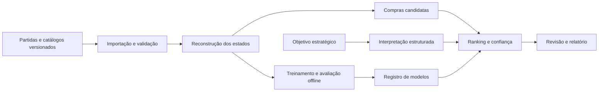

# RiftLab

Sistema acadêmico de aprendizagem estratégica por revisão pós-partida de decisões de compra em League of Legends, desenvolvido para a disciplina de Análise e Projeto de Sistemas.

## Problema e proposta

Uma build frequente não descreve todas as necessidades de uma partida. Composição das equipes, função, inventário e estágio do jogo influenciam quais compras merecem consideração. O RiftLab propõe recuperar pontos de decisão e comparar até três alternativas com evidências e limites de confiança.

O público prioritário são iniciantes e jogadores de elos mais baixos. O objetivo é desenvolver autonomia: observar ameaças, identificar necessidades, comparar custos e justificar escolhas antes de receber feedback. A recomendação é uma estimativa contextual, não uma garantia de vitória nem uma demonstração de que a alternativa teria mudado o resultado.

## Experiência

Documentação de engenharia: [estado técnico](docs/estado-projeto.md),
[requisitos](docs/requirements.md), [arquitetura](docs/architecture.md),
[contratos](docs/contracts.md) e [versionamento/portabilidade](docs/versionamento.md).
Documentação, modelos, fontes Colab e retornos experimentais auditados acompanham o Git;
credenciais, dados identificáveis de jogadores e volumes do banco continuam locais.

1. Importar uma partida concluída ou abrir uma demonstração.
2. Selecionar um participante dentro do recorte suportado.
3. Percorrer a linha do tempo das decisões de compra.
4. Consultar inventário, composição, momento e qualidade dos dados disponíveis.
5. Ver diretamente a comparação disponível, suas justificativas e limitações, com objetivo inicial equilibrado.
6. Opcionalmente abrir **Praticar decisão** para escolher antes de revelar, consultar pistas e registrar uma reflexão.
7. Exportar um relatório com versões, evidências e limitações.

A interface distingue recomendação disponível, suporte limitado, estado incompatível e evidência insuficiente. Ouro estimado e ouro informado manualmente têm identificação própria.

**Analisar partida** é o modo padrão da tela de decisão: não exige adivinhar um item nem cria tentativa de aprendizagem. **Praticar decisão** é uma experiência separada e opcional, também acessível por `?mode=practice`, que preserva a escolha antes da revelação. Depois de ver uma comparação, use outra decisão para praticar sem influência. A análise direta começa com objetivo equilibrado e permite reanalisar com outra prioridade; popularidade e compra histórica não são apresentadas como garantia do melhor item.

## Escopo inicial

- Análise exclusivamente pós-partida, Summoner’s Rift, filas ranqueadas Solo/Duo e Flex.
- Região inicial BR1; roteamento regional Americas.
- Uma função e dez atiradores: os três da auditoria inicial e mais sete medidos no corpus 16.19 antes de entrar no produto.
- Próximo item completo em pontos anteriores ao primeiro ou segundo item principal; componentes existentes considerados no custo restante.
- Ranking supervisionado, comparação com baselines, análise de confiança e experimento de agrupamento de contextos.
- Interpretação de objetivos em linguagem natural, com experimento de ajuste supervisionado de um modelo pré-treinado comparado a regras explícitas e ao formulário estruturado.
- Demonstração local reproduzível com dados sintéticos identificados e independência de serviços externos durante a apresentação.

Ficam fora do primeiro ciclo: overlay em tempo real, automação de compras, treinamento de modelos de linguagem do zero, aprendizado por reforço, aplicação móvel nativa e suporte simultâneo a outros jogos.

## Arquitetura

Monólito modular em Python com FastAPI, PostgreSQL e processamento assíncrono por worker (importação, preparação e expurgo numa fila durável). Interface web em React e TypeScript. Os experimentos de ranking usam CatBoost em CPU e um agrupamento KMeans em NumPy; o critério servido é a popularidade por campeão e etapa da build, porque nenhum modelo a superou. O treinamento roda pela CLI e fica separado do atendimento de consultas. O interpretador de objetivo usa regras por padrão; o ajuste de um modelo de linguagem ficou como experimento num ambiente separado (`ml/objectives`).



## Plano de entrega

| Sprint | Foco | Incremento esperado |
| --- | --- | --- |
| 1 | Fundação e validação dos dados | Ambiente, contratos, amostra auditada e recorte congelado |
| 2 | Importação e reconstrução temporal | Partida navegável com estados e limites de qualidade |
| 3 | Candidatos e baselines | Primeira revisão completa com alternativas determinísticas |
| 4 | Ranking e confiança | Modelo avaliado, versionado e integrado |
| 5 | Objetivos e revisão assistida | Experimento de fine-tuning, formulário alternativo e feedback |
| 6 | Validação e entrega | Experimentos, testes integrados, relatório e demonstração |

## Estado da entrega (15/10/2026)

| Situação | O quê |
| --- | --- |
| **Entregue** | Importação BR1 e demonstração offline. Reconstrução do estado anterior à compra com proveniência e incerteza explícita. Decisões elegíveis. Candidatos legais do catálogo do patch. Comparação de até três alternativas com custo restante. Popularidade versionada com suporte e abstenção. Objetivo por formulário ou texto confirmado. Estudo com escolha antes da revelação, pistas, reflexão e transferência. Julgamento por rubrica e relatório JSON/HTML verificável. Registro de modelos. Expurgo com confirmação e retenção. Navegação Painel, Campeões, Minha posição e Histórico. Minha posição da conta própria. Demonstração reproduzível. |
| **Experimentos com resultado negativo** | Ranker contextual (CatBoost) sem ganho sobre a popularidade no planejamento do próximo item, também com dez atiradores. Clusters de contexto sem estrutura. Ajuste LoRA do interpretador reprovado no gate de ambiguidade. Regras de inventário em 16.16/16.17 não liberadas. |
| **Pendente** | Revisão estratégica por especialistas (ferramenta pronta, aguardando os revisores). Estatísticas pessoais no Painel (taxa de vitória, KDA, decisões revistas). Piloto pedagógico com voluntários. |
| **Fora do escopo** | Overlay ao vivo e partidas em andamento. Automação de compras. Treinar modelo de linguagem do zero. Aprendizado por reforço. Aplicativo móvel nativo. Outros jogos. Uso multiusuário ou exposição pública da API. |

## Situação atual

Sprint 1 (fundação) concluída. Implementado e validado localmente: API FastAPI com health checks (`/health/live`, `/health/ready`), worker mínimo, frontend React mínimo, ambiente reproduzível via Docker Compose (CC-101); protótipo navegável de baixa/média fidelidade das jornadas de revisão e do modo Estudo, com dados ilustrativos e sem API real (CC-102); persistência inicial via Alembic (sete tabelas) e fronteiras de domínio por módulo (CC-103); fontes de dados plugáveis (`MatchSource`/`CatalogSource`) com fixtures sintéticas empacotadas para o modo demonstração, sem exigir rede nem credencial (CC-104); recorte inicial (BR1, fila ranqueada solo/duo, função e três campeões) congelado em `configs/scope.yaml` a partir de partidas reais coletadas com permissão explícita — amostra de conveniência, metodologia e limitações declaradas no próprio arquivo (CC-105); contrato de erro padronizado em `application/problem+json` para validação (422), rota inexistente (404) e falha inesperada (500), além do 503 já existente, com OpenAPI real das rotas de saúde declarado e tipos TypeScript gerados sem divergência (CC-106).

Sprint 2 (importação e reconstrução temporal): importador Riot resiliente entregue (CC-201) — `POST /api/v1/imports`, `GET .../{id}` e `POST .../{id}/retry` são rotas HTTP reais, com job durável em PostgreSQL (posse por lease com token/geração, retomada segura de crash, até 5 tentativas transitórias com backoff antes de falha permanente), worker que busca a partida (Riot Match-V5/Timeline-V5 real ou fixtures demo), valida (só partida concluída, RF17) e persiste match/participantes/eventos de forma atômica. Identificadores pessoais nunca são persistidos brutos: só um hash HMAC local. Importação real exige `RIFTLAB_RIOT_API_KEY` e `RIFTLAB_SUBJECT_HASH_SECRET` configuradas; o modo demonstração continua funcionando sem nenhuma das duas.

Catálogo versionado e regras do patch entregue (CC-202): `cc catalog sync --mode demo|real --patch X` busca (fixture demo ou Data Dragon público real, CDN sem credencial), valida (tipos/limites, ciclo/referência de receita) e persiste catálogo+itens de forma imutável e idempotente — mesmo conteúdo nunca duplica, conteúdo divergente nunca sobrescreve uma versão publicada. `configs/catalog-mappings.yaml` mantém overrides explícitos de 16.16.1/16.17.1. Para outro patch, a preparação ou CLI consulta `versions.json` público, fixa uma versão do mesmo `major.minor` no banco e nunca usa o `latest` de outro patch; ausência no CDN permanece `MISSING_CATALOG`. O recorte inicial do CC-105 segue documentado, enquanto a janela operacional é móvel.

Patch vigente (CC-314): `cc patch detect` registra explicitamente no banco a versão mais nova publicada e sua janela de dois patches. Coleta, extração e relatórios usam essa janela; sem detecção, o recorte móvel falha de forma explícita. Catálogos públicos de itens e campeões do patch 16.19.1 foram sincronizados em banco descartável sem editar YAML (834 itens, 173 campeões); nenhuma partida nova foi coletada. A API e o Histórico/Contexto indicam suporte limitado para partidas reais sem avaliação de ranking no patch. `cc report patch-readiness` mostra contagens agregadas e mínimos do protocolo anterior, sem executar confirmação. Regras empíricas continuam pendentes, nenhum modelo foi treinado e o gate REAL de elegibilidade permanece bloqueado.

Reconstrução pré-compra de inventário implementada e validada (CC-203, com uma limitação empírica explícita registrada abaixo): `cc timeline reconstruct --mode demo|real --match-id X` reduz os eventos de uma partida já importada, em ordem, e guarda o estado do inventário imediatamente ANTES de cada compra elegível (nunca o item comprado aparece no próprio estado). Multiconjunto de itens com trinket em slot separada, receita consumida por quantidade possuída inclusive por subcomponentes transitivos (compra direta paga o restante), capacidade de 6 slots normais verificada contra as regras de empilhamento do catálogo, venda e undo (restaura o multiconjunto exato de uma correlação verificada por invariante interno, nunca um palpite — mas essa própria correlação é uma hipótese sobre semântica não documentada, nunca confirmada como semântica oficial), e ouro estimado a partir do último frame estritamente anterior ao evento. Ambiguidade (item desconhecido, destruição não reconciliada, capacidade excedida, undo sem correlação, catálogo ausente para o patch) nunca é escondida nem "reparada" pelo inventário final: fica marcada como incerta, de forma explícita e datada, e nunca cura retroativamente um estado já calculado. Persistência idempotente — reconstruir a mesma partida de novo não duplica. **Limites empíricos**: a reconciliação entre uma compra de item composto e os eventos `ITEM_DESTROYED` que ela dispara, e a correlação de `ITEM_UNDO`, usam regras internas sobre semântica não documentada pela Riot. Foram examinadas offline num corpus real pequeno (10 partidas dos patches 14.20 e 15.1, com os catálogos históricos correspondentes do Data Dragon público) e são consistentes com ele, mas isso não é semântica oficial nem generalização: os patches do recorte congelado (16.16/16.17) não foram avaliados e os dados brutos não são versionados. Em dado real (não sintético), aplicar qualquer uma das duas regras sempre marca o estado como incerto, mesmo quando a regra interna "bate" — bater com uma regra interna não comprova a semântica real; o sistema nunca apresenta essa estimativa como certeza.

Pontos de decisão e features versionadas entregues (CC-204). A curadoria do catálogo passou a `data_dragon_v5` (persiste o campo documentado `into`) e um classificador puro e versionado (`item_classification_v1`) decide o que é item principal, sem usar nome, texto nem preço; campo ausente ou curadoria sem suporte resulta em "sem classificação", nunca em "principal". A reconstrução passou à v6: a forma real observada — `ITEM_DESTROYED` dos componentes ANTES da compra composta, no mesmo instante — é tratada como transação, então o snapshot fica antes dela e contém a receita do próprio alvo (nas versões 3 a 5 o snapshot omitia exatamente essa receita). `cc decisions extract --match-id X` (só banco: não reconstrói, não abre fonte, não usa rede) seleciona compras de item principal com zero ou um item principal anterior, avalia elegibilidade com motivos (`MISSING_CATALOG`, `OUT_OF_SCOPE`, `INVENTORY_UNCERTAIN`), mantém o orçamento separado da elegibilidade (`STALE_FRAME` acima de 90 s, `UNKNOWN_BUDGET`; desconhecido nunca vira zero), calcula features pré-decisão com schema versionado e máscara de ausência (sem resultado, sem identificador pessoal; a composição agregada de campeões está ausente por não haver catálogo curado de campeões) e grava tudo de forma imutável e versionada. Duas rotas de leitura, `GET /api/v1/matches/{matchId}/decisions?participantId=` (paginação estável por cursor opaco; `409 DECISIONS_NOT_PREPARED` quando ainda não extraído, distinto de `200` com lista vazia) e `GET /api/v1/decisions/{decisionId}`, expõem só informação anterior à decisão (inventário como multiconjunto, orçamento, nível observado, motivos, versões): nunca o item comprado, a classe dele, o resultado da compra, o vetor de features nem a qualidade cumulativa, para o modo Estudo. **Limitação real e explícita:** nos dados reais examinados (10 partidas dos patches 14.20 e 15.1, fora do recorte congelado) foram 199 pontos de decisão e nenhum elegível. As regras conservadoras de incerteza do CC-203, que em dado real marcam cada heurística aplicada de forma cumulativa, e mecânicas reais de inventário ainda não modeladas — consumo de consumíveis, troca de trinket, transformações de item e aquisições fora de `ITEM_PURCHASED` — mantêm a pré-decisão incerta. O demo sintético demonstra o fluxo completo com decisões elegíveis; isso valida a engenharia, não dado real, e esta etapa não promete corrigir a limitação.

Navegação de importação e timeline entregue (CC-205): o fluxo importar → partida → decisão funciona pela interface, sem console, contra o backend real. Depois de uma importação bem-sucedida o worker prepara a partida sozinho (catálogo → reconstrução v6 → extração), como job durável na mesma maquinaria de lease e retomada do importador, com estados `PENDING`, `RUNNING`, `READY` e `FAILED` (código de erro seguro, sem payload) e nova tentativa por `POST /api/v1/matches/{matchId}/preparation`; no modo real só há rede para o catálogo público do Data Dragon, e apenas para patches com entrada explícita em `configs/catalog-mappings.yaml`. `GET /api/v1/matches` (cursor opaco, ordem estável por início e ID) e `GET /api/v1/matches/{matchId}` listam e detalham partidas sem qualquer identificador pessoal, e o detalhe da decisão traz o nome de cada item lido do catálogo fixado pelo próprio ponto. A interface tem entrada com formulário de ID BR1 e "Explorar demonstração" (partida sintética), lista de partidas importadas para retomar, progresso da importação com nova tentativa, partida com preparação acompanhada, participantes, decisões paginadas e detalhe (orçamento aproximado, snapshot antigo ou desconhecido, nunca zero; motivos em português; versões num bloco recolhível). Cada endereço (`/imports/:jobId`, `/matches/:matchId?participant=N`, `/decisions/:decisionId`) pode ser aberto direto ou recarregado, e os erros têm texto útil sem segredo (por exemplo, chave da Riot ausente ou expirada). Validado por Vitest, por Playwright com API simulada (falhas recuperáveis, 360 px sem rolagem horizontal, fluxo só com teclado) e por Playwright contra a stack Docker real (api, worker, PostgreSQL e frontend). **Limitações que continuam verdadeiras:** no corpus real local examinado a elegibilidade segue em 0 de 199 pontos, porque as mecânicas reais de inventário descritas acima ainda não estão modeladas; a análise é só de partidas concluídas, sem acompanhamento ao vivo; e a demonstração usa dados sintéticos, então valida a engenharia e não demonstra ganho real.

Coleta incremental e integridade da ingestão entregues (CC-206): `cc collect run|import|report` coleta partidas SÓ de uma lista permitida de contas de pessoas que consentiram de forma explícita (arquivo de sementes com rótulo pseudônimo e `consent: true`; nunca percorre adversários, colegas de time nem ligas), com manifesto durável, tetos por execução (requisições, partidas, duração e partidas por semente), limitador global compatível com os headers de limite da Riot e com `Retry-After`, parada segura em 401/403 com retomada sem duplicar depois da troca manual da chave, deduplicação por `matchId` e filtros explícitos (plataforma BR1, fila 420, mapa 11, partida concluída, patches do recorte) com contagem de perdas por motivo. Cada passada recomeça da posição 0 da listagem — a lista da Riot cresce pela cabeça, então um índice guardado pularia partidas jogadas entre duas rodadas —, e a partida já conhecida custa 0 requisição, de modo que retomar nunca rebusca o que já foi coletado. A partida coletada é importada a partir do armazenamento local, sem buscar de novo, e entra na preparação automática do CC-205; `cc report reconstruction|diversity|integrity` geram relatórios agregados sem qualquer identificador pessoal (a integridade prova no banco que nenhuma partida parcial fica analisável). Validado com transporte simulado (falhas 5xx, 429 com `Retry-After`, 401 no meio da coleta e retomada, tetos, filtros, queda entre buscar e gravar) e com duas coletas reais pequenas: 50 partidas (patch 16.16 ×12, 16.17 ×38; 117 requisições; nenhuma resposta 401, 403 ou 429) importadas e preparadas até `READY`, todas com integridade verificada. **Resultado honesto:** essa amostra tem 0 pontos de decisão elegíveis (1.461 pontos no total; 104 dentro do recorte de função e campeões, todos com inventário incerto) e 86,29% dos 10.879 estados com pré-decisão incerta, porque as mecânicas reais de destruição e desfazer de itens ainda não estão modeladas (é o trabalho do CC-207). **Limites que continuam verdadeiros:** a amostra é de conveniência (uma única conta responde por 74% das partidas, 413 jogadores distintos em 500 participações e duas das quatro contas não tinham partidas na janela), então não é representativa e não sustenta resultado estatístico; `Retry-After` real e `count` acima de 100 na listagem não foram observados; os dados coletados ficam fora do Git. A primeira coleta real também revelou um defeito de preparação, já corrigido e coberto por teste: um catálogo canônico antigo, de curadoria não suportada, era reaproveitado em silêncio e deixava todos os itens sem classificação; agora a preparação o ressincroniza.

Mecânicas reais de inventário modeladas e testadas contra dado real com protocolo pré-registrado (CC-207), com **resultado negativo declarado**. A reconstrução passou à v7: sete regras empíricas — consumo de consumível possuído, troca de trinket, trinket inicial, itens de sistema e de missão, item inicial de apoio, ordem destroy→compra tratada como transação e correlação de undo em pilha — estão implementadas com proveniência por estado (`quality.empiricalRules`) e um registro versionado (`configs/empirical-rules.yaml`) que só liga uma regra nos patches em que uma confirmação pré-registrada a aprovou. Com todas desligadas, a v7 reproduz a v6 exatamente (verificado por testes de regressão e estado a estado nos dados reais). O protocolo foi fixado com hash antes de qualquer medição confirmatória: as 50 partidas reais (16.16 ×12, 16.17 ×38) foram divididas por partida em exploração (20) e confirmação (30), os limiares são fixos (limite superior de Wilson 95% da taxa de contra-exemplos, com amostra mínima por hipótese) e a confirmação foi executada uma única vez por um auditor congelado. **Resultado:** várias regras passaram individualmente na confirmação — ordem destroy→compra, consumo de consumível e itens de sistema nos dois patches; troca de trinket, trinket inicial e item de apoio só em 16.17 — e a correlação de undo foi reprovada em 16.17. Mesmo assim, **nenhuma regra foi liberada**: o teste final, que exige que o inventário reconstruído feche com o inventário final da partida sob o conjunto de regras aprovado, ficou sem amostra suficiente nos dois patches (16 participantes sem nenhuma marca de incerteza em cada, abaixo do mínimo pré-registrado de 20), e em 16.16 quinze desses dezesseis não fechavam por divergência de trinket. O registro continua com todas as regras pendentes e a elegibilidade não mudou: **0 de 1.461 pontos de decisão elegíveis (0 de 104 dentro do recorte), antes e depois, com 86,29% dos 10.879 estados com pré-decisão incerta**; na partição de confirmação, 0 de 946 (0 de 77 no recorte). Os limiares não foram afrouxados nem a amostra ampliada depois do resultado. Liberar regras exige mais partidas coletadas com autorização e uma nova confirmação pré-registrada; a amostra continua de conveniência e pequena, e nada disso é semântica oficial da Riot.

Corpus do patch 16.19 ampliado (CC-323). `cc collect dataset-16-19` coleta pares match+timeline por expansão em bola de neve a partir das contas com consentimento: cada partida encontrada traz todos os participantes (aliados e adversários) para a fila, sem limite de saltos, com prioridade para quem jogou o recorte (BOTTOM com Caitlyn, Ezreal ou Kai'Sa). A listagem fica restrita à janela do 16.19 e só partidas BR1 do 16.19, fila 420, mapa 11 e concluídas são gravadas, uma única vez, em armazenamento privado. A campanha tem tetos próprios de pares, requisições e tempo, somados entre tentativas, e autorização por tentativa. Diário, relatório e saída não carregam identificador de jogador. Uma execução autorizada gravou 1.000 partidas novas com 2.248 requisições, todas aceitas. A verificação independente confirmou patch, fila, mapa, conclusão e integridade de todas, sem sobreposição com as 173 do protocolo CC-316, com 8.159 jogadores distintos e no máximo 12 partidas por jogador. Numa medição em banco descartável com as regras do 16.19, as 1.173 partidas somam 187 pontos de decisão elegíveis no recorte (de 2.191); as 173 do protocolo reproduzem exatamente a medição anterior (24 de 227). **Limites:** amostra de conveniência puxada para jogadores desses campeões; 90% das partidas caem nos três últimos dias do patch, porque cada jogador contribui com as mais recentes; 40 remakes ficarão fora do dataset; a legalidade dos candidatos continua pendente.

Incerteza de inventário reduzida no patch 16.19 (CC-324). Um censo mostrou que cerca de 80% dos primeiros bloqueios no recorte vinham de itens que aparecem sem compra: biscoito, calçados mágicos e elixires concedidos por runas, e botas trocadas ao terminar a missão de rota (a do BOTTOM tira a bota dos espaços normais; a do MID a troca pela versão superior). Um novo protocolo pré-registrado, com partição por hash (225 partidas para exploração, 309 para confirmação, sem jogadores em comum), aprovou cinco regras na confirmação única, com o fechamento do inventário final dentro do limite (15 de 469 participantes limpos). As regras valem só no 16.19, pelo registro `configs/empirical-rules.yaml`, e a reconstrução passou à v9. Os pontos de decisão elegíveis no recorte subiram de 187 para 676 (de 2.191) nas 1.173 partidas; o dataset preliminar passou a 671 linhas, com o baseline de popularidade acertando a compra histórica de primeira em 67% das decisões de teste (aleatório: 1,2%). **Limites:** as runas servem só para testar a regra, não para aplicá-la; itens concedidos não ocupam espaço na reconstrução; Viego e a missão da selva ficam fora; o baseline mede imitação, não qualidade da compra; nada disso é semântica oficial da Riot.

Dataset final e protocolo de comparação (CC-401). `cc dataset freeze-corpus` aceita uma divisão cronológica em três partes (política `configs/experiments/dataset-16.19-v2.yaml`): 788 partidas de treino, 169 de validação e 170 de teste, sem nenhum instante dividido entre partes; o manifesto anterior foi reproduzido com o mesmo hash. `cc dataset freeze-dataset` junta as linhas da reconstrução v9 ao manifesto e registra cobertura e contaminação por jogador, sem identificadores: 469, 118 e 89 decisões (Caitlyn, Kai'Sa e Ezreal; 1º e 2º item principal). O protocolo `configs/experiments/comparison-protocol-v1.yaml` fixa MRR como métrica principal, intervalos por bootstrap de partidas, seleção só na validação e o teste rodado uma única vez depois de congelada a configuração do modelo. Na validação, o baseline de popularidade tem MRR 0,80 (aleatório 0,06). **Limites:** teste pequeno (89 decisões); cerca de metade das decisões de validação e de teste são de jogadores que também aparecem no treino, por isso o protocolo também reporta o subconjunto sem jogador em comum; um patch; validação e teste no fim do patch.

Ranker contextual em CPU (CC-402). `cc ml train-ranker` treina um CatBoostRanker (objetivo PairLogit, grupo = decisão) com até 12 configurações pequenas e parada antecipada só na validação, junto com dois baselines — B0 (popularidade por campeão e ordem do item) e B1 (regras explícitas: aproveitar componentes e custo restante, pesos fixados antes da avaliação) — e duas ablações (sem composição dos times, sem estado econômico); `cc ml evaluate-test` roda o teste uma única vez. No teste (88 decisões), o MRR foi 0,77 para B0, 0,79 para B1 e 0,98 para o modelo, mas o modelo sem as features econômicas cai a 0,79: o ganho vem de saber quais itens já cabem no ouro, porque o ponto de decisão é o instante da compra (em média só 4 dos ~106 candidatos legais cabem no ouro estimado). **Leitura:** o modelo imita bem o momento da compra; isso não demonstra que ele recomende a melhor compra. Treino com 1 thread: 16 minutos e 347 MB para as 24 configurações. **Limites:** teste pequeno, metade com jogadores vistos no treino, um patch; a métrica é imitação da escolha histórica.

Planejamento do próximo item sem o atalho do ouro (CC-407). Para separar escolha de momento, `cc dataset build-rows --task planning` ancora cada decisão antes da compra — antes da primeira compra da partida para o 1º item principal, ou logo depois do 1º para o 2º — sem nenhuma informação de ouro. Com o mesmo corpus, divisão e protocolo, o teste deu MRR 0,76 para a popularidade por campeão (B0), 0,75 para o CatBoost e 0,04 para a heurística de componentes e custo (B1); composição dos times e custo restante não acrescentaram nada. **Resultado negativo:** nesta amostra, o contexto disponível não melhora a previsão da escolha planejada além da popularidade; o ganho do CC-402 vinha do ouro no instante da compra. O baseline de popularidade continua sendo a referência.

Contexto rico (CC-408). `cc ml enrich-context` acrescenta, só com eventos anteriores à âncora, o campeão adversário da rota, os itens principais já completados por inimigos e aliados, a diferença de ouro do time e a de abates. Na validação, o modelo com e sem esse contexto teve o mesmo MRR (0,81); no teste (já usado uma vez antes, o que fica declarado), 0,76 contra 0,76 da popularidade. **Resultado negativo reforçado:** nesta amostra do 16.19, a escolha planejada do próximo item é explicada pela popularidade por campeão e ordem do item.

Recorte ampliado para dez atiradores, como experimento (CC-702). O mesmo corpus 16.19, a mesma divisão e o mesmo protocolo foram medidos com um recorte separado, `configs/experiments/scope-16.19-marksmen10.yaml`. A regra, fixada antes da medição, foi atirador com pelo menos 60 partidas na rota inferior do treino: Caitlyn, Kai'Sa, Jinx, Ezreal, Jhin, Yunara, Tristana, Ashe, Miss Fortune e Twitch.
- **Dados:** sem rede e sem coleta nova. As decisões elegíveis passaram de 676 para 1.685 (treino 1.176, validação 284, teste 225), com elegibilidade parecida em todos os campeões (29% a 36%). As linhas dos três campeões originais saíram idênticas às anteriores.
- **Fatias:** `cc ml evaluate-test` também reporta as fatias que o dataset declara por linha (campeões originais, novos e cada campeão), na mesma execução única do teste.
- **Resultado:** no planejamento sem ouro, o teste deu MRR 0,75 para a popularidade, 0,74 para o CatBoost e 0,74 com contexto rico. Nos campeões novos, cujo teste nunca tinha sido visto, deu 0,75 contra 0,75. No instante da compra o padrão do CC-402 se repete (0,76 contra 0,94, com o ganho vindo do ouro). **Resultado negativo confirmado com 2,5 vezes mais dados e intervalos mais estreitos.**
- **Produto:** o produto continuou com três campeões até o CC-704.
- **Limites:** a mesma amostra de conveniência em bola de neve, um patch e fatias por campeão pequenas (14 a 44 decisões de teste).

Dez atiradores no produto (CC-704). `configs/scope.yaml` passou à v2, com os dez campeões do CC-702.
- **Popularidade:** o critério servido passou a `configs/ranking/popularity-16.19-v2.json`, com 20 células (campeão × ordem do item), exportado por `cc dataset export-popularity` a partir do treino do dataset v3. O mesmo comando reproduz o v1 byte a byte, e as seis células dos campeões originais não mudaram.
- **Suporte:** o menor grupo tem 26 decisões de treino. O limiar escolhido na validação continua zero, com cobertura total e erro fora do top-3 de 0,10 na validação e 0,08 no teste.
- **Partidas já preparadas:** são reextraídas na próxima preparação, porque a versão do recorte mudou.
- **O que não mudou:** o v1 continua no repositório, para o histórico das análises que o registraram.

Coleta em escala do 16.19 (CC-703). `cc collect dataset-16-19-scale` reaproveita a expansão em bola de neve do CC-323 numa campanha própria, com tetos, autorização por tentativa e diário durável.
- **Prioridade e sorteio:** a prioridade vai para quem jogou os dez atiradores na rota inferior. Cada listagem pede até 100 partidas do jogador no patch e guarda 5, sorteadas por hash com sal fixo, sem requisição a mais. Partidas já coletadas não custam requisição.
- **Execução autorizada:** 10.000 partidas novas com 22.178 requisições em 8,5 horas, sem nenhuma resposta 401, 403 ou 429. A verificação independente confirmou patch, fila, mapa, integridade, nenhuma sobreposição com as coletas anteriores, 64.622 jogadores distintos e no máximo 18 partidas por jogador. Os últimos três dias do patch passaram de 77% das partidas para 22%.
- **Corpus e dataset:** o corpus v3 (`cc dataset freeze-corpus --include-cc703`) tem 10.662 partidas e 16.204 decisões elegíveis (11.418 de treino, 2.391 de validação, 2.395 de teste). As linhas das partidas antigas saíram idênticas às anteriores, fora a parte da divisão.
- **Treino:** `cc ml train-ranker --task-type GPU` permite treinar em GPU, e o dispositivo fica registrado no manifesto da execução. O treino em GPU é um desvio declarado do protocolo em CPU. O resultado ainda não foi medido.
- **Limites:** a amostra continua em bola de neve e inclui partidas de jogadores sem consentimento, guardadas só localmente e com identificadores pseudonimizados no banco; um patch.

Suporte, registro de modelos e desempenho (CC-403 a CC-406). Clusters de contexto (KMeans ajustado só no treino, k = 3, 5 e 8) não mostraram estrutura (silhueta perto de zero) nem ganho na validação e foram descartados. O ranking ativo é a popularidade, servida atrás de uma barreira de validade e de um suporte por célula (campeão × ordem do item): estado incerto, campeão sem dados ou patch sem regras recebem `INSUFFICIENT_EVIDENCE` com motivo legível, nunca uma lista; no recorte atual todas as células têm dados suficientes, então a cobertura é total, com erro (fora do top-3) de 0,11 no teste. Um registro de modelos no PostgreSQL (`cc ml registry-*`) aceita só artefatos locais com hash conferido, promove de forma atômica (uma versão ativa por tarefa), faz rollback e mantém versões aposentadas no histórico; sem versão ativa, o fallback para a popularidade é explícito. Num i3-7020U com 1 thread, 100 consultas de 106 candidatos levam p95 de 163 ms para enumerar os itens legais, 2,5 ms para o ranking com suporte e 18 ms para pontuar com o CatBoost. Os motivos de abstenção aparecem na tela de estudo e cada análise guarda a versão ativa do registro (CC-304/306).

Revalidação das regras de inventário no patch 16.19 preparada com partição pré-registrada (CC-316/CC-320). Um novo protocolo, fixado com hash antes de qualquer coleta, mantém as hipóteses e os limiares do CC-207 e define uma partição por partida cega a eventos: as partidas elegíveis são ordenadas por `sha256("CC-316-partition-v1|" + matchId)`, as 20 primeiras formam a exploração e as demais a confirmação potencial, da qual sai toda partida que compartilhe participante com a exploração. `cc collect structural-cc316` descobre partidas BR1 da fila 420 a partir das contas com consentimento e de participantes dessas partidas, lê do Match-V5 só identidade, versão, fila, mapa e marcador de conclusão com um leitor incremental que pula o restante sem montá-lo em memória, usa os identificadores dos participantes só em memória (para o salto seguinte, no máximo dois, e para comparação por HMAC efêmero) e grava somente um snapshot privado de IDs de partida, sem corpo de partida, timeline ou banco. Uma rodada real admitiu 320 candidatos (231 elegíveis no 16.19: 20 de exploração, 153 de confirmação potencial e 58 excluídas por sobreposição); uma emenda adotou esse snapshot como partição congelada e encerrou a descoberta, e `cc collect cc316-adopt-partition` gera dele, uma única vez, um artefato verificado com digest e procedência por partida. Depois, `cc collect cc316-exploration-fetch` buscou match e timeline só das 20 partidas de exploração (autorização por tentativa, verificação de rede sem requisição à Riot, orçamento cumulativo de requisições e tempo, armazenamento privado gravado uma única vez), e a análise exploratória offline reproduziu as formas de evento do patch anterior; o protocolo da confirmação foi congelado com hash antes de qualquer acesso às 153 partidas restantes; nessa etapa, nenhuma regra foi liberada. **Limites:** a amostra é correlacionada por jogador e truncada pelo teto de candidatos na ordem de descoberta, e a confirmação ainda depende da análise exploratória, de um congelamento hasheado e de autorização própria.

Confirmação no patch 16.19 com resultado positivo (CC-322). Depois do congelamento, `cc collect cc316-confirmation-fetch` buscou as 153 partidas da confirmação (liberadas só com o congelamento selado), um portão conferiu que nenhuma divide jogador com a exploração e o auditor congelado rodou uma única vez. Passaram, com o limite superior de Wilson dentro dos limiares pré-registrados: ordem destroy→compra (1 contra-exemplo em 15.761), itens de sistema e missão (0/4.317), consumo de consumível possuído (8/2.314 pares), World Atlas dos Apoios (0/295), trinket inicial (5/459) e troca de trinket (23/866); o fechamento do inventário final dos participantes limpos também passou (5/193). A correlação de undo foi reprovada (79/1.303) e continua pendente. As seis regras aprovadas valem só no patch 16.19, pelo registro `configs/empirical-rules.yaml`, e a reconstrução passou à v8. Numa remedição em banco descartável com as 173 partidas do protocolo, a pré-decisão incerta caiu de 85,7% para 60,0% dos estados e os pontos de decisão elegíveis no recorte passaram de 0 para 24 de 227 — as primeiras decisões REAL elegíveis do projeto. **Limites:** amostra de descoberta por participantes, correlacionada por jogador, num único patch; os demais patches seguem sem regra; elegibilidade não resolve a legalidade dos candidatos, que continua bloqueada; nada disso é semântica oficial da Riot.

Nomes e retratos oficiais dos campeões nas telas de partida e de decisão (CC-208). O catálogo de campeões (`champion.json` em pt_BR) é baixado do Data Dragon público só para a versão **fixada** ao patch em `configs/catalog-mappings.yaml` — nunca `latest` — e gravado no banco uma vez por versão e idioma; patch sem entrada no mapping não usa rede. A ligação com o `championId` da partida é o `key` numérico do Data Dragon, não o `id` textual que dá nome ao arquivo (por exemplo, `key` 62 é `MonkeyKing.png`, nome "Wukong"). O documento só é aceito com `type` e `version` corretos, e cada entrada precisa de `key` numérico, nome e arquivo de imagem num formato fechado (letras, dígitos e `.png`: sem caminho, `..` ou URL); o que não passa fica fora. A sincronização acontece na preparação da partida (e por `cc catalog sync-champions --patch X`); se o CDN falhar, a partida fica pronta do mesmo jeito. As rotas de leitura continuam só lendo o banco: `GET /api/v1/matches/{matchId}` passa a trazer, por participante, `champion` com nome, versão e arquivo, ou `null`. O navegador carrega o retrato quadrado direto do host oficial, sem chave. Partida de demonstração, patch sem mapping, catálogo ainda não sincronizado, campeão ausente do catálogo ou imagem que não carrega mostram o rótulo numérico, com a caixa do retrato do mesmo tamanho (sem salto de layout). O rodapé traz a atribuição ao Data Dragon e o aviso legal exigido pela Riot Games. Validado com os IDs 145/51/81 nos patches 16.16 e 16.17, contra o CDN real em banco descartável e por testes de parser, transporte, API, interface e navegação em 360 px e por teclado. Não há sugestão de build: as imagens só identificam o campeão.

A navegação principal oferece Painel, Campeões, Minha posição e Histórico (CC-308/311). O Painel mostra até cinco partidas **importadas** recentes, com origem, data, duração, campeões presentes quando conhecidos e acesso direto ao Contexto; o total no servidor não é inferido. O Histórico pagina as partidas importadas em cartões agrupados por dia: fila, tempo relativo, resultado e duração; o campeão da conta local com função, abates/mortes/assistências, KDA, participação em abates e farm por minuto; e os dois times em ordem de rota. Um resumo no topo soma vitórias, derrotas, KDA e os campeões mais jogados **somente nas páginas carregadas**. A busca aceita campeão de qualquer participante ou ID da partida, e os filtros cobrem fila (Solo/Duo e Flex), resultado e origem; "Analisar" abre o Contexto já no participante da conta. A conta local é reconhecida pela mesma regra do Painel (`localParticipantId` em `GET /api/v1/matches`); sem observação de elo da conta, os cartões mostram só times e metadados, e o filtro de resultado fica indisponível. Os nomes e retratos vêm do catálogo de versão fixada, sem busca pela rede nas rotas GET nem identificador pessoal.  Minha posição (CC-310) lê observações datadas da fila Solo/Duo da conta local, obtidas por atualização administrativa explícita via Account-V1 e League-V4 da Riot; a rota `GET /api/v1/ranked/me` só lê o banco, não recebe identidade de terceiros e distingue posição observada, não classificado, indisponível e observação antiga. Variação de PDL só compara a mesma divisão e temporada; mudança de divisão, correção e múltiplas partidas no intervalo não viram ganho atribuído a uma partida. Nenhum elo real foi consultado para validar a interface: testes usam respostas sintéticas. Emblemas de elo vêm do pacote oficial Ranked Emblems da Riot Games, sem endosso. As fontes Inter e Chakra Petch são servidas localmente sob OFL.

Tela da partida e da decisão (17/10/2026). A partida abre com o resultado da conta local, a fila, a duração e o placar de abates dos dois times, com torres, dragões, larvas, arautos, barões e inibidores. O placar lista cada jogador por rota, com K/D/A, KDA, farm por minuto, participação em abates e itens concluídos, e já seleciona a conta local. Para o participante escolhido, as compras aparecem por volta à loja (desfazer aplicado; vendas riscadas; itens concluídos em destaque), com as decisões marcadas no ponto em que aconteceram e os motivos de bloqueio resumidos uma única vez, seguidas da ordem de habilidades. Um gráfico mostra a diferença de ouro entre os times por minuto, com objetivos marcados, dica ao passar o mouse e uma versão em tabela. A remoção da partida fica em "Mais ações". A decisão mostra o momento, o ouro e o nível em destaque, o inventário em seis espaços mais o amuleto, a composição dos dois times (só campeões e funções, nada posterior à compra) e uma linha com as outras decisões do participante. A tela da partida mostra os itens comprados; o modo Praticar continua escondendo a compra até a revelação, e a recomendação continua sendo praticar numa decisão ainda não vista. **Limites:** os itens concluídos do placar são lidos da linha do tempo (compras menos vendas), não do inventário final da Riot; o ouro por minuto só existe para partidas cujo bruto está no armazenamento local.

Estudo de uma decisão e comparação (CC-303 a CC-306). Na página de uma decisão elegível, o aluno confirma um objetivo (Equilibrado, Sobrevivência, Dano ou Utilidade), escolhe entre até três alternativas em ordem neutra — ou "não sei" —, pode pedir pistas (ameaças do time inimigo; custo e atributos) e só então revela a comparação. Antes da revelação, a tela não mostra posição, pontuação, custo nem a compra feita na partida. A comparação (`POST /api/v1/learning-attempts` e `POST /api/v1/analyses`, idempotentes e imutáveis) usa só candidatos do gerador de itens legais e um critério identificado: a popularidade nas decisões de referência daquele campeão e etapa da build (contagens agregadas do treino do 16.19) ou, sem referência, regras explícitas de custo e componentes. O objetivo reordena por uma regra versionada que fica visível ("subiu pela prioridade do objetivo"); cada justificativa cita o campo de origem; a compra histórica aparece rotulada e não é tratada como gabarito; um cenário com outro valor de ouro fica separado do histórico. Sem evidência, a tela explica o motivo em vez de ficar vazia. A demonstração roda sem rede, e numa partida real do 16.19 as decisões de 1º e 2º item recebem três alternativas entre cerca de 106 itens legais. **Limites:** o critério ativo é popularidade (nenhum modelo superou esse baseline), o que mede o que outros jogadores escolheram, não a melhor compra.

Objetivo por texto com confirmação (CC-504). Além do formulário de quatro prioridades, a pessoa pode descrever o objetivo numa frase (até 500 caracteres). `POST /api/v1/objectives/interpret` devolve uma sugestão, mas nada vale antes de ela confirmar ("Usar este objetivo"). O texto só escolhe uma das quatro prioridades, que reordena candidatos já legais; ele não muda legalidade, preço nem atributos. O provedor padrão são regras explícitas (`rules_v1`), sem modelo de linguagem. Há um provedor opcional de modelo local, que roda como serviço em loopback (`ml/objectives`, `riftlab_objectives.serve`) e só entra por configuração explícita (`RIFTLAB_OBJECTIVE_PARSER=local_model`, `RIFTLAB_OBJECTIVE_MODEL_URL`, `RIFTLAB_OBJECTIVE_MODEL_VERSION`). A saída dele é validada de forma estrita, e qualquer outro formato é descartado. Frase ambígua, fora do assunto ou com instrução ao interpretador, assim como falha, resposta inválida ou demora (15 s no servidor, 16 s no navegador), devolve "pedir esclarecimento" com o motivo. O formulário segue funcionando e o objetivo já escolhido não muda. A tela informa o provedor e a versão do interpretador. A análise e o relatório guardam essa versão, e uma reanálise com outro objetivo aparece separada da comparação anterior.

Experimento de ajuste do interpretador (CC-501 a CC-503), com resultado negativo para adoção:
- Corpus sintético com rubrica de cinco saídas e um teste de 100 frases escrito à mão e selado antes do gerador.
- Ajuste LoRA do Qwen2.5-Instruct 0.5B (em CPU, 2,7 h) e 1.5B (numa GPU T4 do Colab, 15 min), sem custo.
- O gate foi registrado antes de consultar o teste, que rodou uma única vez: JSON válido ≥ 0,95, macro-F1 ≥ 0,90 e no máximo 0,05 de queda no recall de "pedir esclarecimento" em relação às regras.
- O 1.5B ajustado chegou a JSON válido 1,00 e macro-F1 0,934, mas pede esclarecimento menos que as regras (0,88 contra 1,00) e chegou a seguir uma instrução embutida na frase; foi reprovado.
- O 0.5B ajustado ficou em 0,766; as regras, em 0,918.
- O provedor padrão continua sendo o de regras. Resultados por versão e decisão estão em `configs/objective-parser-gate.yaml`, e um teste do backend impede que o padrão seja uma versão não aprovada.
- Um revisor humano confirmou às cegas os rótulos disputados do teste.
- Detalhes e comandos em `ml/objectives/README.md`.
- **Limites:** dados sintéticos; regras, gerador e teste do mesmo autor; um revisor; o ajuste mede engenharia contra a rubrica, não ganho com frases de jogadores reais.

Depois da comparação (CC-505), a pessoa pode registrar uma reflexão, uma única vez (`POST /api/v1/learning-attempts/{id}/reflection`). Também pode praticar numa decisão diferente sem pistas, no modo transferência, e ver contagens locais de estudo (`GET /api/v1/learning-attempts/progress`); são só contagens, sem nota nem estimativa de habilidade. O relatório (`GET /api/v1/analyses/{id}/report?format=html|json`) traz contexto antes da compra, objetivo e sua origem, alternativas, versões, limites, resposta inicial, pistas e reflexão. Ele não traz identificador de partida, de participante nem de jogador, e o HTML abre sem internet: sem script e com política de conteúdo que bloqueia carregamentos externos. Um revisor pode registrar um julgamento por rubrica (0 a 3 ou abstenção) em `POST /api/v1/analyses/{id}/feedback`. O registro é idempotente, imutável no banco e guarda o pseudônimo só como hash; ele não altera a análise nem é usado para treinar modelos. A interface move o foco para o passo seguinte quando o botão clicado some e anuncia erros. Ela foi validada com API simulada (sem nenhuma requisição para fora da máquina, 360 px, só teclado, interpretador sem resposta, modelo local indisponível, jornada Painel → Histórico → Contexto → Estudo → Comparação → Transferência só pelo formulário) e contra a stack real, incluindo o download e a abertura do relatório.

Validação integrada e falhas críticas (CC-601):
- **Caminho inteiro:** um teste de integração percorre a API num banco limpo, da importação DEMO até o relatório exportado. No mesmo fluxo:
  - importação e tentativa repetidas não duplicam;
  - interpretador offline devolve "pedir esclarecimento" e o formulário segue;
  - modelo ativo com arquivo alterado cai no baseline, e a análise grava o motivo em `versions.registryFallback`, que aparece no relatório e em "Versões usadas".
- **Sem rede:** os testes do backend bloqueiam qualquer conexão fora da máquina e do banco de teste, e o teste da stack real falha se o navegador pedir host externo.
- **Falhas das quatro áreas cobertas por testes de interface:** League-V4 sem resposta, conta sem observação, Painel vazio, CDN fora do ar e busca sem resultado no Histórico.

Remoção e retenção de dados (CC-603):
- **Remover:** a página de cada partida tem "Remover esta partida". A prévia (`GET /api/v1/matches/{id}/purge-preview`) mostra o que sai e quais datasets e modelos registrados são invalidados, e a remoção só é enviada depois de a pessoa digitar o id (`DELETE /api/v1/matches/{id}?confirm=`).
- **Como o worker remove:** o job `PURGE`, consultável em `/imports/{jobId}`, apaga primeiro os arquivos brutos, restritos ao diretório de armazenamento. Depois, numa transação, apaga todos os dependentes e retira de ativo os modelos treinados com datasets que listam a partida; o registro recusa promovê-los de novo.
- **O que fica:** uma lápide só com um HMAC do id. Ela impede a reimportação real da mesma partida e permite repetir o pedido com o mesmo resultado.
- **O que a remoção não desfaz:** remover linhas não desfaz o que um modelo já treinado aprendeu, e a contagem agregada de popularidade versionada no repositório não é recontada sozinha.
- **Retenção:** `cc retention run` só lista o que passou do prazo (90 dias para partidas importadas, 365 para observações de elo, preservando a mais recente) e apaga apenas com `--execute`.

O OpenAPI servido descreve:
- `/health/*`;
- importações;
- partidas: lista, detalhe, preparação, decisões, prévia e remoção;
- detalhe de decisão;
- `/api/v1/ranked/me`;
- tentativas de estudo: criação, leitura, pistas, resposta, revelação, reflexão e progresso;
- análises: criação, leitura, julgamento e relatório;
- `/api/v1/objectives/interpret`.

### Classificação Solo/Duo e Flex

A interface abre automaticamente na melhor classificação disponível: primeiro uma fila com elo, priorizando observações válidas sobre antigas; depois compara elo, divisão e PDL. Empates usam Solo/Duo. Se apenas Flex tiver classificação, ela já aparece selecionada. O seletor permanece acessível por teclado e permite escolher outra fila manualmente, sem que uma resposta atrasada altere essa escolha. As duas observações são carregadas em paralelo do banco ao abrir a página, com limite de dez segundos por consulta; alternar entre elas não faz novas chamadas à Riot nem recarrega a mesma observação.

O seletor **Fila ranqueada**, disponível em Minha posição e no card do Painel, alterna entre **Solo/Duo** (padrão) e **Flex**. Elo, PDL, vitórias, derrotas e variações usam observações independentes por fila e temporada. `GET /api/v1/ranked/me?queue=RANKED_FLEX_SR` consulta Flex; `RANKED_SOLO_5x5` consulta Solo/Duo. Sem parâmetro, a API preserva Solo/Duo; filas diferentes dessas são rejeitadas. A atualização administrativa existente coleta ambas as filas; falhas preservam a última observação válida de cada uma. Sem observação de Flex, a interface informa a ausência em vez de repetir o elo Solo/Duo. O modo demonstração não inventa uma classificação Flex.

### Partidas da ranqueada Flex

O recorte do produto (`configs/scope.yaml` v3) aceita as filas 420 (Solo/Duo) e 440 (Flex). `cc collect run` lista as partidas da conta com `type=ranked` e o filtro do documento mantém só essas duas filas; a importação, a preparação e a elegibilidade das decisões tratam as duas do mesmo modo, e a página Campeões conta ambas. Como a versão do recorte mudou, partidas já preparadas são reextraídas na próxima preparação. **Flex medido (CC-804, parte A).** A saúde das regras passa a ser lida pela fila da decisão: um `REJECT` medido no Flex suspende só o Flex, e um `ACCEPT` do Solo/Duo ou do agregado não o esconde; sem linha da fila, vale o agregado. Enquanto o Flex não tiver `ACCEPT` próprio, a análise de uma decisão Flex com regras confirmadas só em Solo/Duo leva `RULES_MEASURED_IN_SOLO_DUO`, e a tela avisa que as regras foram medidas em Solo/Duo. O que já foi medido no 16.20: na confirmação própria do CC-802 o Flex teve 22 partidas e o G-FINAL deu 1 de 21 participantes (limite 0,227, `REJECT` por amostra); na remedição com 114 partidas Flex, a sentinela da herança deu `REJECT` (13 de 209, limite 0,1035); no banco local, com 20 partidas Flex, `NO_SAMPLE` (1 de 17). Por isso o Flex local mostra o aviso, e passaria a ser suspenso se a base local chegasse a esse `REJECT`. **Limites:** o dataset e a popularidade servida continuam medidos só em Solo/Duo; o Painel descritivo continua restrito a Solo/Duo.

### Patches novos por herança de regras

Cada regra de inventário e a legalidade dos itens foram confirmadas só no patch 16.19. Sem confirmação no patch da partida, a reconstrução marcava como incerto todo consumo de poção, elixir de runa e montagem de item, e nenhuma decisão de um patch novo podia ser analisada. A reconstrução passou à v10. Um patch sem confirmação própria herda as regras do patch validado mais recente anterior a ele (`inheritance` em `configs/empirical-rules.yaml`). A legalidade segue a mesma lógica: um patch sem manifesto próprio usa os grupos de exclusividade do último manifesto com cobertura completa; item principal novo ou não coberto não vira alternativa compatível por aproximação. Cada estado grava `application: INHERITED` e o patch de origem. A decisão mostra o aviso, a análise registra `RECONSTRUCTION_RULES_INHERITED` e `ITEM_RULES_INHERITED` com suporte limitado, e a ordem usa a popularidade herdada descrita abaixo ou, sem ela, as regras explícitas. Um patch com confirmação própria usa só as suas regras; patches anteriores ao primeiro validado e a demonstração nunca herdam.

**Sentinela observacional G-FINAL (CC-801).** A preparação de partidas RIOT (`PREPARE`) e `cc rules health` comparam a reconstrução final com os fatos oficiais de inventário pós-partida cujo hash bruto confere. Só entram participantes cuja reconstrução é certa. O protocolo compara os seis slots normais e o amuleto separadamente; ignora o slot `roleBound`, exclui dos dois lados somente os itens concedidos 2010, 2422 e 2150–2152 e compara consumíveis por presença (possuía ou não), não por quantidade. O resultado é uma medição contínua de compatibilidade, não uma confirmação científica das regras: usar herança ou obter `ACCEPT` não valida o patch nem substitui uma confirmação própria.

O fechamento calcula o limite superior do intervalo de Wilson bilateral de 95% (`z=1,96`). `ACCEPT` requer pelo menos 20 participantes certos, 3 partidas contribuintes e limite superior ≤ 0,10. Amostra menor resulta em `NO_SAMPLE`; não significa zero divergências nem aprovação. `REJECT` indica que o limite excedeu o critério. Para regras `INHERITED`, `REJECT` suspende a análise; `NO_SAMPLE` permite análise com aviso (`UNVERIFIED`), salvo quando uma invalidação ainda retém um `REJECT` vigente anterior. `ACCEPT` remove a suspensão, mas mantém a indicação de herança. Regras `VALIDATED` não são suspensas por esse monitoramento. A invalidação por expurgo é registrada separadamente; uma medição real posterior, inclusive `NO_SAMPLE`, substitui a retenção, e um `ACCEPT` posterior impede que um `REJECT` histórico ressuscite. A leitura de análise usa o agregado geral do patch; embora a CLI também reporte filas 420 e 440, suspensão independente por fila não está implementada.

Mudanças de catálogo não são inferidas apenas da versão do patch: a comparação detecta adição/remoção, receita, classe e propriedades de compra, mapa e campeão requerido. Uma regra herdada depende dos itens pertinentes ao seu funcionamento; catálogo ausente, dependência não disponível ou diferença relevante retira aquela regra da herança. As regras de itens principais também deixam de tratar como cobertos itens principais adicionados, removidos ou estruturalmente diferentes. Isso reduz o risco, mas não observa diretamente toda mudança de mecânica: uma mudança sem sinal nos fatos/catálogo comparados pode escapar à sentinela e requer confirmação própria.

Estados v10 podem ser copiados para v11 quando catálogo, regras e proveniência coincidem exatamente. Para estados v10 no formato histórico de R4s sem `systemItemIds`, a compatibilidade usa somente o contexto versionado e verificável daquela versão; não consulta nem infere parâmetros do YAML corrente. Estados antigos permanecem imutáveis, e os novos estados gravam proveniência explícita. Contexto legado divergente ou desconhecido requer bruto íntegro para replay; sem ele, não é copiado.

O inventário final oficial fica separado da sequência de eventos e do snapshot pré-decisão. Ele é usado na sentinela, não nas features nem nas alternativas. Quando há fatos, o placar da partida pode mostrar os itens observados nos slots normais e o amuleto. Sem fatos finais disponíveis, a interface apresenta uma estimativa reconstruída pelos eventos, identificada como tal; ausência de registro não é inventada como inventário vazio.

**Confirmação própria do 16.20 por fila (CC-802).** O censo `cc report blockers [--patch P] [--queue Q] [--in-scope] [--json]` lê a extração corrente em transação somente leitura e agrega o primeiro motivo pré-decisão por código e item, mais o total cumulativo, sem `matchId`, PUUID nem hash. A coleta por patch é `cc collect patch-campaign --patch 16.20 --campaign <nome> --attempt N --authorization <arquivo>`: expansão em bola de neve a partir das contas com consentimento, janela do patch, filas 420 e 440 contadas à parte, mapa 11, tetos imutáveis de pares, requisições e tempo somados entre tentativas, diário durável e parada em 401, 403 ou 429; sem arquivo de autorização o comando recusa antes de qualquer rede. As campanhas antigas continuam reproduzíveis. A primeira tentativa parou no HTTP 401 da 947ª requisição (chave de desenvolvimento expirada), sem nova tentativa, com 261 pares novos (167 Solo/Duo e 94 Flex), que somados às 20 partidas Flex já vistas dão 281.

O protocolo seguiu o modelo dos CC-316/CC-324: partição por hash do `matchId` antes de abrir eventos (56 de exploração, incluindo as 20 já vistas, 138 excluídas por compartilharem jogador com a exploração e 87 de confirmação), exploração só nas 56, limiares e unidades congelados dos protocolos anteriores, ferramenta e protocolo selados com hash e auditor único rodado uma vez. Cada linha e o G-FINAL são decididos por fila. A medição usa o catálogo curado completo do patch (`FULL_CANONICAL_V1`): o fecho de receitas por eventos da v11 não contém a bota sucessora quando ela não aparece na partida, e nele a regra R8 da missão do MID falha (46 de 91 no diagnóstico, que não decide liberação).

Resultado na confirmação: na fila 420 o G-FINAL ficou em 4 de 122 participantes limpos (limite de Wilson 0,081), e R1, R2, R2i, R4s, R4w, R5, R7b, R7m e R8 passaram a ser **confirmadas no 16.20 em Solo/Duo**; R7x e R8t não passaram por tamanho de amostra (nenhum contraexemplo, limite acima de 0,05). Na fila 440, com 22 partidas, o G-FINAL deu 1 de 21 (limite 0,227) e nada foi liberado: o Flex do 16.20 continua herdando do 16.19. Candidatas novas: as transformações com `specialRecipe` no mapa 11 (3004→3042, 3003→3040, 3119→3121 e 2526→2530), tratadas como continuidade do item de origem sem mudar a curadoria, ficou sem amostra (24 e 6 unidades, nenhum contraexemplo); a venda do biscoito concedido, também sem amostra; desfazer compra, botas básicas fora da missão e capacidade de inventário não tiveram forma nova e nada foi proposto.

O registro passou ao schema v3 (`configs/empirical-rules.yaml`), gerado mecanicamente do JSON do auditor: `domains` declara cada confirmação restrita a uma fila de um patch, com o contexto de catálogo em que foi medida, e cada regra traz a linha do domínio em `domainsValidated`. A resolução é por (patch, fila): vale a validação do patch inteiro ou do domínio da fila; uma fila sem confirmação própria herda do validado mais recente anterior que cubra essa fila, e outra fila do mesmo patch nunca é fonte. A reconstrução passou à v12: o domínio escolhe o contexto do reducer, a proveniência grava `appliedFromQueue` e `catalogContext`, e partidas cuja resolução e contexto não mudaram são copiadas da v11 sem reabrir a fonte, o que preserva as partidas do 16.19 sem bruto local. `GET /decisions/{id}` expõe `versions.reconstructionRulesQueue`, e a tela diz "confirmadas neste patch na fila Solo/Duo". Na remedição em banco descartável com as mesmas 454 partidas (173 do 16.19 e 281 do 16.20), sem nenhuma falha de preparação nas duas versões, a v12 manteve idênticos o 16.19 (222 decisões elegíveis no recorte) e o Flex do 16.20 (156); no Solo/Duo do 16.20 passou de 244 elegíveis com regras herdadas para 219 com as regras confirmadas, porque R7x e R8t deixam de valer ali e as decisões que dependiam delas ficam incertas. No banco local, as 199 partidas foram copiadas para a v12 com os mesmos elegíveis. A sentinela da mesma amostra deu `REJECT` para a herança no Flex do 16.20 (13 de 209 participantes, limite 0,1035) e `ACCEPT` para o Solo/Duo confirmado (10 de 299). **Limites:** a confirmação vale só para o 16.20 em Solo/Duo; o Flex teve amostra pequena; a amostra em bola de neve inclui partidas de jogadores sem consentimento, guardadas só em armazenamento privado; nada disso é semântica oficial da Riot.

**Popularidade herdada (CC-803, parte A).** Um patch sem referência própria para a célula (campeão × ordem do item) usa o artefato do patch numérico anterior mais recente, sem procurar ancestrais mais antigos, sem `DEMO` e sem patch futuro. A herança exige que o catálogo de origem do artefato esteja identificado: um manifesto ao lado do artefato (`popularity-16.19-v2.provenance.json`) fixa o hash dos bytes do artefato, o hash do dataset de treino e a identidade de conteúdo do catálogo (patch, versão Data Dragon, hash bruto, mapping e curadoria), e o backend resolve esse catálogo pelo hash, nunca pelo UUID local nem pelo catálogo mais recente. Cada célula perde os itens ausentes no destino ou com diferença estrutural pela comparação de catálogos do CC-801; as contagens restantes ficam inteiras e o prior é recalculado só com elas; célula vazia deixa de existir. A análise mantém `engine=POPULARITY`, marca `support.level=LIMITED` com `POPULARITY_INHERITED`, grava `versions.ranking` como `popularity_16_19_v2 (herdado)` e descreve a origem em `support.referenceSource`; a tela diz "Popularidade nas decisões de referência do patch 16.19 deste campeão nesta etapa da build". Sem manifesto, com identidade divergente ou sem catálogo correspondente, a análise volta às regras explícitas e mostra o motivo. A barreira de suporte histórica (mais de zero decisões) continua valendo na célula filtrada.

O manifesto do 16.19 foi reconstruído depois da exportação, não é original: as linhas do dataset v3 vieram da remedição do CC-702, que fixou o `item.json` 16.19.1 pelo hash bruto, e curadoria, mapping e função de identidade não mudaram desde então. O exportador reproduz o artefato byte a byte a partir do dataset, e o catálogo curado reproduzido coincide item a item com o catálogo 16.19 persistido. Do 16.19 para o 16.20, a comparação não encontrou diferença estrutural nos itens do artefato (só atributos de quatro variantes de Arena mudaram), então as 20 células e as 1.175 decisões de referência são herdadas. **Limites:** a herdada reflete o meta do 16.19 e mede imitação, não a melhor compra; mudança de atributos sem efeito na receita, na classe ou na compra não remove o item.

**Popularidade própria do patch (CC-803, parte B).** O corpus e o dataset aceitam qualquer patch: `cc dataset freeze-corpus --policy configs/experiments/dataset-<patch>-v1.yaml --source RÓTULO=CAMINHO` (a política pode declarar a outra fila como exclusão, `otherQueues: EXCLUDE`, porque as coletas por patch guardam as duas filas juntas), `cc dataset build-rows --rules configs/item-rules` resolve o manifesto de legalidade próprio ou herdado no catálogo do patch, e `cc dataset freeze-dataset --raw-dir` acrescenta os armazenamentos da coleta. `cc dataset export-popularity --min-cell-support 20` corta as células com menos de 20 decisões de treino; sem a opção, o exportador reproduz o v1 e o v2 do 16.19 byte a byte, e os manifestos de corpus do 16.19 saem com o mesmo hash. `cc report popularity-readiness` compara, só na validação, a referência própria (com a herdada nas células sem mínimo) contra a herdada filtrada e o uniforme esperado, e lê o teste no máximo uma vez. No 16.20, o único domínio confirmado é Solo/Duo: 164 partidas (114 de treino, 25 de validação, 25 de teste) dão 137 decisões de treino, e nenhuma célula chega a 20 (máximo 15). O resultado pré-registrado é `NO_SAMPLE`: não há arquivo próprio, a herdada continua e o teste ficou fechado. Na validação, a herdada filtrada acertou a compra histórica de primeira em 69,6% das 46 decisões (MRR 0,823; uniforme 1,5% e 0,068). **Limites:** amostra pequena e de um único patch; 26 das 46 decisões de validação são de jogadores que também aparecem no treino; mede imitação, não a melhor compra.

### Ampliar o que entra na análise (CC-804)

Três experimentos de validação sobre o corpus 16.19 v3 (7.463 partidas de treino, 1.599 de validação), pré-registrados antes das métricas, com o teste reservado fechado e reutilização declarada do corpus nos CC-701 a CC-705; o produto não muda. Em todos, B0 é a popularidade por campeão e ordem do item ajustada só no treino, comparada na validação com o prior por ordem e com o uniforme esperado exato; o intervalo é bootstrap pareado por partida (2.000 réplicas, semente 401). O gate para recomendar um card futuro exige cobertura de suporte (célula com 20 decisões de treino) de pelo menos 70%, ao menos 100 decisões de 30 partidas e limite inferior do intervalo de B0 − uniforme acima de zero.

- **3º item dos dez atiradores** (recorte experimental `configs/experiments/scope-16.19-marksmen10-third.yaml`, linhas de planejamento tardio da CC-701 com âncora logo depois do 2º item): cobertura 99,3%, 444 decisões de 409 partidas, MRR 0,743 contra 0,650 do prior e 0,050 do uniforme (intervalo de B0 − uniforme 0,663 a 0,722; de B0 − prior 0,066 a 0,119). Gate positivo: recomenda levar o 3º item ao produto num card próprio.
- **Outras rotas, 1º e 2º item** (campeões com pelo menos 60 partidas distintas de treino na rota, escolhidos antes de olhar a validação; mesmas regras de inventário e qualidade do produto): TOP com 52 campeões, cobertura 100%, 3.323 decisões, MRR 0,726 contra 0,088 do uniforme; Selva com 48, 97,7%, 2.300 decisões, MRR 0,745; Meio com 44, 95,8%, 2.040 decisões, MRR 0,794. Os três passam no gate. Apoio fica `NO_SAMPLE`: só 22 decisões elegíveis no treino, porque a cadeia do item de missão do suporte (3865 → 3866 → 3867, uma transformação `specialRecipe`) deixa o inventário incerto, e nenhum critério de qualidade foi relaxado para gerar amostra. As quatro comparações são exploratórias.
- **Bruto das partidas antigas:** as 109 partidas do 16.19 do banco local estavam sem bruto, mas todas existiam nas coletas privadas. Foram restauradas sem nenhuma chamada à Riot, só depois de conferir o hash do corpo contra o `raw_hash` já persistido (109 de 109 iguais), e repreparadas, sem mudar nenhuma decisão elegível: passam a ter gráfico de ouro e inventário final oficial, podem ser recalculadas se as regras do 16.19 mudarem, e a sentinela do 16.19 no banco local passou a ter amostra (8 divergências em 170 participantes, `ACCEPT`).

O notebook único da sprint reproduz os experimentos 3º item e rotas a partir de um pacote privado (agrupadores opacos, sem identificadores de partida ou jogador, só treino e validação); a execução local do notebook com esse pacote reproduziu as coberturas e as métricas. **Limites:** um único patch; a popularidade mede imitação, não a melhor compra; ampliar o recorte aumenta cobertura, não qualidade da recomendação; experimentos no 16.19 não garantem o resultado no patch atual.

### Idioma e imagens dos itens

Os nomes dos itens no inventário, nas alternativas de estudo e nos padrões por campeão são exibidos em português brasileiro com o catálogo oficial do Data Dragon da versão fixada para a decisão ou padrão. A tradução altera apenas a apresentação: IDs, receitas, preços, regras e resultados permanecem os mesmos. Se o catálogo traduzido estiver indisponível ou não contiver o item, o nome original é preservado; sem nome, aparece o ID. A consulta ao catálogo oficial ocorre no navegador, sem credenciais, e não é necessária para analisar a decisão.

Na tela de decisão, o inventário, o amuleto e as opções de compra também mostram ícones oficiais da mesma versão, mantendo os nomes visíveis e as escolhas acessíveis por teclado. Falhas nas imagens não bloqueiam o estudo nem alteram o espaço reservado para o ícone.

### Glossário no modo Estudo

O modo Estudo oferece um glossário curado e acessível por teclado, disponível antes da escolha e durante a comparação. Ele explica composição, componentes, custo restante, orçamento, elegibilidade, popularidade e abstenção, sem depender de um modelo ou revelar a compra histórica. Consultar o glossário não abre pistas nem modifica a tentativa. Na prática de transferência sem ajuda, o glossário fica oculto.

### Padrões por campeão

A área **Campeões** explora compras principais observadas nas partidas reais importadas, por campeão, patch e etapa (primeiro item, segundo item ou sequência dos dois). A função suportada é BOTTOM. Nomes e retratos vêm do catálogo fixado para o patch; os itens preservam o nome e a versão do catálogo da reconstrução. Os filtros ficam na URL e as situações elegíveis abrem diretamente o estudo ou o contexto da partida.

A amostra considera até 200 participações recentes por campeão e mostra total disponível, decisões elegíveis e denominador dos trajetos completos. Só as versões correntes entram no guia; compras incertas não preenchem lacunas de uma sequência. Abaixo de cinco participações completas e elegíveis, o guia se abstém de publicar padrões, mantendo o acesso às situações de estudo. Esse mínimo é uma regra de apresentação, não validação estatística. Frequência não indica qualidade estratégica ou build ideal: a amostra descritiva local é separada do baseline versionado usado na comparação. A consulta não coleta dados nem altera datasets ou modelos.

## Demonstração reproduzível

**Requisitos:** Docker com Compose v2, Python 3 (só biblioteca padrão) e as portas 8000 e 5173
livres. A primeira execução precisa de internet para baixar as imagens base e as dependências.
Depois disso, a demonstração roda sem rede: não usa chave da Riot nem segredo, não consulta a
Riot nem o Data Dragon, e não usa modelo de linguagem nem serviço pago.

```sh
scripts/demo.sh up              # constrói, sobe, migra e semeia (partidas DEMO e elo fictício)
# abra http://127.0.0.1:5173
scripts/demo.sh parser-offline  # interpretador de texto "fora do ar" (para o cenário 3)
scripts/demo.sh parser-rules    # volta ao interpretador por regras (padrão)
scripts/demo.sh reset           # apaga só a demonstração e sobe de novo
scripts/demo.sh down            # derruba a demonstração e apaga os volumes dela
```

A demonstração usa o projeto Docker próprio `riftlab-demo`, com volumes separados. `reset` e
`down` nunca tocam o banco de desenvolvimento nem dados reais, e o script recusa rodar com
outro `COMPOSE_PROJECT_NAME`. Todas as partidas são sintéticas e marcadas como DEMO. Em Minha
posição aparece um **elo fictício**, marcado como tal e nunca consultado na Riot.

**Roteiro** (Histórico → partida → participante 1 → decisão):

1. **O contexto muda as alternativas.**
   - Em DEMO-0009, o atirador carrega duas espadas antes do 1º item, e a comparação traz itens
     de dano que aproveitam esses componentes.
   - Em DEMO-0010, o mesmo campeão carrega colete e gema, e a comparação traz itens defensivos.
   - Cada justificativa cita o campo de origem.
2. **Evidência insuficiente.** Em DEMO-0011, a destruição de um item que o jogador não tinha
   deixa o inventário incerto. A decisão aparece como inelegível, com o motivo, e não há
   alternativas inventadas.
3. **Interpretador indisponível.** Depois de `scripts/demo.sh parser-offline`, a frase digitada
   não é interpretada. A tela diz que o interpretador não respondeu, mantém o objetivo e segue
   pelo formulário.

**Mais o que mostrar:**
- As quatro áreas (Painel, Campeões, Minha posição, Histórico).
- A importação de DEMO-0006, que falha de propósito (patch ausente) com mensagem útil.
- A remoção de uma partida.

**Relatório verificável:** o relatório baixado na comparação (HTML ou JSON) pode ser conferido
sem rede:

```sh
python3 scripts/verify_report.py relatorio.html   # ou relatorio.json
```

O script confere que o relatório:
- não tem script, URL externa nem identificador de partida, de participante ou de jogador;
- traz a CSP que impede carregamentos externos;
- no JSON, traz o objetivo com a origem e as versões usadas.

O roteiro também é um teste de interface contra a stack de demonstração:

```sh
cd frontend && E2E_BASE_URL=http://127.0.0.1:5173 npm run test:e2e:demo
```

## Ambiente de desenvolvimento

Requisitos: Docker e Docker Compose. Comandos validados localmente:

```sh
cp .env.example .env   # opcional; modo demo funciona sem chave Riot
docker compose up -d --build
curl http://127.0.0.1:8000/health/live
curl http://127.0.0.1:8000/health/ready
# frontend em http://127.0.0.1:5173
docker compose down
```

Testes automatizados isolados (backend contra Postgres descartável):

```sh
docker compose -f compose.test.yaml run --rm backend-tests
```

A stack não aplica migrations sozinha: depois do primeiro `up`, rode `docker compose run --rm api db upgrade`. Fumaça do fluxo importar → partida → decisões só pela API (sem console): `python3 scripts/smoke_import_flow.py --base-url http://127.0.0.1:8000`. E2E da demonstração contra essa stack real: `cd frontend && E2E_BASE_URL=http://127.0.0.1:5173 npm run test:e2e:stack` (os demais specs, com API simulada, rodam com `npm run test:e2e`).

Backend (Python 3.12, gerenciado com `uv`) e frontend (Node 22, React/TypeScript/Vite) também rodam fora de container para desenvolvimento; consulte os `package.json`/`pyproject.toml` de cada pacote para os scripts de lint, typecheck, testes e build. O experimento do interpretador tem ambiente Python próprio, fora do backend e dos containers: ver `ml/objectives/README.md`.

## Avaliação

O ranking compara popularidade por campeão, regras explícitas e ranking contextual em separação temporal de partidas (resultados na seção anterior). Compras históricas medem concordância com comportamento observado; pertinência estratégica será avaliada separadamente em casos revisados. Scores de ranking não são apresentados como probabilidades de vitória. O interpretador de objetivo é avaliado num teste reservado, com gate registrado antes da execução (`configs/objective-parser-gate.yaml`).

## Dados e execução

Credenciais, históricos brutos e pesos de modelos não pertencem ao repositório. O modo real depende de uma chave válida da Riot e das condições de acesso vigentes. O modo de demonstração usa fixtures sintéticas identificadas. A entrega básica roda em CPU, e a demonstração não depende de serviço pago nem de modelo de linguagem. O ajuste do interpretador rodou em CPU local e numa GPU T4 do Colab, sem custo; pesos e adaptadores ficam fora do repositório, com hash registrado.

## Relação com a Riot Games

Projeto acadêmico independente, sem afiliação ou endosso da Riot Games. League of Legends e suas propriedades associadas pertencem aos respectivos titulares. Antes de disponibilizar o produto a jogadores, serão verificados registro, avisos e condições aplicáveis no portal da desenvolvedora.
