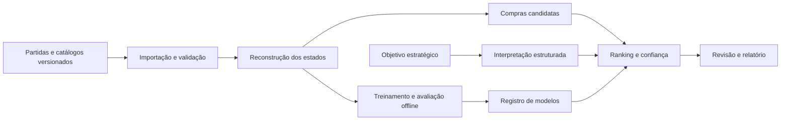

# RiftLab

Sistema acadêmico de aprendizagem estratégica por revisão pós-partida de decisões de compra em League of Legends, desenvolvido para a disciplina de Análise e Projeto de Sistemas.

## Problema e proposta

Uma build frequente não descreve todas as necessidades de uma partida. Composição das equipes, função, inventário e estágio do jogo influenciam quais compras merecem consideração. O RiftLab propõe recuperar pontos de decisão e comparar até três alternativas com evidências e limites de confiança.

O público prioritário são iniciantes e jogadores de elos mais baixos. O objetivo é desenvolver autonomia: observar ameaças, identificar necessidades, comparar custos e justificar escolhas antes de receber feedback. A recomendação é uma estimativa contextual, não uma garantia de vitória nem uma demonstração de que a alternativa teria mudado o resultado.

## Experiência prevista

1. Importar uma partida concluída ou abrir uma demonstração.
2. Selecionar um participante dentro do recorte suportado.
3. Percorrer a linha do tempo das decisões de compra.
4. Consultar inventário, composição, momento e qualidade dos dados disponíveis.
5. Escolher uma alternativa e justificar o raciocínio antes de revelar a comparação.
6. Consultar pistas graduais, comparar consequências e tentar um novo cenário sem ajuda.
7. Exportar um relatório com versões, evidências e limitações.

A interface distinguirá recomendação disponível, suporte limitado, estado incompatível e evidência insuficiente. Ouro estimado e ouro informado manualmente terão identificação própria.

## Escopo inicial

- Análise exclusivamente pós-partida, Summoner’s Rift, fila ranqueada solo/duo.
- Região inicial BR1; roteamento regional Americas.
- Uma função e três campeões, escolhidos após auditoria da amostra.
- Próximo item completo em pontos anteriores ao primeiro ou segundo item principal; componentes existentes considerados no custo restante.
- Ranking supervisionado, comparação com baselines, análise de confiança e experimento de agrupamento de contextos.
- Interpretação de objetivos em linguagem natural por modelo pré-treinado com ajuste supervisionado, validada contra formulário estruturado.
- Demonstração local reproduzível com dados sintéticos identificados e independência de serviços externos durante a apresentação.

Ficam fora do primeiro ciclo: overlay em tempo real, automação de compras, treinamento de modelos de linguagem do zero, aprendizado por reforço, aplicação móvel nativa e suporte simultâneo a outros jogos.

## Arquitetura prevista

Monólito modular em Python com FastAPI, PostgreSQL e processamento assíncrono por worker. Interface web em React e TypeScript. CatBoost para ranking e scikit-learn para baselines, agrupamento e avaliação. O treinamento permanece separado do atendimento de consultas.



## Plano de entrega

| Sprint | Foco | Incremento esperado |
| --- | --- | --- |
| 1 | Fundação e validação dos dados | Ambiente, contratos, amostra auditada e recorte congelado |
| 2 | Importação e reconstrução temporal | Partida navegável com estados e limites de qualidade |
| 3 | Candidatos e baselines | Primeira revisão completa com alternativas determinísticas |
| 4 | Ranking e confiança | Modelo avaliado, versionado e integrado |
| 5 | Objetivos e revisão assistida | Experimento de fine-tuning, formulário alternativo e feedback |
| 6 | Validação e entrega | Experimentos, testes integrados, relatório e demonstração |

## Situação atual

Sprint 1 (fundação) concluída. Implementado e validado localmente: API FastAPI com health checks (`/health/live`, `/health/ready`), worker mínimo, frontend React mínimo, ambiente reproduzível via Docker Compose (CC-101); protótipo navegável de baixa/média fidelidade das jornadas de revisão e do modo Estudo, com dados ilustrativos e sem API real (CC-102); persistência inicial via Alembic (sete tabelas) e fronteiras de domínio por módulo (CC-103); fontes de dados plugáveis (`MatchSource`/`CatalogSource`) com fixtures sintéticas empacotadas para o modo demonstração, sem exigir rede nem credencial (CC-104); recorte inicial (BR1, fila ranqueada solo/duo, função e três campeões) congelado em `configs/scope.yaml` a partir de partidas reais coletadas com permissão explícita — amostra de conveniência, metodologia e limitações declaradas no próprio arquivo (CC-105); contrato de erro padronizado em `application/problem+json` para validação (422), rota inexistente (404) e falha inesperada (500), além do 503 já existente, com OpenAPI real das rotas de saúde declarado e tipos TypeScript gerados sem divergência (CC-106).

Sprint 2 (importação e reconstrução temporal) em andamento: importador Riot resiliente entregue (CC-201) — `POST /api/v1/imports`, `GET .../{id}` e `POST .../{id}/retry` são rotas HTTP reais, com job durável em PostgreSQL (posse por lease com token/geração, retomada segura de crash, até 5 tentativas transitórias com backoff antes de falha permanente), worker que busca a partida (Riot Match-V5/Timeline-V5 real ou fixtures demo), valida (só partida concluída, RF17) e persiste match/participantes/eventos de forma atômica. Identificadores pessoais nunca são persistidos brutos: só um hash HMAC local. Importação real exige `RIFTLAB_RIOT_API_KEY` e `RIFTLAB_SUBJECT_HASH_SECRET` configuradas; o modo demonstração continua funcionando sem nenhuma das duas.

Catálogo versionado e regras do patch entregue (CC-202): `cc catalog sync --mode demo|real --patch X` busca (fixture demo ou Data Dragon público real, CDN sem credencial), valida (tipos/limites, ciclo/referência de receita) e persiste catálogo+itens de forma imutável e idempotente — mesmo conteúdo nunca duplica, conteúdo divergente nunca sobrescreve uma versão publicada. `configs/catalog-mappings.yaml` mapeia patch real → versão do Data Dragon explicitamente; sem entrada, nenhuma tentativa de rede. Validado com o Data Dragon público de verdade nesta sessão (16.16.1/16.17.1, os patches congelados em `configs/scope.yaml`).

Reconstrução pré-compra de inventário implementada e validada (CC-203, com uma limitação empírica explícita registrada abaixo): `cc timeline reconstruct --mode demo|real --match-id X` reduz os eventos de uma partida já importada, em ordem, e guarda o estado do inventário imediatamente ANTES de cada compra elegível (nunca o item comprado aparece no próprio estado). Multiconjunto de itens com trinket em slot separada, receita consumida por quantidade possuída inclusive por subcomponentes transitivos (compra direta paga o restante), capacidade de 6 slots normais verificada contra as regras de empilhamento do catálogo, venda e undo (restaura o multiconjunto exato de uma correlação verificada por invariante interno, nunca um palpite — mas essa própria correlação é uma hipótese sobre semântica não documentada, nunca confirmada como semântica oficial), e ouro estimado a partir do último frame estritamente anterior ao evento. Ambiguidade (item desconhecido, destruição não reconciliada, capacidade excedida, undo sem correlação, catálogo ausente para o patch) nunca é escondida nem "reparada" pelo inventário final: fica marcada como incerta, de forma explícita e datada, e nunca cura retroativamente um estado já calculado. Persistência idempotente — reconstruir a mesma partida de novo não duplica. **Limites empíricos**: a reconciliação entre uma compra de item composto e os eventos `ITEM_DESTROYED` que ela dispara, e a correlação de `ITEM_UNDO`, usam regras internas sobre semântica não documentada pela Riot. Foram examinadas offline num corpus real pequeno (10 partidas dos patches 14.20 e 15.1, com os catálogos históricos correspondentes do Data Dragon público) e são consistentes com ele, mas isso não é semântica oficial nem generalização: os patches do recorte congelado (16.16/16.17) não foram avaliados e os dados brutos não são versionados. Em dado real (não sintético), aplicar qualquer uma das duas regras sempre marca o estado como incerto, mesmo quando a regra interna "bate" — bater com uma regra interna não comprova a semântica real; o sistema nunca apresenta essa estimativa como certeza.

Pontos de decisão e features versionadas entregues (CC-204). A curadoria do catálogo passou a `data_dragon_v5` (persiste o campo documentado `into`) e um classificador puro e versionado (`item_classification_v1`) decide o que é item principal, sem usar nome, texto nem preço; campo ausente ou curadoria sem suporte resulta em "sem classificação", nunca em "principal". A reconstrução passou à v6: a forma real observada — `ITEM_DESTROYED` dos componentes ANTES da compra composta, no mesmo instante — é tratada como transação, então o snapshot fica antes dela e contém a receita do próprio alvo (nas versões 3 a 5 o snapshot omitia exatamente essa receita). `cc decisions extract --match-id X` (só banco: não reconstrói, não abre fonte, não usa rede) seleciona compras de item principal com zero ou um item principal anterior, avalia elegibilidade com motivos (`MISSING_CATALOG`, `OUT_OF_SCOPE`, `INVENTORY_UNCERTAIN`), mantém o orçamento separado da elegibilidade (`STALE_FRAME` acima de 90 s, `UNKNOWN_BUDGET`; desconhecido nunca vira zero), calcula features pré-decisão com schema versionado e máscara de ausência (sem resultado, sem identificador pessoal; a composição agregada de campeões está ausente por não haver catálogo curado de campeões) e grava tudo de forma imutável e versionada. Duas rotas de leitura, `GET /api/v1/matches/{matchId}/decisions?participantId=` (paginação estável por cursor opaco; `409 DECISIONS_NOT_PREPARED` quando ainda não extraído, distinto de `200` com lista vazia) e `GET /api/v1/decisions/{decisionId}`, expõem só informação anterior à decisão (inventário como multiconjunto, orçamento, nível observado, motivos, versões): nunca o item comprado, a classe dele, o resultado da compra, o vetor de features nem a qualidade cumulativa, para o modo Estudo. **Limitação real e explícita:** nos dados reais examinados (10 partidas dos patches 14.20 e 15.1, fora do recorte congelado) foram 199 pontos de decisão e nenhum elegível. As regras conservadoras de incerteza do CC-203, que em dado real marcam cada heurística aplicada de forma cumulativa, e mecânicas reais de inventário ainda não modeladas — consumo de consumíveis, troca de trinket, transformações de item e aquisições fora de `ITEM_PURCHASED` — mantêm a pré-decisão incerta. O demo sintético demonstra o fluxo completo com decisões elegíveis; isso valida a engenharia, não dado real, e esta etapa não promete corrigir a limitação.

Navegação de importação e timeline entregue (CC-205): o fluxo importar → partida → decisão funciona pela interface, sem console, contra o backend real. Depois de uma importação bem-sucedida o worker prepara a partida sozinho (catálogo → reconstrução v6 → extração), como job durável na mesma maquinaria de lease e retomada do importador, com estados `PENDING`, `RUNNING`, `READY` e `FAILED` (código de erro seguro, sem payload) e nova tentativa por `POST /api/v1/matches/{matchId}/preparation`; no modo real só há rede para o catálogo público do Data Dragon, e apenas para patches com entrada explícita em `configs/catalog-mappings.yaml`. `GET /api/v1/matches` (cursor opaco, ordem estável por início e ID) e `GET /api/v1/matches/{matchId}` listam e detalham partidas sem qualquer identificador pessoal, e o detalhe da decisão traz o nome de cada item lido do catálogo fixado pelo próprio ponto. A interface tem entrada com formulário de ID BR1 e "Explorar demonstração" (partida sintética), lista de partidas importadas para retomar, progresso da importação com nova tentativa, partida com preparação acompanhada, participantes, decisões paginadas e detalhe (orçamento aproximado, snapshot antigo ou desconhecido, nunca zero; motivos em português; versões num bloco recolhível). Cada endereço (`/imports/:jobId`, `/matches/:matchId?participant=N`, `/decisions/:decisionId`) pode ser aberto direto ou recarregado, e os erros têm texto útil sem segredo (por exemplo, chave da Riot ausente ou expirada). Validado por Vitest, por Playwright com API simulada (falhas recuperáveis, 360 px sem rolagem horizontal, fluxo só com teclado) e por Playwright contra a stack Docker real (api, worker, PostgreSQL e frontend). **Limitações que continuam verdadeiras:** no corpus real local examinado a elegibilidade segue em 0 de 199 pontos, porque as mecânicas reais de inventário descritas acima ainda não estão modeladas; o campeão aparece pelo ID ("Campeão #id") porque o projeto não tem catálogo de campeões; a análise é só de partidas concluídas, sem acompanhamento ao vivo; e a demonstração usa dados sintéticos, então valida a engenharia e não demonstra ganho real.

Coleta incremental e integridade da ingestão entregues (CC-206): `cc collect run|import|report` coleta partidas SÓ de uma lista permitida de contas de pessoas que consentiram de forma explícita (arquivo de sementes com rótulo pseudônimo e `consent: true`; nunca percorre adversários, colegas de time nem ligas), com manifesto durável, tetos por execução (requisições, partidas, duração e partidas por semente), limitador global compatível com os headers de limite da Riot e com `Retry-After`, parada segura em 401/403 com retomada sem duplicar depois da troca manual da chave, deduplicação por `matchId` e filtros explícitos (plataforma BR1, fila 420, mapa 11, partida concluída, patches do recorte) com contagem de perdas por motivo. Cada passada recomeça da posição 0 da listagem — a lista da Riot cresce pela cabeça, então um índice guardado pularia partidas jogadas entre duas rodadas —, e a partida já conhecida custa 0 requisição, de modo que retomar nunca rebusca o que já foi coletado. A partida coletada é importada a partir do armazenamento local, sem buscar de novo, e entra na preparação automática do CC-205; `cc report reconstruction|diversity|integrity` geram relatórios agregados sem qualquer identificador pessoal (a integridade prova no banco que nenhuma partida parcial fica analisável). Validado com transporte simulado (falhas 5xx, 429 com `Retry-After`, 401 no meio da coleta e retomada, tetos, filtros, queda entre buscar e gravar) e com duas coletas reais pequenas: 50 partidas (patch 16.16 ×12, 16.17 ×38; 117 requisições; nenhuma resposta 401, 403 ou 429) importadas e preparadas até `READY`, todas com integridade verificada. **Resultado honesto:** essa amostra tem 0 pontos de decisão elegíveis (1.461 pontos no total; 104 dentro do recorte de função e campeões, todos com inventário incerto) e 86,29% dos 10.879 estados com pré-decisão incerta, porque as mecânicas reais de destruição e desfazer de itens ainda não estão modeladas (é o trabalho do CC-207). **Limites que continuam verdadeiros:** a amostra é de conveniência (uma única conta responde por 74% das partidas, 413 jogadores distintos em 500 participações e duas das quatro contas não tinham partidas na janela), então não é representativa e não sustenta resultado estatístico; `Retry-After` real e `count` acima de 100 na listagem não foram observados; os dados coletados ficam fora do Git. A primeira coleta real também revelou um defeito de preparação, já corrigido e coberto por teste: um catálogo canônico antigo, de curadoria não suportada, era reaproveitado em silêncio e deixava todos os itens sem classificação; agora a preparação o ressincroniza.

Ranking, objetivos e modo Estudo ainda não têm rotas HTTP nem interface: continuam como especificação e schemas Pydantic validados com exemplos (`backend/src/riftlab/shared/api/`). O OpenAPI servido pela API hoje descreve `/health/*`, `/api/v1/imports*`, `/api/v1/matches` (lista, detalhe e preparação) e as duas rotas de decisões. Não existem resultados experimentais nem pipeline de modelos nesta etapa; a auditoria de dados e a coleta incremental são evidência de acesso, volume e integridade da amostra, não um experimento de ranking treinado.

## Ambiente de desenvolvimento

Requisitos: Docker e Docker Compose. Comandos validados localmente:

```sh
cp .env.example .env   # opcional; modo demo funciona sem chave Riot
docker compose up -d --build
curl http://127.0.0.1:8000/health/live
curl http://127.0.0.1:8000/health/ready
# frontend em http://127.0.0.1:5173
docker compose down
```

Testes automatizados isolados (backend contra Postgres descartável):

```sh
docker compose -f compose.test.yaml run --rm backend-tests
```

A stack não aplica migrations sozinha: depois do primeiro `up`, rode `docker compose run --rm api db upgrade`. Fumaça do fluxo importar → partida → decisões só pela API (sem console): `python3 scripts/smoke_import_flow.py --base-url http://127.0.0.1:8000`. E2E da demonstração contra essa stack real: `cd frontend && E2E_BASE_URL=http://127.0.0.1:5173 npm run test:e2e:stack` (os demais specs, com API simulada, rodam com `npm run test:e2e`).

Backend (Python 3.12, gerenciado com `uv`) e frontend (Node 22, React/TypeScript/Vite) também rodam fora de container para desenvolvimento; consulte os `package.json`/`pyproject.toml` de cada pacote para os scripts de lint, typecheck, testes e build.

## Avaliação

O estudo comparará popularidade por campeão, regras explícitas e ranking contextual em separação temporal de partidas. Compras históricas medem concordância com comportamento observado; pertinência estratégica será avaliada separadamente em casos revisados. Scores de ranking não serão apresentados como probabilidades de vitória.

## Dados e execução

Credenciais, históricos brutos e pesos de modelos não pertencem ao repositório. O modo real dependerá de uma chave válida da Riot e das condições de acesso vigentes. O modo de demonstração utilizará fixtures sintéticas identificadas. A RX7600 poderá auxiliar inferência, mas a entrega básica será executável em CPU; fine-tuning terá orçamento e ambiente registrados no experimento.

## Relação com a Riot Games

Projeto acadêmico independente, sem afiliação ou endosso da Riot Games. League of Legends e suas propriedades associadas pertencem aos respectivos titulares. Antes de disponibilizar o produto a jogadores, serão verificados registro, avisos e condições aplicáveis no portal da desenvolvedora.
