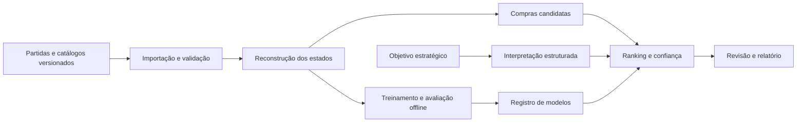

# RiftLab

Sistema acadêmico de aprendizagem estratégica por revisão pós-partida de decisões de compra em League of Legends, desenvolvido para a disciplina de Análise e Projeto de Sistemas.

## Problema e proposta

Uma build frequente não descreve todas as necessidades de uma partida. Composição das equipes, função, inventário e estágio do jogo influenciam quais compras merecem consideração. O RiftLab propõe recuperar pontos de decisão e comparar até três alternativas com evidências e limites de confiança.

O público prioritário são iniciantes e jogadores de elos mais baixos. O objetivo é desenvolver autonomia: observar ameaças, identificar necessidades, comparar custos e justificar escolhas antes de receber feedback. A recomendação é uma estimativa contextual, não uma garantia de vitória nem uma demonstração de que a alternativa teria mudado o resultado.

## Experiência prevista

1. Importar uma partida concluída ou abrir uma demonstração.
2. Selecionar um participante dentro do recorte suportado.
3. Percorrer a linha do tempo das decisões de compra.
4. Consultar inventário, composição, momento e qualidade dos dados disponíveis.
5. Escolher uma alternativa e justificar o raciocínio antes de revelar a comparação.
6. Consultar pistas graduais, comparar consequências e tentar um novo cenário sem ajuda.
7. Exportar um relatório com versões, evidências e limitações.

A interface distinguirá recomendação disponível, suporte limitado, estado incompatível e evidência insuficiente. Ouro estimado e ouro informado manualmente terão identificação própria.

## Escopo inicial

- Análise exclusivamente pós-partida, Summoner’s Rift, fila ranqueada solo/duo.
- Região inicial BR1; roteamento regional Americas.
- Uma função e três campeões, escolhidos após auditoria da amostra.
- Próximo item completo em pontos anteriores ao primeiro ou segundo item principal; componentes existentes considerados no custo restante.
- Ranking supervisionado, comparação com baselines, análise de confiança e experimento de agrupamento de contextos.
- Interpretação de objetivos em linguagem natural por modelo pré-treinado com ajuste supervisionado, validada contra formulário estruturado.
- Demonstração local reproduzível com dados sintéticos identificados e independência de serviços externos durante a apresentação.

Ficam fora do primeiro ciclo: overlay em tempo real, automação de compras, treinamento de modelos de linguagem do zero, aprendizado por reforço, aplicação móvel nativa e suporte simultâneo a outros jogos.

## Arquitetura prevista

Monólito modular em Python com FastAPI, PostgreSQL e processamento assíncrono por worker. Interface web em React e TypeScript. CatBoost para ranking e scikit-learn para baselines, agrupamento e avaliação. O treinamento permanece separado do atendimento de consultas.



## Plano de entrega

| Sprint | Foco | Incremento esperado |
| --- | --- | --- |
| 1 | Fundação e validação dos dados | Ambiente, contratos, amostra auditada e recorte congelado |
| 2 | Importação e reconstrução temporal | Partida navegável com estados e limites de qualidade |
| 3 | Candidatos e baselines | Primeira revisão completa com alternativas determinísticas |
| 4 | Ranking e confiança | Modelo avaliado, versionado e integrado |
| 5 | Objetivos e revisão assistida | Experimento de fine-tuning, formulário alternativo e feedback |
| 6 | Validação e entrega | Experimentos, testes integrados, relatório e demonstração |

## Situação atual

Sprint 1 (fundação) concluída. Implementado e validado localmente: API FastAPI com health checks (`/health/live`, `/health/ready`), worker mínimo, frontend React mínimo, ambiente reproduzível via Docker Compose (CC-101); protótipo navegável de baixa/média fidelidade das jornadas de revisão e do modo Estudo, com dados ilustrativos e sem API real (CC-102); persistência inicial via Alembic (sete tabelas) e fronteiras de domínio por módulo (CC-103); fontes de dados plugáveis (`MatchSource`/`CatalogSource`) com fixtures sintéticas empacotadas para o modo demonstração, sem exigir rede nem credencial (CC-104); recorte inicial (BR1, fila ranqueada solo/duo, função e três campeões) congelado em `configs/scope.yaml` a partir de partidas reais coletadas com permissão explícita — amostra de conveniência, metodologia e limitações declaradas no próprio arquivo (CC-105); contrato de erro padronizado em `application/problem+json` para validação (422), rota inexistente (404) e falha inesperada (500), além do 503 já existente, com OpenAPI real das rotas de saúde declarado e tipos TypeScript gerados sem divergência (CC-106).

Sprint 2 (importação e reconstrução temporal) em andamento: importador Riot resiliente entregue (CC-201) — `POST /api/v1/imports`, `GET .../{id}` e `POST .../{id}/retry` são rotas HTTP reais, com job durável em PostgreSQL (posse por lease com token/geração, retomada segura de crash, até 5 tentativas transitórias com backoff antes de falha permanente), worker que busca a partida (Riot Match-V5/Timeline-V5 real ou fixtures demo), valida (só partida concluída, RF17) e persiste match/participantes/eventos de forma atômica. Identificadores pessoais nunca são persistidos brutos: só um hash HMAC local. Importação real exige `RIFTLAB_RIOT_API_KEY` e `RIFTLAB_SUBJECT_HASH_SECRET` configuradas; o modo demonstração continua funcionando sem nenhuma das duas.

Catálogo versionado e regras do patch entregue (CC-202): `cc catalog sync --mode demo|real --patch X` busca (fixture demo ou Data Dragon público real, CDN sem credencial), valida (tipos/limites, ciclo/referência de receita) e persiste catálogo+itens de forma imutável e idempotente — mesmo conteúdo nunca duplica, conteúdo divergente nunca sobrescreve uma versão publicada. `configs/catalog-mappings.yaml` mantém overrides explícitos de 16.16.1/16.17.1. Para outro patch, a preparação ou CLI consulta `versions.json` público, fixa uma versão do mesmo `major.minor` no banco e nunca usa o `latest` de outro patch; ausência no CDN permanece `MISSING_CATALOG`. O recorte inicial do CC-105 segue documentado, enquanto a janela operacional é móvel.

Patch vigente (CC-314): `cc patch detect` registra explicitamente no banco a versão mais nova publicada e sua janela de dois patches. Coleta, extração e relatórios usam essa janela; sem detecção, o recorte móvel falha de forma explícita. Catálogos públicos de itens e campeões do patch 16.19.1 foram sincronizados em banco descartável sem editar YAML (834 itens, 173 campeões); nenhuma partida nova foi coletada. A API e o Histórico/Contexto indicam suporte limitado para partidas reais sem avaliação de ranking no patch. `cc report patch-readiness` mostra contagens agregadas e mínimos do protocolo anterior, sem executar confirmação. Regras empíricas continuam pendentes, nenhum modelo foi treinado e o gate REAL de elegibilidade permanece bloqueado.

Reconstrução pré-compra de inventário implementada e validada (CC-203, com uma limitação empírica explícita registrada abaixo): `cc timeline reconstruct --mode demo|real --match-id X` reduz os eventos de uma partida já importada, em ordem, e guarda o estado do inventário imediatamente ANTES de cada compra elegível (nunca o item comprado aparece no próprio estado). Multiconjunto de itens com trinket em slot separada, receita consumida por quantidade possuída inclusive por subcomponentes transitivos (compra direta paga o restante), capacidade de 6 slots normais verificada contra as regras de empilhamento do catálogo, venda e undo (restaura o multiconjunto exato de uma correlação verificada por invariante interno, nunca um palpite — mas essa própria correlação é uma hipótese sobre semântica não documentada, nunca confirmada como semântica oficial), e ouro estimado a partir do último frame estritamente anterior ao evento. Ambiguidade (item desconhecido, destruição não reconciliada, capacidade excedida, undo sem correlação, catálogo ausente para o patch) nunca é escondida nem "reparada" pelo inventário final: fica marcada como incerta, de forma explícita e datada, e nunca cura retroativamente um estado já calculado. Persistência idempotente — reconstruir a mesma partida de novo não duplica. **Limites empíricos**: a reconciliação entre uma compra de item composto e os eventos `ITEM_DESTROYED` que ela dispara, e a correlação de `ITEM_UNDO`, usam regras internas sobre semântica não documentada pela Riot. Foram examinadas offline num corpus real pequeno (10 partidas dos patches 14.20 e 15.1, com os catálogos históricos correspondentes do Data Dragon público) e são consistentes com ele, mas isso não é semântica oficial nem generalização: os patches do recorte congelado (16.16/16.17) não foram avaliados e os dados brutos não são versionados. Em dado real (não sintético), aplicar qualquer uma das duas regras sempre marca o estado como incerto, mesmo quando a regra interna "bate" — bater com uma regra interna não comprova a semântica real; o sistema nunca apresenta essa estimativa como certeza.

Pontos de decisão e features versionadas entregues (CC-204). A curadoria do catálogo passou a `data_dragon_v5` (persiste o campo documentado `into`) e um classificador puro e versionado (`item_classification_v1`) decide o que é item principal, sem usar nome, texto nem preço; campo ausente ou curadoria sem suporte resulta em "sem classificação", nunca em "principal". A reconstrução passou à v6: a forma real observada — `ITEM_DESTROYED` dos componentes ANTES da compra composta, no mesmo instante — é tratada como transação, então o snapshot fica antes dela e contém a receita do próprio alvo (nas versões 3 a 5 o snapshot omitia exatamente essa receita). `cc decisions extract --match-id X` (só banco: não reconstrói, não abre fonte, não usa rede) seleciona compras de item principal com zero ou um item principal anterior, avalia elegibilidade com motivos (`MISSING_CATALOG`, `OUT_OF_SCOPE`, `INVENTORY_UNCERTAIN`), mantém o orçamento separado da elegibilidade (`STALE_FRAME` acima de 90 s, `UNKNOWN_BUDGET`; desconhecido nunca vira zero), calcula features pré-decisão com schema versionado e máscara de ausência (sem resultado, sem identificador pessoal; a composição agregada de campeões está ausente por não haver catálogo curado de campeões) e grava tudo de forma imutável e versionada. Duas rotas de leitura, `GET /api/v1/matches/{matchId}/decisions?participantId=` (paginação estável por cursor opaco; `409 DECISIONS_NOT_PREPARED` quando ainda não extraído, distinto de `200` com lista vazia) e `GET /api/v1/decisions/{decisionId}`, expõem só informação anterior à decisão (inventário como multiconjunto, orçamento, nível observado, motivos, versões): nunca o item comprado, a classe dele, o resultado da compra, o vetor de features nem a qualidade cumulativa, para o modo Estudo. **Limitação real e explícita:** nos dados reais examinados (10 partidas dos patches 14.20 e 15.1, fora do recorte congelado) foram 199 pontos de decisão e nenhum elegível. As regras conservadoras de incerteza do CC-203, que em dado real marcam cada heurística aplicada de forma cumulativa, e mecânicas reais de inventário ainda não modeladas — consumo de consumíveis, troca de trinket, transformações de item e aquisições fora de `ITEM_PURCHASED` — mantêm a pré-decisão incerta. O demo sintético demonstra o fluxo completo com decisões elegíveis; isso valida a engenharia, não dado real, e esta etapa não promete corrigir a limitação.

Navegação de importação e timeline entregue (CC-205): o fluxo importar → partida → decisão funciona pela interface, sem console, contra o backend real. Depois de uma importação bem-sucedida o worker prepara a partida sozinho (catálogo → reconstrução v6 → extração), como job durável na mesma maquinaria de lease e retomada do importador, com estados `PENDING`, `RUNNING`, `READY` e `FAILED` (código de erro seguro, sem payload) e nova tentativa por `POST /api/v1/matches/{matchId}/preparation`; no modo real só há rede para o catálogo público do Data Dragon, e apenas para patches com entrada explícita em `configs/catalog-mappings.yaml`. `GET /api/v1/matches` (cursor opaco, ordem estável por início e ID) e `GET /api/v1/matches/{matchId}` listam e detalham partidas sem qualquer identificador pessoal, e o detalhe da decisão traz o nome de cada item lido do catálogo fixado pelo próprio ponto. A interface tem entrada com formulário de ID BR1 e "Explorar demonstração" (partida sintética), lista de partidas importadas para retomar, progresso da importação com nova tentativa, partida com preparação acompanhada, participantes, decisões paginadas e detalhe (orçamento aproximado, snapshot antigo ou desconhecido, nunca zero; motivos em português; versões num bloco recolhível). Cada endereço (`/imports/:jobId`, `/matches/:matchId?participant=N`, `/decisions/:decisionId`) pode ser aberto direto ou recarregado, e os erros têm texto útil sem segredo (por exemplo, chave da Riot ausente ou expirada). Validado por Vitest, por Playwright com API simulada (falhas recuperáveis, 360 px sem rolagem horizontal, fluxo só com teclado) e por Playwright contra a stack Docker real (api, worker, PostgreSQL e frontend). **Limitações que continuam verdadeiras:** no corpus real local examinado a elegibilidade segue em 0 de 199 pontos, porque as mecânicas reais de inventário descritas acima ainda não estão modeladas; a análise é só de partidas concluídas, sem acompanhamento ao vivo; e a demonstração usa dados sintéticos, então valida a engenharia e não demonstra ganho real.

Coleta incremental e integridade da ingestão entregues (CC-206): `cc collect run|import|report` coleta partidas SÓ de uma lista permitida de contas de pessoas que consentiram de forma explícita (arquivo de sementes com rótulo pseudônimo e `consent: true`; nunca percorre adversários, colegas de time nem ligas), com manifesto durável, tetos por execução (requisições, partidas, duração e partidas por semente), limitador global compatível com os headers de limite da Riot e com `Retry-After`, parada segura em 401/403 com retomada sem duplicar depois da troca manual da chave, deduplicação por `matchId` e filtros explícitos (plataforma BR1, fila 420, mapa 11, partida concluída, patches do recorte) com contagem de perdas por motivo. Cada passada recomeça da posição 0 da listagem — a lista da Riot cresce pela cabeça, então um índice guardado pularia partidas jogadas entre duas rodadas —, e a partida já conhecida custa 0 requisição, de modo que retomar nunca rebusca o que já foi coletado. A partida coletada é importada a partir do armazenamento local, sem buscar de novo, e entra na preparação automática do CC-205; `cc report reconstruction|diversity|integrity` geram relatórios agregados sem qualquer identificador pessoal (a integridade prova no banco que nenhuma partida parcial fica analisável). Validado com transporte simulado (falhas 5xx, 429 com `Retry-After`, 401 no meio da coleta e retomada, tetos, filtros, queda entre buscar e gravar) e com duas coletas reais pequenas: 50 partidas (patch 16.16 ×12, 16.17 ×38; 117 requisições; nenhuma resposta 401, 403 ou 429) importadas e preparadas até `READY`, todas com integridade verificada. **Resultado honesto:** essa amostra tem 0 pontos de decisão elegíveis (1.461 pontos no total; 104 dentro do recorte de função e campeões, todos com inventário incerto) e 86,29% dos 10.879 estados com pré-decisão incerta, porque as mecânicas reais de destruição e desfazer de itens ainda não estão modeladas (é o trabalho do CC-207). **Limites que continuam verdadeiros:** a amostra é de conveniência (uma única conta responde por 74% das partidas, 413 jogadores distintos em 500 participações e duas das quatro contas não tinham partidas na janela), então não é representativa e não sustenta resultado estatístico; `Retry-After` real e `count` acima de 100 na listagem não foram observados; os dados coletados ficam fora do Git. A primeira coleta real também revelou um defeito de preparação, já corrigido e coberto por teste: um catálogo canônico antigo, de curadoria não suportada, era reaproveitado em silêncio e deixava todos os itens sem classificação; agora a preparação o ressincroniza.

Mecânicas reais de inventário modeladas e testadas contra dado real com protocolo pré-registrado (CC-207), com **resultado negativo declarado**. A reconstrução passou à v7: sete regras empíricas — consumo de consumível possuído, troca de trinket, trinket inicial, itens de sistema e de missão, item inicial de apoio, ordem destroy→compra tratada como transação e correlação de undo em pilha — estão implementadas com proveniência por estado (`quality.empiricalRules`) e um registro versionado (`configs/empirical-rules.yaml`) que só liga uma regra nos patches em que uma confirmação pré-registrada a aprovou. Com todas desligadas, a v7 reproduz a v6 exatamente (verificado por testes de regressão e estado a estado nos dados reais). O protocolo foi fixado com hash antes de qualquer medição confirmatória: as 50 partidas reais (16.16 ×12, 16.17 ×38) foram divididas por partida em exploração (20) e confirmação (30), os limiares são fixos (limite superior de Wilson 95% da taxa de contra-exemplos, com amostra mínima por hipótese) e a confirmação foi executada uma única vez por um auditor congelado. **Resultado:** várias regras passaram individualmente na confirmação — ordem destroy→compra, consumo de consumível e itens de sistema nos dois patches; troca de trinket, trinket inicial e item de apoio só em 16.17 — e a correlação de undo foi reprovada em 16.17. Mesmo assim, **nenhuma regra foi liberada**: o teste final, que exige que o inventário reconstruído feche com o inventário final da partida sob o conjunto de regras aprovado, ficou sem amostra suficiente nos dois patches (16 participantes sem nenhuma marca de incerteza em cada, abaixo do mínimo pré-registrado de 20), e em 16.16 quinze desses dezesseis não fechavam por divergência de trinket. O registro continua com todas as regras pendentes e a elegibilidade não mudou: **0 de 1.461 pontos de decisão elegíveis (0 de 104 dentro do recorte), antes e depois, com 86,29% dos 10.879 estados com pré-decisão incerta**; na partição de confirmação, 0 de 946 (0 de 77 no recorte). Os limiares não foram afrouxados nem a amostra ampliada depois do resultado. Liberar regras exige mais partidas coletadas com autorização e uma nova confirmação pré-registrada; a amostra continua de conveniência e pequena, e nada disso é semântica oficial da Riot.

Corpus do patch 16.19 ampliado (CC-323). `cc collect dataset-16-19` coleta pares match+timeline por expansão em bola de neve a partir das contas com consentimento: cada partida encontrada traz todos os participantes (aliados e adversários) para a fila, sem limite de saltos, com prioridade para quem jogou o recorte (BOTTOM com Caitlyn, Ezreal ou Kai'Sa). A listagem fica restrita à janela do 16.19 e só partidas BR1 do 16.19, fila 420, mapa 11 e concluídas são gravadas, uma única vez, em armazenamento privado. A campanha tem tetos próprios de pares, requisições e tempo, somados entre tentativas, e autorização por tentativa. Diário, relatório e saída não carregam identificador de jogador. Uma execução autorizada gravou 1.000 partidas novas com 2.248 requisições, todas aceitas. A verificação independente confirmou patch, fila, mapa, conclusão e integridade de todas, sem sobreposição com as 173 do protocolo CC-316, com 8.159 jogadores distintos e no máximo 12 partidas por jogador. Numa medição em banco descartável com as regras do 16.19, as 1.173 partidas somam 187 pontos de decisão elegíveis no recorte (de 2.191); as 173 do protocolo reproduzem exatamente a medição anterior (24 de 227). **Limites:** amostra de conveniência puxada para jogadores desses campeões; 90% das partidas caem nos três últimos dias do patch, porque cada jogador contribui com as mais recentes; 40 remakes ficarão fora do dataset; a legalidade dos candidatos continua pendente.

Incerteza de inventário reduzida no patch 16.19 (CC-324). Um censo mostrou que cerca de 80% dos primeiros bloqueios no recorte vinham de itens que aparecem sem compra: biscoito, calçados mágicos e elixires concedidos por runas, e botas trocadas ao terminar a missão de rota (a do BOTTOM tira a bota dos espaços normais; a do MID a troca pela versão superior). Um novo protocolo pré-registrado, com partição por hash (225 partidas para exploração, 309 para confirmação, sem jogadores em comum), aprovou cinco regras na confirmação única, com o fechamento do inventário final dentro do limite (15 de 469 participantes limpos). As regras valem só no 16.19, pelo registro `configs/empirical-rules.yaml`, e a reconstrução passou à v9. Os pontos de decisão elegíveis no recorte subiram de 187 para 676 (de 2.191) nas 1.173 partidas; o dataset preliminar passou a 671 linhas, com o baseline de popularidade acertando a compra histórica de primeira em 67% das decisões de teste (aleatório: 1,2%). **Limites:** as runas servem só para testar a regra, não para aplicá-la; itens concedidos não ocupam espaço na reconstrução; Viego e a missão da selva ficam fora; o baseline mede imitação, não qualidade da compra; nada disso é semântica oficial da Riot.

Dataset final e protocolo de comparação (CC-401). `cc dataset freeze-corpus` aceita uma divisão cronológica em três partes (política `configs/experiments/dataset-16.19-v2.yaml`): 788 partidas de treino, 169 de validação e 170 de teste, sem nenhum instante dividido entre partes; o manifesto anterior foi reproduzido com o mesmo hash. `cc dataset freeze-dataset` junta as linhas da reconstrução v9 ao manifesto e registra cobertura e contaminação por jogador, sem identificadores: 469, 118 e 89 decisões (Caitlyn, Kai'Sa e Ezreal; 1º e 2º item principal). O protocolo `configs/experiments/comparison-protocol-v1.yaml` fixa MRR como métrica principal, intervalos por bootstrap de partidas, seleção só na validação e o teste rodado uma única vez depois de congelada a configuração do modelo. Na validação, o baseline de popularidade tem MRR 0,80 (aleatório 0,06). **Limites:** teste pequeno (89 decisões); cerca de metade das decisões de validação e de teste são de jogadores que também aparecem no treino, por isso o protocolo também reporta o subconjunto sem jogador em comum; um patch; validação e teste no fim do patch.

Ranker contextual em CPU (CC-402). `cc ml train-ranker` treina um CatBoostRanker (objetivo PairLogit, grupo = decisão) com até 12 configurações pequenas e parada antecipada só na validação, junto com dois baselines — B0 (popularidade por campeão e ordem do item) e B1 (regras explícitas: aproveitar componentes e custo restante, pesos fixados antes da avaliação) — e duas ablações (sem composição dos times, sem estado econômico); `cc ml evaluate-test` roda o teste uma única vez. No teste (88 decisões), o MRR foi 0,77 para B0, 0,79 para B1 e 0,98 para o modelo, mas o modelo sem as features econômicas cai a 0,79: o ganho vem de saber quais itens já cabem no ouro, porque o ponto de decisão é o instante da compra (em média só 4 dos ~106 candidatos legais cabem no ouro estimado). **Leitura:** o modelo imita bem o momento da compra; isso não demonstra que ele recomende a melhor compra. Treino com 1 thread: 16 minutos e 347 MB para as 24 configurações. **Limites:** teste pequeno, metade com jogadores vistos no treino, um patch; a métrica é imitação da escolha histórica.

Planejamento do próximo item sem o atalho do ouro (CC-407). Para separar escolha de momento, `cc dataset build-rows --task planning` ancora cada decisão antes da compra — antes da primeira compra da partida para o 1º item principal, ou logo depois do 1º para o 2º — sem nenhuma informação de ouro. Com o mesmo corpus, divisão e protocolo, o teste deu MRR 0,76 para a popularidade por campeão (B0), 0,75 para o CatBoost e 0,04 para a heurística de componentes e custo (B1); composição dos times e custo restante não acrescentaram nada. **Resultado negativo:** nesta amostra, o contexto disponível não melhora a previsão da escolha planejada além da popularidade; o ganho do CC-402 vinha do ouro no instante da compra. O baseline de popularidade continua sendo a referência.

Contexto rico (CC-408). `cc ml enrich-context` acrescenta, só com eventos anteriores à âncora, o campeão adversário da rota, os itens principais já completados por inimigos e aliados, a diferença de ouro do time e a de abates. Na validação, o modelo com e sem esse contexto teve o mesmo MRR (0,81); no teste (já usado uma vez antes, o que fica declarado), 0,76 contra 0,76 da popularidade. **Resultado negativo reforçado:** nesta amostra do 16.19, a escolha planejada do próximo item é explicada pela popularidade por campeão e ordem do item.

Suporte, registro de modelos e desempenho (CC-403 a CC-406). Clusters de contexto (KMeans ajustado só no treino, k = 3, 5 e 8) não mostraram estrutura (silhueta perto de zero) nem ganho na validação e foram descartados. O ranking ativo é a popularidade, servida atrás de uma barreira de validade e de um suporte por célula (campeão × ordem do item): estado incerto, campeão sem dados ou patch sem regras recebem `INSUFFICIENT_EVIDENCE` com motivo legível, nunca uma lista; no recorte atual todas as células têm dados suficientes, então a cobertura é total, com erro (fora do top-3) de 0,11 no teste. Um registro de modelos no PostgreSQL (`cc ml registry-*`) aceita só artefatos locais com hash conferido, promove de forma atômica (uma versão ativa por tarefa), faz rollback e mantém versões aposentadas no histórico; sem versão ativa, o fallback para a popularidade é explícito. Num i3-7020U com 1 thread, 100 consultas de 106 candidatos levam p95 de 163 ms para enumerar os itens legais, 2,5 ms para o ranking com suporte e 18 ms para pontuar com o CatBoost. Os motivos de abstenção aparecem na tela de estudo e cada análise guarda a versão ativa do registro (CC-304/306).

Revalidação das regras de inventário no patch 16.19 preparada com partição pré-registrada (CC-316/CC-320). Um novo protocolo, fixado com hash antes de qualquer coleta, mantém as hipóteses e os limiares do CC-207 e define uma partição por partida cega a eventos: as partidas elegíveis são ordenadas por `sha256("CC-316-partition-v1|" + matchId)`, as 20 primeiras formam a exploração e as demais a confirmação potencial, da qual sai toda partida que compartilhe participante com a exploração. `cc collect structural-cc316` descobre partidas BR1 da fila 420 a partir das contas com consentimento e de participantes dessas partidas, lê do Match-V5 só identidade, versão, fila, mapa e marcador de conclusão com um leitor incremental que pula o restante sem montá-lo em memória, usa os identificadores dos participantes só em memória (para o salto seguinte, no máximo dois, e para comparação por HMAC efêmero) e grava somente um snapshot privado de IDs de partida, sem corpo de partida, timeline ou banco. Uma rodada real admitiu 320 candidatos (231 elegíveis no 16.19: 20 de exploração, 153 de confirmação potencial e 58 excluídas por sobreposição); uma emenda adotou esse snapshot como partição congelada e encerrou a descoberta, e `cc collect cc316-adopt-partition` gera dele, uma única vez, um artefato verificado com digest e procedência por partida. Depois, `cc collect cc316-exploration-fetch` buscou match e timeline só das 20 partidas de exploração (autorização por tentativa, verificação de rede sem requisição à Riot, orçamento cumulativo de requisições e tempo, armazenamento privado gravado uma única vez), e a análise exploratória offline reproduziu as formas de evento do patch anterior; o protocolo da confirmação foi congelado com hash antes de qualquer acesso às 153 partidas restantes; nessa etapa, nenhuma regra foi liberada. **Limites:** a amostra é correlacionada por jogador e truncada pelo teto de candidatos na ordem de descoberta, e a confirmação ainda depende da análise exploratória, de um congelamento hasheado e de autorização própria.

Confirmação no patch 16.19 com resultado positivo (CC-322). Depois do congelamento, `cc collect cc316-confirmation-fetch` buscou as 153 partidas da confirmação (liberadas só com o congelamento selado), um portão conferiu que nenhuma divide jogador com a exploração e o auditor congelado rodou uma única vez. Passaram, com o limite superior de Wilson dentro dos limiares pré-registrados: ordem destroy→compra (1 contra-exemplo em 15.761), itens de sistema e missão (0/4.317), consumo de consumível possuído (8/2.314 pares), World Atlas dos Apoios (0/295), trinket inicial (5/459) e troca de trinket (23/866); o fechamento do inventário final dos participantes limpos também passou (5/193). A correlação de undo foi reprovada (79/1.303) e continua pendente. As seis regras aprovadas valem só no patch 16.19, pelo registro `configs/empirical-rules.yaml`, e a reconstrução passou à v8. Numa remedição em banco descartável com as 173 partidas do protocolo, a pré-decisão incerta caiu de 85,7% para 60,0% dos estados e os pontos de decisão elegíveis no recorte passaram de 0 para 24 de 227 — as primeiras decisões REAL elegíveis do projeto. **Limites:** amostra de descoberta por participantes, correlacionada por jogador, num único patch; os demais patches seguem sem regra; elegibilidade não resolve a legalidade dos candidatos, que continua bloqueada; nada disso é semântica oficial da Riot.

Nomes e retratos oficiais dos campeões nas telas de partida e de decisão (CC-208). O catálogo de campeões (`champion.json` em pt_BR) é baixado do Data Dragon público só para a versão **fixada** ao patch em `configs/catalog-mappings.yaml` — nunca `latest` — e gravado no banco uma vez por versão e idioma; patch sem entrada no mapping não usa rede. A ligação com o `championId` da partida é o `key` numérico do Data Dragon, não o `id` textual que dá nome ao arquivo (por exemplo, `key` 62 é `MonkeyKing.png`, nome "Wukong"). O documento só é aceito com `type` e `version` corretos, e cada entrada precisa de `key` numérico, nome e arquivo de imagem num formato fechado (letras, dígitos e `.png`: sem caminho, `..` ou URL); o que não passa fica fora. A sincronização acontece na preparação da partida (e por `cc catalog sync-champions --patch X`); se o CDN falhar, a partida fica pronta do mesmo jeito. As rotas de leitura continuam só lendo o banco: `GET /api/v1/matches/{matchId}` passa a trazer, por participante, `champion` com nome, versão e arquivo, ou `null`. O navegador carrega o retrato quadrado direto do host oficial, sem chave. Partida de demonstração, patch sem mapping, catálogo ainda não sincronizado, campeão ausente do catálogo ou imagem que não carrega mostram o rótulo numérico, com a caixa do retrato do mesmo tamanho (sem salto de layout). O rodapé traz a atribuição ao Data Dragon e o aviso legal exigido pela Riot Games. Validado com os IDs 145/51/81 nos patches 16.16 e 16.17, contra o CDN real em banco descartável e por testes de parser, transporte, API, interface e navegação em 360 px e por teclado. Não há sugestão de build: as imagens só identificam o campeão.

A navegação principal oferece Painel, Campeões, Minha posição e Histórico (CC-308/311). O Painel mostra até cinco partidas **importadas** recentes, com origem, data, duração, campeões presentes quando conhecidos e acesso direto ao Contexto; o total no servidor não é inferido. O Histórico pagina as partidas importadas, marca DEMO e RIOT, busca por ID ou por campeão presente em qualquer participante **somente nas páginas carregadas**, filtra por origem, mostra metadados da partida selecionada sem nova consulta por linha e abre Contexto → participante → decisão. Os nomes vêm do catálogo de versão fixada, sem busca pela rede nas rotas GET nem identificador pessoal. A API de partidas ainda não identifica qual participante é a conta própria nem fornece resultado, KDA ou tropas; o filtro de resultado fica indisponível e não há estatística pessoal inferida das partidas.  Minha posição (CC-310) lê observações datadas da fila Solo/Duo da conta local, obtidas por atualização administrativa explícita via Account-V1 e League-V4 da Riot; a rota `GET /api/v1/ranked/me` só lê o banco, não recebe identidade de terceiros e distingue posição observada, não classificado, indisponível e observação antiga. Variação de PDL só compara a mesma divisão e temporada; mudança de divisão, correção e múltiplas partidas no intervalo não viram ganho atribuído a uma partida. Nenhum elo real foi consultado para validar a interface: testes usam respostas sintéticas. Emblemas de elo vêm do pacote oficial Ranked Emblems da Riot Games, sem endosso. As fontes Inter e Chakra Petch são servidas localmente sob OFL. O OpenAPI servido descreve `/health/*`, `/api/v1/imports*`, `/api/v1/matches` (lista, detalhe e preparação) as duas rotas de decisões e `/api/v1/ranked/me`. Ainda não existem resultados experimentais nem pipeline de modelos treinados nesta etapa; a auditoria de dados e a coleta incremental são evidência de acesso, volume e integridade da amostra, não um experimento de ranking treinado.

## Ambiente de desenvolvimento

Requisitos: Docker e Docker Compose. Comandos validados localmente:

```sh
cp .env.example .env   # opcional; modo demo funciona sem chave Riot
docker compose up -d --build
curl http://127.0.0.1:8000/health/live
curl http://127.0.0.1:8000/health/ready
# frontend em http://127.0.0.1:5173
docker compose down
```

Testes automatizados isolados (backend contra Postgres descartável):

```sh
docker compose -f compose.test.yaml run --rm backend-tests
```

A stack não aplica migrations sozinha: depois do primeiro `up`, rode `docker compose run --rm api db upgrade`. Fumaça do fluxo importar → partida → decisões só pela API (sem console): `python3 scripts/smoke_import_flow.py --base-url http://127.0.0.1:8000`. E2E da demonstração contra essa stack real: `cd frontend && E2E_BASE_URL=http://127.0.0.1:5173 npm run test:e2e:stack` (os demais specs, com API simulada, rodam com `npm run test:e2e`).

Backend (Python 3.12, gerenciado com `uv`) e frontend (Node 22, React/TypeScript/Vite) também rodam fora de container para desenvolvimento; consulte os `package.json`/`pyproject.toml` de cada pacote para os scripts de lint, typecheck, testes e build.

## Avaliação

O estudo comparará popularidade por campeão, regras explícitas e ranking contextual em separação temporal de partidas. Compras históricas medem concordância com comportamento observado; pertinência estratégica será avaliada separadamente em casos revisados. Scores de ranking não serão apresentados como probabilidades de vitória.

## Dados e execução

Credenciais, históricos brutos e pesos de modelos não pertencem ao repositório. O modo real dependerá de uma chave válida da Riot e das condições de acesso vigentes. O modo de demonstração utilizará fixtures sintéticas identificadas. A RX7600 poderá auxiliar inferência, mas a entrega básica será executável em CPU; fine-tuning terá orçamento e ambiente registrados no experimento.

## Relação com a Riot Games

Projeto acadêmico independente, sem afiliação ou endosso da Riot Games. League of Legends e suas propriedades associadas pertencem aos respectivos titulares. Antes de disponibilizar o produto a jogadores, serão verificados registro, avisos e condições aplicáveis no portal da desenvolvedora.

Estudo de uma decisão e comparação (CC-303 a CC-306). Na página de uma decisão elegível, o aluno confirma um objetivo (Equilibrado, Sobrevivência, Dano ou Utilidade), escolhe entre até três alternativas em ordem neutra — ou "não sei" —, pode pedir pistas (ameaças do time inimigo; custo e atributos) e só então revela a comparação. Antes da revelação, a tela não mostra posição, pontuação, custo nem a compra feita na partida. A comparação (`POST /api/v1/learning-attempts` e `POST /api/v1/analyses`, idempotentes e imutáveis) usa só candidatos do gerador de itens legais e um critério identificado: a popularidade nas decisões de referência daquele campeão e etapa da build (contagens agregadas do treino do 16.19) ou, sem referência, regras explícitas de custo e componentes. O objetivo reordena por uma regra versionada que fica visível ("subiu pela prioridade do objetivo"); cada justificativa cita o campo de origem; a compra histórica aparece rotulada e não é tratada como gabarito; um cenário com outro valor de ouro fica separado do histórico. Sem evidência, a tela explica o motivo em vez de ficar vazia. A demonstração roda sem rede, e numa partida real do 16.19 as decisões de 1º e 2º item recebem três alternativas entre cerca de 106 itens legais. **Limites:** o critério ativo é popularidade (nenhum modelo superou esse baseline), o que mede o que outros jogadores escolheram, não a melhor compra.

