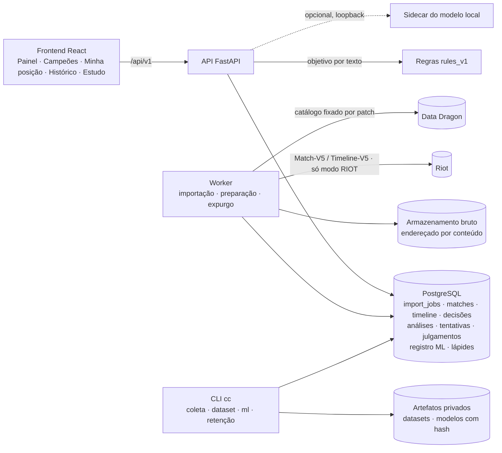
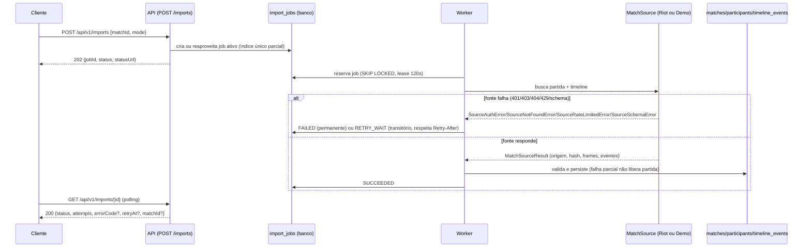
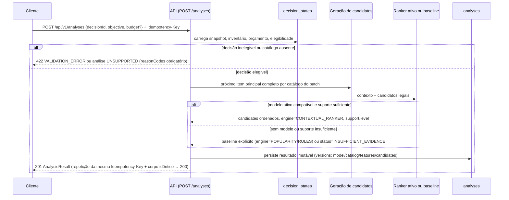

Diagramas de sequência da importação (real desde o CC-201) e da análise (real desde o CC-303), conforme os contratos de `docs/contracts.md`.

# Arquitetura e decisões de implementação

## Stack e diretórios (código entregue, 13/10/2026)

**Backend:** Python 3.12, `uv` com lockfile. Versões travadas:

| Pacote | Versão |
| --- | --- |
| FastAPI | 0.141 |
| Pydantic | 2.13 |
| SQLAlchemy | 2.0 (async, asyncpg) |
| Alembic | 1.20 |
| PostgreSQL | 17.11 |
| Typer (CLI `cc`) | 0.27.2 |
| httpx | 0.28.1 |

Grupo opcional `ml`: CatBoost 1.2.10 e NumPy 2.5. O KMeans do CC-403 foi feito em NumPy, sem
scikit-learn.

**Frontend:** React 19, TypeScript 5.9, Vite 8, tipos gerados do OpenAPI
(`openapi-typescript`), Vitest 5 e Playwright 1.63.

**Interpretador experimental:** Transformers 4.46, PEFT 0.13 e torch 2.5 (CPU) num ambiente
separado em `ml/objectives`, fora do backend e das imagens.

```text
backend/src/riftlab/
  api/ (rotas)  shared/ (contratos Pydantic, erros, db)  config.py  errors.py  cli/ (cc)
  ingestion/ (importação, armazenamento bruto, expurgo)  preparation/  timeline/  decisions/
  catalog/  champions/  candidates/  ranking/  analyses/  learning/  objectives/  reviews/
  ranked/  matches/  match_review/ (revisão da partida, F1)  collection/  dataset/  ml/ (features, ranker, clusters, suporte, registro,
  revisão de especialistas)  reports/  worker/
backend/{migrations,tests/{unit,contract,integration}}
frontend/src/{app,features/{imports,matches,history,ranked,study,objectives,reports,review},shared}
frontend/tests/e2e/
ml/objectives/ (corpus, LoRA, avaliação, sidecar, notebook do Colab)
configs/ (escopo, mapeamentos de catálogo, regras empíricas, ranking, experimentos, gate do
  interpretador, schema do objetivo)
scripts/
```

O domínio não importa FastAPI. Treino e inferência compartilham as funções de features e
candidatos (`ml/features.py`, `candidates/`). O frontend não calcula legalidade nem recebe
chave da Riot.

### Componentes



## Processos

Compose: frontend, API, worker e PostgreSQL (portas só em 127.0.0.1; banco sem porta publicada); armazenamento local em volume para dados/artifacts. API e worker usam a mesma imagem e código. Jobs duráveis no banco, reservados com transação curta e SKIP LOCKED; chamadas de rede fora da transação. Lease de 120 s, heartbeat 30 s; recuperação de lease vencido, cinco tentativas transitórias com backoff exponencial/jitter e teto 15 min, Retry-After prevalece. 401/403 e payload incompatível são falhas permanentes, não repetidas indefinidamente. Um worker de ingestão inicial; limitador central conservador por chave/rota e respeito aos headers de rate limit. Paralelizar workers requer coordenação do limitador.

Jobs (`import_jobs`, tipos IMPORT, PREPARE e PURGE):
- Estados: QUEUED → RUNNING → SUCCEEDED; RUNNING → RETRY_WAIT → RUNNING; RUNNING → FAILED.
- Reprocessar uma falha cria nova tentativa vinculada e preserva o histórico.
- O worker processa no máximo um job de cada tipo por ciclo.

Registro de modelos (CC-405/603):
- Estados: REGISTERED → ACTIVE → RETIRED, com eventos REGISTER, PROMOTE, RETIRE, ROLLBACK e
  INVALIDATE.
- Promover exige hash conferido e dataset não invalidado.
- A troca de ativo é atômica, com rollback.
- O modelo não é treinado durante requisição HTTP; o treino roda pela CLI.

## Integração e operação

Riot adapter só acessa hosts permitidos, jamais URL arbitrária recebida na API. BR1 é plataforma; Americas é rota regional de Match-V5. Catálogo por gameVersion mapeado explicitamente para versão Data Dragon, registrando correspondência. Não usar automaticamente catálogo mais recente como substituto. Atraso/ausência produz estado não suportado. Chave em variável de ambiente e header, nunca URL/log.

Saúde: liveness do processo e readiness do banco; falta de chave não derruba modo demo. Logs JSON com request/job ID e códigos de erro, sem payload bruto. Métricas: duração de importação, fila, retries, falha de reconstrução, latência, cobertura e abstenção por patch. Inicialização sem modelo ativo permite baselines identificados; nunca rotular baseline como ML.

## UX

Rotas reais:

| Rota | Tela |
| --- | --- |
| `/` (e `/painel`) | Painel |
| `/importar` | importar por ID ou abrir a demonstração; as partidas importadas ficam no Histórico |
| `/campeoes` | Campeões (marcador; o guia por campeão do CC-307 não foi construído) |
| `/minha-posicao` | Minha posição |
| `/historico` | Histórico |
| `/historico/:matchId` | contexto da partida, a partir do Histórico |
| `/imports/:jobId` | progresso da importação |
| `/matches/:matchId?participant=N` | partida |
| `/decisions/:decisionId` | detalhe da decisão, com o estudo, a comparação, a reflexão, o julgamento e a exportação |
| `/prototipo` | protótipo ilustrativo do CC-102 |

Comportamento da interface:
- Cores, espaços, raios e fontes vêm só de `frontend/src/design/tokens.css` (tema escuro único);
  um teste falha se outra folha de estilo declarar cor literal (CC-903).
- A faixa "Partidas DEMO são sintéticas" só aparece quando a tela mostra dados de demonstração.
- Cada tela tem estados de carregando, vazio, sucesso, erro recuperável e incompatível.
- O objetivo vem primeiro do formulário; o texto é alternativa e vale só depois de confirmado.
- O score é relativo; o suporte é contagem descrita, nunca porcentagem de vitória.
- Valores ausentes não ficam escondidos.
- Quando um botão some depois da ação, o foco vai para o passo seguinte; erros usam `role=alert`.

## Empacotamento e publicação

Portas ligadas a 127.0.0.1. CI usa fixtures sintéticas, banco descartável e sem segredos reais. Imagens excluem configurações, históricos e materiais locais pelo contexto mínimo e .dockerignore. Não carregar pickle/modelo enviado pelo usuário; pesos vêm do registro confiável com hash. Demonstração em máquina única não equivale a produção multiusuário.

## Sequências de importação e análise (reais)

Diagramas de sequência da importação e da análise, conforme os contratos de `docs/contracts.md`. A sequência de **importação** abaixo é real desde o CC-201 (API, `import_jobs`, worker, `RiotMatchSource`/`DemoMatchSource` e persistência de match/participantes/eventos todos existem como código executável, validados com PostgreSQL real). A sequência de **análise** continua só previsão: nenhum de seus participantes (candidatos, ranker, persistência de análise) existe ainda — chega em CC-301 a CC-405. Servem para revisar a sequência antes de implementar cada etapa, não como evidência de comportamento real da análise.

### Importação (RF01-03, UC01) — implementado no CC-201



### Análise de decisão (RF06-08, UC02) — real desde o CC-303

O motor servido é POPULARITY, com RULES quando falta referência; CONTEXTUAL_RANKER não é servido, porque nenhum modelo superou o baseline. A análise grava `versions.registryVersion` e `registryFallback`.



## Modo Estudo (real desde o CC-304/305)

O módulo `learning` e as rotas `/api/v1/learning-attempts*` implementam o estudo. O painel de
estudo fica na página da decisão; não há rotas `/study` separadas.

1. A pessoa confirma o objetivo (formulário ou texto confirmado).
2. Escolhe entre alternativas em ordem neutra, ou "não sei".
3. Pode pedir duas pistas graduais.
4. Revela a comparação explicitamente. A revelação é monotônica: a tentativa não volta a ficar
   cega.
5. Depois: reflexão única, prática de transferência sem pistas numa decisão diferente,
   progresso por contagens e relatório JSON/HTML.

Não há conexão com partida ativa: só partida concluída ou demonstração sintética.

## Decisão (CC-208, 29/09/2026): nomes e retratos de campeões

- **Onde:** catálogo `champion.json` (pt_BR) persistido no PostgreSQL por (versão do Data Dragon, idioma), versão sempre a FIXADA para o patch em `configs/catalog-mappings.yaml`. Alternativas rejeitadas: buscar o CDN dentro dos GET (transformaria leitura em coleta implícita e acoplaria disponibilidade da página à do CDN) e resolver no frontend (duplicaria o mapping patch→versão).
- **Rede:** só em `ensure_champion_catalog`, chamado pela preparação (worker) e por `cc catalog sync-champions`; patch sem mapping e catálogo já gravado não usam rede. Transporte com host fechado, rota fixa, sem redirect e sem credencial.
- **Cache:** durável e limitado pelas versões do mapping (uma linha por versão+idioma, imutável). Documento com `type`/`version` divergente é recusado inteiro; entrada inválida é descartada e contada.
- **Falha:** CDN indisponível ou documento inválido não falham a preparação (log com código); a API devolve `champion: null` e a interface mostra o rótulo numérico. Imagem que falha no navegador vira caixa vazia do mesmo tamanho.
- **Leitura:** `GET /api/v1/matches/{id}` resolve por `championId` = `key` numérico, só banco, READ ONLY; DEMO nunca resolvida.


## Expurgo e retenção (CC-603)

`DELETE /api/v1/matches/{id}?confirm={id}` cria um job `PURGE` na mesma fila durável dos
jobs de importação e preparação (lease, retomada, nova tentativa), consultável em
`/imports/{jobId}`.

**Processamento pelo worker:**
1. Remove os brutos da partida no armazenamento durável: ponteiros, blobs usados só por eles e
   o formato legado. O id passa pelo padrão fechado, o caminho resolvido precisa ficar no
   diretório e link simbólico é removido sem ser seguido.
2. Numa transação única:
   - apaga julgamentos, tentativas, análises, pontos e extrações de decisão, estados,
     reconstruções, eventos, jobs da partida, participantes e a partida;
   - invalida os datasets registrados que listam a partida e retira os modelos ACTIVE
     treinados com eles;
   - grava a lápide (`purge_tombstones`: HMAC do id com o segredo local, modo, motivo e
     contagens);
   - troca o id na linha do job por uma referência irreversível.

Se o processo cair entre os passos, a nova tentativa repete o passo 1 sem efeito e conclui o
passo 2.

**Garantias complementares:**
- O registro recusa promover versão de dataset invalidado e, se ainda houver versão ativa
  dele, cai no baseline com `ACTIVE_DATASET_INVALIDATED`.
- A lápide recusa reimportação real da mesma partida (409 `MATCH_PURGED`).
- API e worker precisam do mesmo `RIFTLAB_SUBJECT_HASH_SECRET` para a lápide ser reconhecida;
  no compose, ambos leem o mesmo ambiente.

**Limites declarados:**
- Modelos já treinados não desaprendem.
- O critério de popularidade versionado em `configs/` não é recontado sozinho.
- O corpus de pesquisa em `.private/collection` precisa ser congelado de novo pelo operador.

A retenção (`cc retention run`) só lista por padrão. Com `--execute`, expurga as partidas
importadas há mais de `RIFTLAB_MATCH_RETENTION_DAYS` (90) e apaga observações de elo com mais
de `RIFTLAB_RANK_RETENTION_DAYS` (365), preservando a mais recente de cada conta, fila e
temporada. Imprime só contagens.

### Painel de conta e atividade local

O módulo `dashboard/` lê placares, observações de conta, tentativas e catálogos em
uma transação somente leitura com snapshot repetível. A identidade permanece no
servidor: a projeção HTTP contém apenas fatos do participante vinculado e agregados.
O vínculo não é inferido por campeão, horário ou pela presença da partida no corpus.
A interface separa origem, janela de desempenho e atividade de estudo em todas as
datas. Sem vínculo há orientação e acesso às partidas importadas para estudo.
