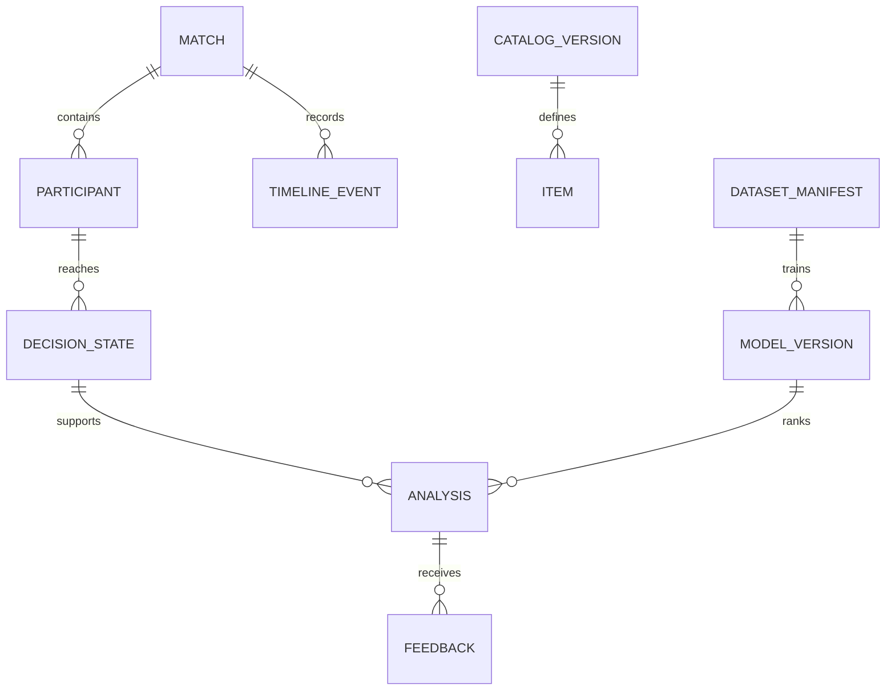

# Domínio, persistência e reconstrução

## Resolução de patch (CC-314)

`patch_resolutions` fixa uma única versão Data Dragon por `game_patch`, com
`resolved_at`, SHA-256 do `versions.json` e versão da regra; inserções
concorrentes reaproveitam a primeira linha. `current_patch` registra a
detecção explícita, instante, hash e a ordem dos minors observados para a
janela móvel. Catálogos de itens e campeões continuam versionados por versão
exata do Data Dragon. O registro empírico permanece separado por patch;
nenhuma aprovação ou avaliação é herdada.

## Entidades e restrições

| Entidade/tabela | Chaves e conteúdo | Invariante |
| --- | --- | --- |
| catalog_versions | id, game_patch, data_dragon_version, sha256, mapping_version | Catálogo imutável, relação de patch explícita |
| items | catalog_id + item_id, preço, receita, atributos, flags | IDs só têm sentido dentro de catálogo |
| matches | match_id PK, queue, map, patch, start_at, duration, raw_hash | Importação repetida não cria outra partida |
| participants | match_id + participant_id, champion_id, team, role, subject_hash, win/kills/deaths/assists/total_minions_killed/neutral_minions_killed nullable | IDs pessoais brutos isolados dos dados públicos; placar final não é feature de decisão |
| timeline_events | match_id + source_index, timestamp_ms, type, payload | Mesmo timestamp preserva ordem original |
| import_jobs | UUID, match_id, mode, kind (IMPORT\|PREPARE, CC-205), state, attempts, lease_until, error_code | Índice parcial único por importação ativa (kind=IMPORT) e por preparação ativa da partida (kind=PREPARE: no máximo uma) |
| decision_states | UUID, match/participant/event, state_version, features, quality | Unique(match, participant, event, state_version) |
| analyses | UUID, decision_id, objective, model_id, candidate_version, result | Resultado e input snapshot imutáveis |
| feedback | UUID, analysis_id, reviewer_hash, item_id, grade, rubric_version | Submissão idempotente por chave local |
| dataset_manifests | UUID, hash, filtros, lista de partidas, splits, schema | Dataset congelado e rastreável |
| model_versions | UUID, dataset_id, hash, config, metrics, state | Um ativo por tarefa/escopo compatível |

Tempo de partida em milissegundos inteiros; datas de ingestão em UTC. Ouro/preços em inteiros. Inventário é multiconjunto, não conjunto: componentes repetidos são consumidos uma vez por unidade. Modelar seis slots normais e espaço de trinket separadamente. Catálogo especifica receitas, restrições e classificação de item principal; botas, consumíveis, trinkets e itens de missão não contam como primeiro/segundo item principal no recorte inicial.

## Unidade de decisão

Estado imediatamente anterior a um evento ITEM_PURCHASED de item principal elegível, enquanto o participante possui zero ou um item principal. Cada estado mantém índice do evento e timestamp. O item efetivamente comprado é alvo de imitação, nunca característica de entrada. Eventos do futuro não participam das features. A lista de estados é retrospectivamente selecionada por compras completas: isso limita as conclusões a tais momentos, não a todas as visitas à loja.

Snapshot temporal: usar último participantFrame com timestamp estritamente anterior ao evento; frame no mesmo timestamp só será aceito se auditoria provar semântica pré-evento. Mostrar idade do snapshot. Mais de 90 s de defasagem marca STALE_FRAME e impede orçamento imediato; ouro permanece aproximado mesmo abaixo desse limite. Sem snapshot anterior: null e máscara de ausência. Sem interpolação com frame futuro. Resultado final, itens finais, KDA final e dano final são proibidos como features.

## Redução de eventos

Reconstruir do início da partida, com registro de operações antes/depois. Compra consome os componentes pela receita, adiciona item e respeita multiplicidade. ITEM_DESTROYED pode refletir consumo de receita; reconciliar sequência conforme fixture real para não consumir duas vezes. Venda remove uma unidade. UNDO reverte operação correlacionada por campos/eventos comprovados no spike. Quando a correlação não é demonstrável, marcar INVENTORY_UNCERTAIN e abster-se; nunca supor apenas pelo nome do evento. Transformações gratuitas, itens especiais e receitas ambíguas inicialmente tornam aquele estado incompatível, sem descartar silenciosamente a partida inteira. Inventário final é somente cheque de consistência offline, não reparação retroativa de features.

## Orçamento e candidatos

Candidato = próximo alvo de item principal completo, não necessariamente compra imediatamente acessível. remaining_cost = preço total menos créditos dos componentes possuídos e consumíveis pela receita, sem dupla contagem de ancestrais. Receita e preço devem reconciliar; divergência marca catálogo incompatível. Não simular venda automática.

**Enumeração pura v1 (CC-301).** `candidates.enumerate_candidates` recebe somente visão pré-decisão, catálogo fixado e itens completos dessa versão, classificação `item_classification_v1`, regras de item versionadas para o patch e cenário manual opcional. Devolve candidatos por `itemId` crescente, custo restante, códigos de evidência, exclusões separadas por motivo e diagnóstico `NO_LEGAL_CANDIDATES` quando vazio. Não consulta catálogo canônico nem usa o alvo comprado, resultado final ou ranking. A busca exata por multiconjunto considera tanto um componente pronto quanto seus descendentes avulsos sem consumir a mesma unidade duas vezes. Receita cíclica, incompleta ou com preço do pai menor que a soma dos filhos exclui o alvo. O item precisa caber nos seis slots normais após o consumo; trinket ocupa slot separada. Cada unidade normal é contada como um slot quando não há regra de stack comprovada, escolha conservadora.

Os manifests `configs/item-rules/16.16.json` e `16.17.json` excluem o namespace de IDs >=100000 observado nos Data Dragon locais, onde existem cópias de nomes de itens normais que `item_classification_v1` marca como MAIN. Os arquivos Data Dragon não trazem grupo exclusivo nem política de duplicata; ambos os manifests mantêm essas regras como desconhecidas, de modo que os candidatos MAIN reais desses patches são excluídos com `EXCLUSIVE_GROUP_UNKNOWN` e `DUPLICATE_RULE_UNKNOWN` até curadoria com fonte. A regra não muda a classificação v1 e não declara que a enumeração de alternativas REAL está pronta para recomendação.

budget_source: UNKNOWN, FRAME_ESTIMATE, USER_PROVIDED. Ouro de frame não é saldo exato no evento. Sem orçamento confiável, affordability=UNKNOWN e mostrar custo para completar. Orçamento manual vale somente para cenário hipotético e nunca vira dado real de treino. Compra imediata só é exibida como hipótese quando orçamento explícito e regras de slots/receita são verificadas. Respeitar mapa, disponibilidade, restrições por campeão, grupos exclusivos e duplicação de itens conforme catálogo curado. Casos sem regra conhecida são excluídos com motivo, não liberados por padrão.

Na enumeração interna v1, `WITHIN_USER_BUDGET` significa apenas `userBudget.gold >= remainingCost` e `ABOVE_USER_BUDGET` significa o inverso, em cenário explicitamente informado. Para frame ou ausência de orçamento, `UNKNOWN` permanece mesmo quando o valor estimado supera o custo. Esses valores não ampliam o enum público da API de análises e não afirmam saldo exato ou compra imediata.

## Persistência implementada (CC-103)

As sete tabelas descritas acima existem de verdade via Alembic (`backend/migrations/`,
revisão `1c245b5abad5`), validadas em PostgreSQL real (banco vazio, `upgrade head`
idempotente). Fronteiras de módulo: `backend/src/riftlab/{shared,catalog,ingestion,timeline}/`,
cada um com `domain.py` (dataclasses + `Protocol` de repositório, sem import de
SQLAlchemy/FastAPI), `models.py` (ORM) e `repository.py` (implementação
`SqlAlchemyXRepository`, sem `relationship()` — só colunas FK explícitas). `shared/db.py`
define `Base` (naming convention para nomes de constraint estáveis), mixins de UUID/
created_at e `unit_of_work()` (sessão transacional curta; repositórios nunca commitam).

`requested_match_id` em `import_jobs` não tem FK para `matches`; `match_id` é uma coluna
nullable separada, preenchida só quando a partida existe de verdade — job precede
importação, conforme decidido. Identidade ativa é um índice único parcial
`(requested_match_id, mode)` sobre estados `QUEUED/RUNNING/RETRY_WAIT`, validado com
concorrência real (duas transações independentes competindo pela mesma chave; uma
commita, a outra recebe `ConflictError` traduzido de `IntegrityError`).

`catalog_id` em `decision_states` é nullable (estado incompatível pode existir sem
catálogo). `items`, `timeline_events.payload` e `decision_states.{snapshot,features,quality}`
têm coluna `schema_version` própria. `decision_states` tem duas FKs compostas
(`match_id,participant_id` → `participants`; `match_id,event_source_index` →
`timeline_events`), cada uma isolando a partida corretamente — comprovado rejeitando
participante/evento de outra partida em teste real.

**Limite de ordenação descoberto**: como os módulos não usam `relationship()` do ORM
(domínio não importa SQLAlchemy, por design), o `unit_of_work` não infere sozinho a
ordem de INSERT entre mappers não relacionados dentro de um único flush. Quem grava
agregados dependentes (ex.: `decision_states` após `participants`/`timeline_events`) na
mesma transação precisa chamar `await session.flush()` explicitamente entre os passos
antes de inserir o dependente — comportamento diferente de FKs simples de uma coluna só
(que funcionam sem flush explícito, aparentemente por ordem de inserção coincidir).
Documentado aqui para os módulos futuros (CC-204) que vão gravar estados na mesma
transação de partida/participantes/eventos — o worker do CC-201 já segue esta regra
(flush explícito entre `matches` e `participants`/`timeline_events`).

Fora do escopo: modelos ORM/tabelas de análises, feedback, datasets e modelos
(sprints próprias); reconstrução temporal real de inventário (CC-203/204); dados de
catálogo real (CC-105/CC-202). `cc db upgrade`/`cc db current` (Alembic programático)
são os únicos comandos operacionais de migração entregues; sem `cc db downgrade`
nesta etapa.

## Importação real e lease do worker (CC-201)

`import_jobs` ganhou duas colunas (migração `14567d04d5d0`, sobre `1c245b5abad5`):
`lease_generation` (inteiro, token de posse — incrementado a cada reserva, fresca ou
reclamada de lease vencido) e `retry_of_job_id` (UUID nullable, auto-FK, vincula uma
tentativa manual — `POST /imports/{id}/retry` — ao job anterior, preservando
histórico). `IngestionRepository` ganhou `reserve_next_job` (`SELECT ... FOR UPDATE
SKIP LOCKED`, transação curta), `renew_lease`, `mark_import_succeeded/failed/
retry_wait` — todos guardados por `WHERE id=... AND lease_generation=... AND
state='RUNNING'`: um worker que perdeu a posse (job já reclamado por outro) tem 0
linhas afetadas e descarta o resultado, nunca sobrescreve (validado com concorrência
real em `tests/integration/test_import_job_lease.py`, incluindo retorno tardio do
dono antigo). `attempts` conta cada entrega do job a um worker — fresca, retomada de
`RETRY_WAIT` ou reclamação de lease vencido — e tem teto explícito
(`MAX_TRANSIENT_ATTEMPTS=5`, `docs/architecture.md`); esgotado, `reserve_next_job`
marca `FAILED` (`RETRY_LIMIT_EXCEEDED`) em vez de reservar de novo, evitando loop
infinito num job que sempre derruba o worker.

`MatchParticipantSourceDTO` (CC-104) ganhou `subject_hash: str` obrigatório —
calculado pela própria fonte, nunca por quem persiste: `DemoMatchSource` usa um hash
não-secreto (fixtures não têm PUUID real algum); `RiotMatchSource`
(`ingestion/infrastructure/riot_source.py`) usa HMAC-SHA256 do PUUID com
`RIFTLAB_SUBJECT_HASH_SECRET` (`shared/errors`-style `SubjectHashSecretMissingError`
se ausente em modo RIOT — nunca hash simples nem chave fixa). `RiotMatchSource`
reaproveita `RiotHttpTransport` (CC-105) configurado com
`max_attempts_per_request=1`: o job em `import_jobs` é o único dono do retry
transitório (`retry_at` durável, backoff exponencial com jitter e teto 15 min,
nunca reduz `Retry-After` do servidor) — o transporte nunca dorme sozinho no worker.
Só aceita `endOfGameResult=GameComplete` (RF17: nunca uma fonte "ao vivo") e valida
`matchId` consistente entre os documentos de match e timeline antes de aceitar.

Corpos brutos match+timeline ficam em `DurableRawMatchStore`
(`ingestion/infrastructure/raw_store.py`) — gravação atômica (arquivo temporário +
`os.replace`, mesma partição), sidecar `.sha256` para detectar corrupção sem nunca
sobrescrever sozinho, caminho controlado por `Settings.raw_storage_dir`
(`/app/data/raw/imports` no runtime, corresponde ao volume nomeado `riftlab_raw_data`
gravado só pelo serviço `worker`; a API o monta somente leitura para mostrar o Riot ID dos participantes na tela da partida, CC-1210). Explicitamente **não** é o `RawMatchStorage`/
manifesto JSON do spike CC-105 (não seguro para acesso concorrente/durável), nunca
alterado por este módulo. O worker verifica o armazenamento antes de qualquer
requisição de rede: um `match_id` já baixado e íntegro é reaproveitado sem nova
chamada — recuperação real após crash, sem gastar orçamento de requisições de novo.

Persistência final (`Match`, `Participant`, `TimelineEvent`) e `mark_import_succeeded`
acontecem numa única transação curta — falha parcial nunca libera a partida como
importada; se a posse foi perdida entre a reserva e este ponto, a transação inteira é
revertida (nunca fica `Match` persistido com o job correspondente `FAILED`), e quem
reclamou o lease refaz o trabalho reaproveitando o armazenamento bruto durável, sem
nova rede. `POST /imports` é idempotente mesmo sob corrida real de criação (índice
único parcial do banco): a chamada perdedora nunca recebe 409, reconsulta e devolve o
job da vencedora.

## Fontes plugáveis e fixtures demo (CC-104)

`MatchSource` e `CatalogSource` (Protocols assíncronos em `ingestion/domain.py` e
`catalog/domain.py`, ao lado das dataclasses existentes — sem diretórios `domain/`
novos) definem a interface entre uma fonte de dados bruta e o consumidor, anterior a
qualquer validação/reconstrução/persistência (validação/persistência de
match+participantes+eventos implementada no CC-201 acima via `RiotMatchSource`/
`DemoMatchSource`; reconstrução real de inventário/ouro continua em CC-203/204). `MatchSourceResult`/`CatalogSourceResult` (DTOs próprios, não os agregados de
domínio) preservam origem (`SourceOrigin`, `shared/domain.py`: `curated_demo` com
adapter real nesta etapa, `completed_match` declarado sem adapter — mesmo padrão de
`ImportMode.RIOT` desde o CC-101 —, nunca um valor "live"), `schema_version`, hash
SHA-256 dos bytes brutos lidos, participantes, frames (`participant_frames` opaco por
participante) e a sequência original de eventos via `source_index` (posição entre
frames e, dentro de cada frame, entre eventos — preserva duplicatas e múltiplos
eventos no mesmo `timestamp_ms`, nunca deduplica).

`DemoMatchSource`/`DemoCatalogSource` (`ingestion/infrastructure/`,
`catalog/infrastructure/`) implementam essas interfaces inteiramente a partir de
fixtures JSON sintéticas empacotadas dentro do próprio pacote Python (`.../fixtures/`,
com `manifest.json` fechado por identificador). Decisão de empacotamento: como
`uv sync` instala o projeto raiz em modo editável (confirmado via
`riftlab==0.1.0 (from file:///app)` no log do build), e o Dockerfile já faz
`COPY backend/src ./src` tanto no alvo `test` quanto no `runtime`, as fixtures viram
parte do pacote automaticamente, sem exigir COPY adicional nem alterar
`.dockerignore`/contexto — carregadas via `importlib.resources`
(`shared/resources.py`), resolução independente do cwd. Comprovado com
`docker build --target runtime` seguido de `docker run --network none` chamando os
dois adapters sem Postgres: ver `.private/validation/sprint-1/CC-104/
04-runtime-image-fixture-smoke-and-private-scan.txt`.

7 cenários de partida cobrem exatamente o pedido pelo card: compra simples, receita
com componentes (multiplicidade do mesmo componente e dois eventos no mesmo
`timestamp_ms`, identidade só por posição), venda, undo (preserva os dois eventos
correlacionados, sem colapsar — correlação em si continua tarefa de CC-203/204),
frame ausente (`participant_frames == {}` no frame que contém o evento — ausência
preservada, nunca fabricada), patch obrigatório ausente (falha determinística, sem
cair para o catálogo atual como substituto) e evento repetido (mesmo tipo/payload/
timestamp duas vezes, `source_index` diferente, sem deduplicar). Catálogo demo
(`DEMO-1`) com 3 itens sintéticos cujas receitas reconciliam com os cenários de
compra; `DEMO-2-INVALID` cobre item sem preço para o teste de fixture inválida.
Identificadores (`DEMO-000N`, `DEMO-1`, itens `100001+`, campeões `900N+`) usam
namespace claramente sintético, sem reivindicar nenhuma faixa numérica real da Riot.

`SourceError`/`SourceNotFoundError`/`SourceSchemaError` (`shared/errors.py`, ao lado
de `ConflictError`/`NotFoundError`) carregam um `code` estável (ex.:
`MATCH_SOURCE_MISSING_FIELD`, `SCHEMA_UNSUPPORTED`, `MATCH_SOURCE_NOT_FOUND`) e um
`detail` que nunca ecoa corpo bruto, confirmado por teste dedicado. A fonte demo
nunca cai para outra fonte por aproximação: identificador fora do manifesto fechado
— mesmo com formato parecido a um match ID real — sempre levanta
`SourceNotFoundError`.

Testes de contrato (`tests/contract/test_demo_match_source.py`,
`test_demo_catalog_source.py`) rodam sem Postgres e com sockets de rede bloqueados
por `monkeypatch` (nunca só "não chamamos nada de rede" por inspeção); um consumidor
tipado só no Protocol (verificado por `mypy`) é exercitado tanto com o adapter demo
quanto com um fake mínimo local, provando fonte trocável sem mudança de domínio.
Fora do escopo (nesta etapa, CC-104): importação HTTP Riot real e processamento de
jobs — implementados no CC-201 acima. Reconstrução de inventário/ouro, ranking, seed
de persistência e qualquer nova jornada de UI continuam para CC-203 em diante.

## Catálogo versionado e regras do patch (CC-202)

`catalog_versions.sha256` (migração `f2a7c9d4e1b6`, índice único
`uq_catalog_versions_sha256`) deixou de ser só um hash dos bytes brutos: é a
identidade de CONTEÚDO do catálogo, cobrindo raw fetched + `mapping_version`
+ `curation_rules_version` — mudar qualquer um dos três produz uma
identidade nova, nunca reaproveita conteúdo derivado desatualizado (pedido
explícito do plano do card). Sync (`catalog/application.py:sync_catalog`)
busca (rede fora de transação) -> valida (`validate_item_types_and_limits`/
`validate_recipe_graph`, puras, em `catalog/domain.py`) -> persiste
catálogo+itens numa transação única; idempotente sob concorrência real via
esse índice único (mesmo padrão de `ingestion.create_import_job`/CC-201: a
inserção perdedora vira `ConflictError`, reconsulta e devolve a linha
vencedora, nunca duplica nem sobrescreve).

**Proveniência e seleção canônica (revisão pós-`92c6b1a`, migrações
`a3f6b1d8c4e2`/`c7e2a9f1b3d5`)**: `raw_hash`/`curation_rules_version` são
persistidos como colunas próprias em `catalog_versions` — o hash combinado
(`sha256`) não é reversível, então sem esses dois campos um consumidor não
recuperaria qual fetch/curadoria gerou um catálogo já salvo.
`catalog_excluded_items` (catalog_id+item_id) persiste cada item excluído
da curadoria com motivo — sem essa tabela, a informação existia só no DTO
em memória e era descartada ao persistir, impedindo um consumidor futuro
(CC-203+) de distinguir "item não existe nesta partida" de "item existe mas
não é suportado ainda".

Qual sincronização é a canônica por identidade `(game_patch,
data_dragon_version, mapping_version)` vive numa tabela própria,
`catalog_identities` (essas três colunas como chave primária,
`canonical_catalog_id` nullable apontando para `catalog_versions.id`) — não
um índice único sobre `catalog_versions` (tentativa anterior, migração
`a3f6b1d8c4e2`: um índice único só impede duas linhas canônicas
simultâneas DEPOIS de ambas tentarem existir; duas sincronizações
concorrentes de conteúdo divergente para uma identidade NOVA, sem nenhuma
linha `catalog_versions` ainda visível uma para a outra, colidiam só no
COMMIT — a perdedora recebia `IntegrityError` bruto do banco, derrubando a
transação inteira e perdendo o conteúdo que tinha acabado de inserir;
reproduzido com barreira real em Postgres isolado antes desta correção).
`mark_canonical` faz upsert idempotente da linha de identidade (`INSERT ...
ON CONFLICT DO NOTHING`, existe mesmo antes de qualquer `catalog_versions`
para ela) e trava essa linha (`SELECT ... FOR UPDATE`) antes de escrever
`canonical_catalog_id` — serializa de verdade toda promoção concorrente
para a mesma identidade: a segunda transação simplesmente espera a
primeira commitar (nunca um erro de banco bruto), então decide
deterministicamente (última a commitar depois de obter o lock vence), sem
jamais perder o conteúdo de nenhuma das sincronizações concorrentes (ambas
já foram inseridas e commitadas antes da disputa pelo lock).

Sincronizar duas variantes de conteúdo para a mesma identidade (ex.: bump
de `curation_rules_version`, ou o raw upstream mudando sob a mesma versão
pinada) faz a mais recente virar canônica deliberadamente; a anterior
continua consultável por `catalog_id` exato, nunca reescrita. Migração de
banco com linhas anteriores a esta revisão nunca inventa proveniência real:
`raw_hash`/`curation_rules_version` recebem o sentinela `LEGACY_UNKNOWN`
(migração `a3f6b1d8c4e2`); a linha de identidade herda o `canonical_catalog_id`
que já estava marcado (migração `c7e2a9f1b3d5`, backfill não destrutivo a
partir do `is_canonical` da migração anterior) — identidades que ficaram
sem canônico definido (legado ambíguo, múltiplas linhas concorrentes sem
decisão) permanecem assim (resolução devolve `MISSING_CATALOG` até decisão
manual), nunca uma escolha automática entre elas.

`configs/catalog-mappings.yaml` (versionado, `mappingVersion` próprio)
mapeia `game_patch` real (major.minor, mesmo formato de `matches.patch`) ->
versão do Data Dragon; um patch sem entrada devolve `MISSING_CATALOG` sem
qualquer tentativa de rede. `DataDragonCatalogSource`
(`catalog/infrastructure/data_dragon_source.py`) busca `item.json` real do
CDN público (`ddragon.leagueoflegends.com`, sem autenticação, host fechado,
sem redirect) e devolve o mesmo DTO (`CatalogSourceResult`) que
`DemoCatalogSource` — consumidor não distingue a fonte. A URL correta não
prova corpo correto (achado da revisão): o `type`/`version` declarados
dentro do próprio corpo são conferidos contra a versão exata pedida antes de
qualquer curadoria — divergência vira `SourceSchemaError` permanente
(`DATA_DRAGON_VERSION_MISMATCH`), nunca um resultado rotulado com a versão
errada.

Curadoria (`catalog/infrastructure/curation.py`, `CURATION_RULES_VERSION`)
separa normalização de campos documentados (preço=`gold.total`, receita
como multiconjunto explícito de `{itemId, quantity}` extraído de `from` —
nunca um conjunto, Data Dragon real repete o mesmo componente quando a
receita pede mais de uma unidade) de decisões de curadoria: itens com
`specialRecipe` (upgrades Ornn/Muramana, ~27 no patch real auditado) e itens
com `name` de tipo certo mas valor vazio (achado real de rede: 4 itens do
payload real têm `name=""`, artefatos internos do provedor — distinto de
`name` de tipo errado, que é falha estrutural e nunca tratado como o mesmo
caso) são excluídos com motivo explícito, nunca forçados a caber no formato
normal nem tratados como falha do catálogo inteiro. Um item cuja receita
referencie um componente já excluído (achado real de rede: os 5 upgrades
míticos que derivam de "Bounty of Worlds", em si excluído por
`specialRecipe`) é excluído em cascata, em ponto fixo — nunca tratado como
referência inexistente (que segue sendo erro permanente do catálogo inteiro,
reservado para corrupção/fixture sintética de teste) nem como componente
reconciliável. Toda leitura de container (`from`/`maps`/`stats`) valida
chave e tipo explicitamente antes de converter (achado da revisão: chave
não numérica em `from`/`maps` vazava `ValueError` cru; valor de `maps` não
booleano era tratado como "mapa=false" silenciosamente, confundindo
inválido com ausência legítima; valor de `stats` não numérico/infinito era
aceito sem checagem); item_id duplicado após normalização de chave (ex.:
`"007"` e `"7"`) é rejeitado explicitamente. `validate_recipe_graph` (comum
a demo e real, em `catalog/domain.py`) rejeita ciclo direto/indireto e
referência genuinamente inexistente, sempre antes de qualquer persistência;
valida também que cada entrada de receita é um objeto antes de acessar
campos (achado da revisão).

CLI `cc catalog sync --mode demo|real --patch X` (`cli/main.py`) é o único
ponto de entrada operacional desta etapa — nenhuma rota HTTP nova montada
(fica para consumidores futuros, CC-203 em diante). Validado com rede real
contra o Data Dragon público (16.16.1/16.17.1, os dois patches congelados em
`configs/scope.yaml`/CC-105) na implementação inicial, e com fixtures/mocks
na correção pós-revisão (achados reproduzíveis sem rede real) — ver
`.private/validation/sprint-2/CC-202/`.

## Reconstrução pré-compra de inventário (CC-203)

`timeline/application.py:reconstruct_participant_purchases` é um reducer
PURO (sem I/O, sem relógio, sem aleatoriedade) sobre os eventos de UM
participante, em ordem `(timestamp_ms, source_index)` — a filtragem por
dono acontece dentro do reducer (nunca antes de chamá-lo), para que dois
participantes processados separadamente fiquem isolados por construção,
sem se misturar. Identidade de evento é o índice (`source_index`), nunca o
conteúdo: dois eventos idênticos (mesmo timestamp/type/itemId) nunca são
deduplicados — achado real da auditoria CC-105 (2047 assinaturas repetidas
dentro da mesma partida em 122 partidas reais).

`InventorySnapshot` é um multiconjunto imutável (`item_id -> count`, nunca
negativo) mais uma slot separada para trinket (`trinket_item_id`) — achado
real (consulta ao catálogo 16.17.1 já sincronizado nesta sessão): todo item
com a tag `"Trinket"` tem `recipe=[]` no catálogo real, então trocar de
trinket nunca aciona consumo de componente, só substitui a slot
diretamente. Uma compra de item com receita consome, para cada componente
`{itemId, quantity}`, o mínimo entre a quantidade pedida e a quantidade
possuída (nunca exige posse total — "compra direta paga o restante").
Snapshot de uma compra é sempre o estado ANTES de aplicar o alvo: o item
comprado nunca aparece no próprio snapshot (critério de aceite do card).

**Reconciliação `ITEM_PURCHASED`/`ITEM_DESTROYED` sem corpus real
disponível nesta sessão** (`.private/validation/sprint-2/CC-203/01-corpus-
investigation-blocked.txt`: `data/raw/cc-105/`, corpus de 122 partidas reais
auditado no CC-105, não existe neste ambiente de execução — dependência
externa não resolvida, registrada como BLOCKED, não presumida/fabricada). A
auditoria CC-105 confirma que `ITEM_DESTROYED` ocorre de verdade (2324
ocorrências reais, amostra inicial de 14 partidas — `data-audit.md`, seção
"contagem real, 14 partidas"; nunca recontado para as 122 partidas da
retomada) e é hipoteticamente ligado a consumo de componente de receita,
mas nunca validou a correlação exata
timestamp/itemId com a compra que o dispara. Política conservadora adotada
sem essa evidência: consumo de receita é sempre aplicado diretamente a
partir de `ITEM_PURCHASED` + `Item.recipe` do catálogo (nunca depende de
observar um `ITEM_DESTROYED`); um `ITEM_DESTROYED` no MESMO
`timestamp_ms` de uma compra de receita, para um `item_id` que essa compra
efetivamente consumiu, é reconciliado como já contabilizado (nunca removido
de novo — evita a dupla remoção que o card pede explicitamente para
prevenir); qualquer `ITEM_DESTROYED` que não encontre esse par é
"não reconciliado" — aplicado como fato literal (remove uma unidade se
possuída) mas sempre marca o participante como `INVENTORY_UNCERTAIN`
(`UNRECONCILED_ITEM_DESTROYED`) a partir dali — nunca assume que toda
destruição é sempre receita, nem ignora a destruição por completo.

Incerteza (`INVENTORY_UNCERTAIN`, `quality.uncertain`/`quality.reasons` em
`DecisionState`) é sempre um efeito colateral PROGRESSIVO (nunca cura um
estado anterior, nunca é "reparada" por um evento posterior — "nunca
restaurar certeza usando itens finais", pedido explícito do card): venda
sem posse (`SALE_WITHOUT_OWNERSHIP`), destruição não reconciliada
(`UNRECONCILED_ITEM_DESTROYED`, `DESTROY_WITHOUT_OWNERSHIP`), undo sem
correlação única (`UNDO_UNCORRELATED`), item desconhecido do catálogo
(`ITEM_UNKNOWN`) distinto de item conhecido mas excluído pela curadoria
(`ITEM_EXCLUDED_UNSUPPORTED`, usa `catalog_excluded_items`/CC-202) e
catálogo inteiro ausente para o patch da partida (`NO_CATALOG`) — todos
"causas seguras e datadas" (`event_source_index`/`timestamp_ms`), nunca um
booleano solto. `ITEM_UNDO` (`beforeId`/`afterId`, 100% presentes na
amostra real do CC-105) restaura o multiconjunto EXATO anterior a partir de
um ledger da última compra reversível do participante (nunca uma
reconstrução aproximada a partir de before/after) — correlação exige que
`beforeId` bata com o item resultante dessa última compra; sem correlação
única, o replay nunca "repara pelo palpite" (critério de aceite do card).

Frame de ouro estimado (`select_gold_estimate`) escolhe o último frame
ESTRITAMENTE anterior ao evento (nunca mesmo timestamp, nunca futuro, nunca
interpolado); idade >90000ms marca `stale=true`; ausência de frame anterior
ou frame sem dado do participante são igualmente `origin=UNKNOWN`
(`value=None`), nunca um zero disfarçado — ouro real `0` é `origin=OBSERVED`,
distinto de ausência.

Orquestrador (`reconstruct_match`): resolve o catálogo da partida UMA única
vez no início (nunca reconsultado durante o replay, mesmo que uma
sincronização concorrente troque o canônico enquanto o comando roda — um
`catalog_id` já obtido continua consultável por ID exato e imutável) ->
carrega eventos já persistidos (`timeline_events`, CC-201) -> relê a
MESMA fonte local (demo ou raw imutável real) só para obter `frames`
(nunca persistidos pelo CC-201, nunca uma coleta nova — raw é imutável,
uma releitura local não é rede) -> reduz cada participante (puro) ->
persiste tudo numa única transação (idempotente: uma partida já
reconstruída devolve os estados já persistidos, nunca duplica). CLI `cc
timeline reconstruct --mode demo|real --match-id X`
(`demo_catalog_mapping()`, `catalog/infrastructure/demo_source.py`, deriva
o mapping demo diretamente das fixtures — o YAML real só cobre patches
reais, nunca "DEMO-1"; achado real do smoke desta sessão: a primeira versão
da CLI sempre carregava o YAML real mesmo em `--mode demo`, então toda
reconstrução demo caía silenciosamente em `NO_CATALOG`, corrigido).

**Correção pós-revisão de `aa3e304` (`CC-203-REVIEW.md`, 6 achados: 4 Altos,
2 Médios)**:

1. **Undo não comprovava correlação de verdade**: comparar só `beforeId`
   contra a última operação reversível aceitava contradições (ex.:
   `afterId` referenciando um item nunca consumido pela compra desfeita).
   `_ReversibleOp` agora também guarda `consumed_components`; um `afterId`
   precisa ser `0` ou um desses componentes — qualquer outro valor é
   `UNDO_UNCORRELATED`, nunca aplicado às cegas. Venda também passou a ser
   reversível (antes sempre apagava o ledger, deixando "undo de venda" sem
   caminho suportado, contradizendo o plano). Undo de uma compra de receita
   também desfaz a expectativa de reconciliação em `pending_destroys` —
   sem isso, um `ITEM_DESTROYED` real chegando depois, no mesmo timestamp,
   podia se reconciliar contra uma compra já desfeita.
2. **Receita só considerava o filho imediato**: comprar C (receita
   referencia B) sem nunca ter comprado B, possuindo A (componente de B),
   deixava A parado no inventário. `_consume_recipe` agora decompõe
   recursivamente um componente faltante nos SEUS PRÓPRIOS
   subcomponentes (sempre preferindo um componente já pronto possuído
   direto antes de decompor); o orquestrador carrega o FECHAMENTO
   TRANSITIVO de receita (`_load_catalog_items_closure`), não só os
   item_ids literalmente presentes nos eventos. Capacidade de inventário
   (6 slots normais, trinket em slot própria) também passou a ser
   verificada: regra de stack vem de `flags.consumed`/`flags.stacks` do
   catálogo (CC-202) — item não-consumível é 1 por slot (regra confiável
   default), consumível sem `stacks` declarado é `ITEM_STACK_RULE_UNKNOWN`
   (nunca uma capacidade inventada), excesso é `INVENTORY_CAPACITY_EXCEEDED`.
3. **Reconciliação de destroy tratada como certeza**: a política de
   reconciliar `ITEM_DESTROYED` por timestamp/item/quantidade é uma
   HEURÍSTICA — nunca validada contra o corpus real (`data/raw/cc-105/`
   ausente nesta sessão, permanece BLOCKED). `quality.destroyReconciliationHeuristic`
   (sempre presente em todo `DecisionState`, `validatedAgainstRealCorpus:
   false`) propaga essa limitação explicitamente, distinto de `uncertain`
   (que bloqueia recomendação — a reconciliação em si nunca bloqueia
   sozinha, só desconta certeza empírica de uma estimativa que continua
   sendo o melhor esforço). Também corrigida uma citação imprecisa: os 2324
   `ITEM_DESTROYED` reais confirmados pela auditoria CC-105 são da amostra
   INICIAL de 14 partidas, nunca recontados para as 122 partidas da
   retomada — texto anterior desta seção citava "122 partidas" por engano.
4. **Reconstrução real podia emitir rede**: `RiotMatchSource` busca da Riot
   de verdade quando o cache local está ausente/incompleto, contradizendo
   "reconstrução nunca coleta nova". `LocalRawMatchSource`
   (`ingestion/infrastructure/riot_source.py`) nunca importa
   `RiotHttpTransport`/cliente HTTP/chave — estruturalmente incapaz de
   emitir rede; falha explícita (`SourceNotFoundError`,
   `RAW_MATCH_NOT_CACHED`) se o raw ainda não estiver completo em disco. A
   CLI (`--mode real`) usa exclusivamente essa fonte agora. `reconstruct_match`
   também confere `raw_hash` da releitura contra o já persistido em
   `matches.raw_hash` — nunca mistura fonte divergente com eventos já
   persistidos da mesma partida.
5. **Idempotência e catálogo devolvido incorretos**: checar só
   `list_decision_states` do PRIMEIRO participante falhava quando esse
   participante especificamente não tinha compra alguma (mas outro tinha) —
   uma reexecução tentava reinserir estados já existentes. Nova tabela
   `match_reconstructions` (migração `e4f8a2c9d6b1`) é uma marca atômica
   gravada na MESMA transação dos `DecisionState`s — existência da marca é
   a única fonte de verdade de idempotência, nunca inferida por contagem de
   compra. A reexecução idempotente também passou a devolver o `catalog_id`
   REALMENTE usado (da marca persistida), nunca um valor reresolvido na
   hora (que podia divergir do canônico atual se uma sincronização
   concorrente já tivesse trocado).
6. **Ouro e vocabulário de proveniência**: `select_gold_estimate` aceitava
   `currentGold` negativo como se fosse observado — ouro real nunca é
   negativo, então vira `UNKNOWN` (nunca apresentado como confiável), igual
   a `bool`/string/`null`. `origin` usa o vocabulário PÚBLICO
   (`shared/api/enums.py:BudgetSource` — `UNKNOWN`, `FRAME_ESTIMATE`), nunca
   um rótulo próprio inventado (`"OBSERVED"` não é um valor do contrato,
   docs/contracts.md/domain-model.md já documentavam esse enum desde antes
   do CC-203 para `budget_source`).

**Correção pós-revisão de `d3992b6` (`CC-203-REVIEW-2.md`, 3 achados: 2
Altos, 1 Médio) — CC-203 ainda não aprovado; investigação empírica do
corpus continua BLOCKED**:

1. **Hipótese continuava permitindo recomendação (flag documental não era
   gate operacional)**: `quality.destroyReconciliationHeuristic` propagava a
   limitação da heurística de destroy apenas de forma DOCUMENTAL — o
   participante continuava `uncertain=False`. Corrigido: o reducer agora
   distingue `origin` (`SourceOrigin.CURATED_DEMO` vs `COMPLETED_MATCH`,
   parâmetro obrigatório, nunca um default silencioso) — aplicar a
   heurística de reconciliação de destroy OU a correlação de undo (por
   `beforeId`/`afterId`) em dado REAL sempre marca `uncertain=True`
   (`UNVALIDATED_DESTROY_RECONCILIATION`/`UNVALIDATED_UNDO_SEMANTICS`),
   mesmo quando a regra interna "bate" — bater com uma regra própria
   inventada não comprova a semântica real da Riot, nunca chamado de
   "comprovado" fora da evidência. Em DEMO, a mesma regra pode ficar certa
   (sintética, verificada pela suíte de testes). Prevenção de dupla
   contagem é preservada incondicionalmente nos dois casos (correto
   independente de a correlação ser semanticamente real).
2. **Migração não suportava estados publicados por uma versão anterior**:
   `decision_states` já persistidos por `aa3e304`/`d3992b6` (sempre
   `state_version=1`, sem marca alguma) colidiam com uma reexecução do
   algoritmo corrigido, que também gravava `state_version=1` — só banco
   vazio/limpeza manual evitava a colisão, nunca validado contra upgrade
   real. Corrigido: `RECONSTRUCTION_ALGORITHM_VERSION=2` (módulo
   `timeline/application.py`) — todo `DecisionState`/marca novos usam essa
   versão; `match_reconstructions` ganhou `reconstruction_version` como
   parte da chave primária composta (migração `f7b3e8d2a5c4`, backfill não
   destrutivo `=1` para marcas pré-existentes, nunca inventado). Uma
   partida com `decision_states` de versão 1 nunca é apagada/sobrescrita —
   a reconstrução nova grava sua própria versão ao lado, sem colisão.
3. **Retorno idempotente ainda dependia de reler a fonte**: `reconstruct_match`
   chamava `match_source.load_match` ANTES de checar a marca — um resultado
   já persistido falhava se o raw estivesse ausente/incompleto, apesar de
   não precisar de nenhuma leitura nova. Corrigido: a marca (por
   `match_id`+`reconstruction_version`) é consultada PRIMEIRO; o caminho
   idempotente lista participantes via `IngestionRepository.list_participants`
   (novo, só banco) e nunca chama `match_source.load_match` — testado com
   uma fonte que levanta `AssertionError` se invocada. Só a reconstrução
   FRESCA (marca ausente) precisa da fonte, para frames/participantes e a
   conferência de `raw_hash` (achado 4 da revisão anterior, preservada).

Nota de proveniência desta correção: o volume de desenvolvimento real teve
`decision_states` residuais da implementação anterior apagados manualmente
durante a primeira rodada de validação de `aa3e304`/`d3992b6` — a revisão
apontou que essa prática mascarava exatamente o achado 2 acima (upgrade
nunca testado com dado legado de verdade) e que a autorização de
publicação vigente não cobria exclusão de dado de desenvolvimento sem
escopo explícito. Fato registrado com honestidade, não escondido; a partir
desta correção, testes de legado usam dado inserido deliberadamente em
banco isolado e descartável (nunca o volume dev), e nenhuma exclusão de
dado real foi repetida.

## Pontos de decisão e extração (CC-204, implementado localmente até 19/09/2026)

**Unidade de decisão implementada.** Uma compra de item PRINCIPAL (classificador `item_classification_v1` sobre a curadoria `data_dragon_v5`; demo: flag `flags.completed` da curadoria `curated_demo_v1`) do participante gera um ponto de decisão. Alvo conhecido e não principal (componente, botas, consumível, trinket, básico) não gera ponto; alvo desconhecido/excluído/sem classificação, sem catálogo, desfeito por undo ou de status incerto gera ponto listado como INELEGÍVEL. Posição no inventário: `mainItemOrdinal` = unidades de item principal possuídas antes + 1 (trinket fora); 1 e 2 são elegíveis, 3 ou mais ficam `OUT_OF_SCOPE` (`MAIN_ITEM_ORDINAL_BEYOND_SECOND`).

**Reconstrução v6 (transação destroy→compra).** Forma real (851/851 no corpus local): `ITEM_DESTROYED` dos componentes ANTES da compra composta no mesmo T. Os destroys reivindicados pela compra fazem parte da transação: `inventory_before` inclui as unidades reivindicadas, `pre_decision_*` não tem as marcas `UNRECONCILED_ITEM_DESTROYED` desses destroys, as marcas também saem do cumulativo, o gate REAL `UNVALIDATED_DESTROY_ORDER_RECONCILIATION` segue marcando as decisões seguintes, destroy não reivindicado continua conservador, o undo restaura os componentes. Nas v3–v5 o snapshot omitia a receita do próprio alvo (R3-F1, herdado do CC-203, registrado em `cards/CC-203.md`).

**Elegibilidade.** Contexto: só `preDecisionQuality`, catálogo, recorte (por origem: `configs/scope.yaml` para REAL, `demo_scope_v1` para DEMO) e ordinal → `MISSING_CATALOG`, `OUT_OF_SCOPE`, `INVENTORY_UNCERTAIN` com sub-motivos literais. Seleção retrospectiva (alvo): `TARGET_NOT_CLASSIFIABLE`, `TARGET_REVERTED`, `TARGET_STATUS_UNCERTAIN` (avaliados com ou sem catálogo). Orçamento separado: `STALE_FRAME` (idade > 90000 ms, derivada da idade) e `UNKNOWN_BUDGET`; preservam valor/origem/idade e impedem afirmar compra imediata sem tornar a decisão inelegível.

**Tabelas (migração `b8d4f1a6c3e9`).** `decision_extractions`: marca por (match_id, reconstruction_version, selection_version, feature_schema_version, scope_version, classification_version, curation_rules_version, catalog_id) — UNIQUE NULLS NOT DISTINCT — com `point_count`/`eligible_count`; FK composta para `match_reconstructions (match_id, reconstruction_version)`. `decision_points`: uma linha por (extração, estado); FK composta para a identidade completa do estado (id, partida, participante, evento, versão) — exige o índice único `uq_decision_states_id_identity`; `target_item_id`/`target_class` retrospectivos (só diagnóstico, nunca expostos); `reasons`, `budget`, `features` (nulo se inelegível, check `eligible_iff_features`) em JSONB (`none_as_null`); índice de paginação (match, participante, extraction_id, event_timestamp_ms, event_source_index, id). Imutáveis: sem update no código e gatilho BEFORE UPDATE; DELETE permitido: usado pelo expurgo (CC-603).

**Reconstrução v7 (regras empíricas, CC-207).** `RECONSTRUCTION_ALGORITHM_VERSION = 7`. Regras R1 (consumo de consumível possuído), R2 (troca de trinket), R2i (trinket inicial 3340), R4s (itens de sistema/missão sem slot), R4w (item inicial de apoio), R5 (ordem destroy→compra) e R6 (undo em pilha), nos pontos do desenho da Rodada 2, com proveniência em `quality.empiricalRules` e registro `configs/empirical-rules.yaml` (carregador recusa `activatedInVersion` diferente da versão corrente). Uma regra só vale nos `patchesValidated` com status `EMPIRICALLY_SUPPORTED`; fora disso o comportamento é o da v6, bit a bit. Confirmação única (29/09/2026): nenhuma liberação (G-FINAL `NO_SAMPLE` em 16.16 e 16.17), registro todo `PENDING`, elegibilidade real inalterada (0/1.461). Versões 1–6 preservadas.

**Reconstrução v10 (herança por patch).** `RECONSTRUCTION_ALGORITHM_VERSION = 10`, reducer idêntico ao da v9. O registro `configs/empirical-rules.yaml` (schema v2) declara `inheritance.mode`: com `LATEST_VALIDATED_EARLIER`, um patch sem regra própria liga o conjunto validado do patch numérico mais recente anterior a ele (ordem por major.minor; DEMO e patches anteriores ao primeiro validado nunca herdam; patch com regra própria nunca mistura). `quality.empiricalRules` grava `application` (`VALIDATED` | `INHERITED`) e `appliedFromPatch`; `GET /decisions/{id}` expõe `versions.reconstructionRules` e `reconstructionRulesPatch`. Cópia sem fonte exige mesma versão, catálogo fixado, proveniência e conjunto (id, versão e parâmetros) de regras; caso contrário, é necessário replay do bruto. Na transição v10→v11, manifesto legado versionado registra o contexto histórico publicado de R4s v1, com hash do arquivo de origem e identidade do commit. A ponte normaliza em memória `systemItemIds` ausente somente quando proveniência, aplicação, patch e catálogo conferem; não lê o YAML corrente para preencher ausência. Estados v10 não são alterados e os estados v11 copiados gravam parâmetros explícitos. Contexto divergente ou desconhecido não é copiado sem bruto íntegro. Legalidade: `configs/item-rules/{patch}.json` próprio, senão o manifesto anterior mais recente com `exclusiveCoverage`, `uniqueItemIds` e `coveredItemIds`; itens principais do patch fora de `coveredItemIds` recebem `EXCLUSIVE_GROUP_UNKNOWN`. Versões 1–10 preservadas.

**Fatos oficiais finais (CC-801).** `participant_final_items` armazena, por chave primária `(match_id, participant_id)`, os itens dos seis slots normais como JSONB, `trinket_item_id`, `role_bound_item_id`, `raw_hash` SHA-256 e `created_at`; chave estrangeira composta aponta para o participante da partida e há restrição de no máximo seis itens. `roleBound` permanece separado e não participa da comparação de fechamento. A importação grava o fato somente quando os campos pós-partida estão presentes; ausência integral é desconhecida (`null` na API), enquanto `[]` significa que os slots normais foram observados e nenhum item modelado estava presente. Com slots conhecidos, amuleto nulo representa ausência observada. A tabela bloqueia UPDATE por trigger; expurgo remove os fatos dependentes da partida. O comando de backfill só lê raw local íntegro, confere SHA-256, partida e conjunto/identidade dos participantes, insere linhas ausentes e recusa divergência sem sobrescrever. Esses fatos não integram snapshots pré-decisão, features ou candidatos; servem à conferência final da sentinela.

**Reconstrução v12 (domínio patch × fila, CC-802).** `RECONSTRUCTION_ALGORITHM_VERSION = 12`, reducer idêntico ao da v11. O registro passa ao schema v3: `domains` mapeia `"<patch>/<fila>"` para `patch`, `queueId` (420 ou 440), `catalogContext` (`EVENT_RECIPE_CLOSURE_V11` ou `FULL_CANONICAL_V1`), `evidence` e `activatedInVersion`; cada regra ganha `domainsValidated`, lista de `{domain, contraRate, counterExamples, evidence}`. O carregador recusa domínio sem regra, regra que cita domínio não declarado, domínio que repete um patch já validado por inteiro, fila fora de 420/440, contexto desconhecido e versão diferente da corrente; o schema v2 continua aceito. A resolução é por (patch, fila): regras com o patch em `patchesValidated` ou com o domínio da fila em `domainsValidated`; sem regra própria, herda do validado mais recente anterior que cubra a fila (validação do patch inteiro ou domínio da mesma fila; no mesmo patch, o domínio vence), e outra fila do mesmo patch nunca é fonte. O contexto do reducer é o do domínio de origem (`CatalogContextPolicy.resolve_for_domain`, só nas versões que aceitam domínio); fora de domínios, o fecho v11. A proveniência de domínio grava `appliedFromQueue` e `catalogContext` e usa taxa, contraexemplos e evidência do domínio; a de patch inteiro mantém a forma anterior. A cópia sem fonte v11→v12 compara também fila e contexto; partidas cuja resolução muda (16.20 Solo/Duo) são reconstruídas a partir do bruto. Primeiro domínio: `16.20/420`, `FULL_CANONICAL_V1`, nove regras (R1, R2, R2i, R4s, R4w, R5, R7b, R7m, R8). Versões 1–11 preservadas.

**Reconstrução v13 (regras novas, CC-1002).** `RECONSTRUCTION_ALGORITHM_VERSION = 13`. São dez regras novas, todas desligadas por padrão e ligadas só pelo registro:

- **R1e:** consumível destruído sem posse antes da própria compra, no mesmo instante, é consumido na compra (elixires).
- **R6v:** desfazer correlacionado com a operação reversível anterior, imediata ou em pilha, restaura o estado sem marcar. O desfazer sem correlação continua `UNDO_UNCORRELATED`.
- **R7h:** o Olho do Arauto (3513) ocupa o espaço do amuleto até ser usado; o destroy do amuleto sem compra, seguido do uso do Olho, não muda o amuleto.
- **R8b:** depois da missão do BOTTOM (1202), as botas ficam no espaço do papel. Compra de bota não entra no inventário normal, e destroy de bota sem posse (melhoria) não marca.
- **R8m:** com a missão do MID (1201) já concluída, a bota tier 2 destruída antes da própria compra, no mesmo instante, entra como o sucessor único do catálogo.
- **R9:** transformação por linhagem (3003, 3004, 3119, 2526, 2420). O destroy da origem possuída, sem compra que a use no instante, mantém a origem, e eventos do resultado são lidos como ela.
- **R10j:** o pet da Selva possuído (1101–1103), destruído no instante do fim da missão da Selva (1204), sai sem substituto.
- **R11s:** World Atlas → Bússola Rúnica → Recompensa dos Mundos sem compra.
- **R11f:** escolha final do Apoio sem compra que use a Recompensa. A Recompensa continua como identidade lógica da escolha, e a compra visível da escolha não entra nem marca.
- **R12w:** a Sentinela de Controle de um Apoio (pré-passo por função, como a R4w, marca `roleSlot`) não muda o inventário normal.

Domínios confirmados, todos em `FULL_CANONICAL_V1` com 21 regras: `16.19/420`, `16.19/440`, `16.20/420` (agora com R7x e R8t) e `16.20/440`, que deixa de herdar. As regras atuais continuam validadas no 16.19 inteiro. O domínio do 16.19 muda o contexto do reducer daquela fila para FULL, e foi nesse contexto que a confirmação mediu. Patches seguintes herdam do domínio da mesma fila. Com as regras novas desligadas, o reducer é idêntico ao da v12, e a cópia sem fonte v12→v13 vale quando a resolução e o contexto não mudam. Versões 1–12 preservadas.

**Seleção v2 (CC-1005).** `DECISION_SELECTION_VERSION = "decision_selection_v2"`. Ao classificar o inventário possuído para contar itens principais, os resultados de linhagem contam pela identidade da origem: Bússola, Recompensa e escolhas finais pelo World Atlas (inicial, não principal), e Serafim, Muramana, Fimbulwinter e Diadema pela origem. Eles ficam fora do catálogo curado por terem receita especial e, antes, tornavam o inventário inclassificável. Nada mais muda na seleção.

**Saúde das regras e G-FINAL (CC-801).** `patch_rule_health` é um histórico append-only na aplicação, com trigger de banco que rejeita UPDATE. Cada linha identifica `game_patch`, dimensão de fila (`NULL` geral, 420 Solo/Duo ou 440 Flex), aplicação (`VALIDATED`/`INHERITED`), `source_patch`, fingerprint SHA-256 da proveniência/parâmetros, versão de reconstrução, contagens (`clean_participants`, `failures`, partidas contribuintes), limite de Wilson, veredito, `is_invalidation` e horário. `compute_health` roda após PREPARE de origem RIOT; `cc rules health` pode recalcular um patch ou todos. A amostra exige fato oficial com `raw_hash` igual ao da partida e reconstrução sem incerteza. A comparação abrange os fatos dos seis slots normais e o amuleto separado; exclui `roleBound`, exclui dos dois lados somente os IDs concedidos 2010, 2422 e 2150–2152, e compara consumíveis pela presença. Participantes incertos não entram no denominador.

O protocolo usa o limite superior do intervalo de Wilson bilateral de 95% (`z=1,96`), `ε=0,10`, mínimo de 20 participantes certos e 3 partidas contribuintes. `ACCEPT` requer todos os mínimos e limite ≤ ε; limite maior produz `REJECT`; abaixo de qualquer mínimo, `NO_SAMPLE`; com zero participantes, o Wilson superior retornado é 1,0. Esses vereditos observacionais monitoram a aplicação das regras e não equivalem à confirmação empírica própria do patch. Para herança, `REJECT` suspende análise; `NO_SAMPLE` real deixa a regra `UNVERIFIED` e permite análise com aviso, exceto quando o último estado é uma invalidação: nesse caso pode reter o último `REJECT` vigente até recontagem. A medição real mais recente — inclusive `NO_SAMPLE` — encerra retenção; um `ACCEPT` posterior ao `REJECT` também impede que a invalidação ressuscite a rejeição antiga. `ACCEPT` não altera `application: INHERITED` nem valida o patch. Saúde de regras `VALIDATED` nunca suspende análise. A leitura usa a linha da fila da decisão no grupo (aplicação, origem, fingerprint e versão) e só recorre ao agregado geral quando não há linha da fila (CC-804); na v12 a proveniência de domínio entra no fingerprint, então uma fila validada e outra herdada do mesmo patch formam grupos separados. Um `REJECT` da fila suspende só ela, uma invalidação retém o `REJECT` só na fila em que foi medido, e uma decisão Flex com regras sem domínio da fila 440 e saúde do Flex `UNVERIFIED` recebe `RULES_MEASURED_IN_SOLO_DUO` na análise.

**Compatibilidade da herança com catálogos.** `catalog_diff` sinaliza itens adicionados/removidos, receita, classificação e diferenças em `purchasable`, `maps` ou `requiredChampion` (preço não é comparado). Na reconstrução, mudanças ou dependências indisponíveis retiram regras herdadas afetadas (`WITHHELD`); catálogo de origem/alvo ausente falha fechado para regras dependentes. Nas regras de itens, itens principais novos, removidos ou com diferença estrutural não são tratados como cobertos pelo manifesto herdado. Isso verifica dependências representadas nos catálogos, mas não detecta toda mudança de mecânica; a confirmação própria continua necessária.

**Leitura.** Rotas GET (matriz em `contracts.md`), só banco, transação READ ONLY; "extração corrente" = `resolve_current_versions` (mesma função da extração: marca de reconstrução v6, `catalog_id` da marca, curadoria da linha, classificação, seleção, schema, recorte pela origem).

**Limite real medido (evidências privadas 10 e 15 do CC-204).** Corpus real local (10 partidas, 14.20/15.1): 199 pontos, 0 elegíveis em v5 e v6, no recorte real e no contrafactual. Bloqueios dominantes: destroys sem compra no mesmo instante (consumíveis, componentes, principais, botas), troca de trinket (78 marcas com compra no mesmo instante), `DESTROY_WITHOUT_OWNERSHIP` (aquisições fora de `ITEM_PURCHASED`) e o gate REAL de ordem. Decisão de política (o que fazer em dado REAL) reservada ao usuário; nenhum gate foi alterado.

## Tentativa de aprendizagem

Adicionar learning_attempts conforme learning-design.md. Relacionamento decision_state 1:N learning_attempt, analysis 1:N learning_attempt (analysis_id nullable até revelação). Unique client_request_id para idempotência; objetivo e candidate_ids congelados no início. selected_item_id deve pertencer às alternativas. REVEALED é monotônico: a tentativa não volta a ficar cega. Estados OPEN → ANSWERED → REVEALED, ou OPEN → REVEALED por pedido explícito; registrar skipped quando pertinente. Expurgo de partida remove tentativas e textos associados.

**Catálogo de campeões (CC-208).** `champion_catalogs` (id, `data_dragon_version`, `locale`, `raw_sha256`, `rejected_entries`, `created_at`; único por versão+idioma, imutável) e `champions` (`catalog_id`, `champion_key` = `key` numérico do Data Dragon = `championId` da Match-V5, `champion_text_id`, `name`, `image_file`). Sincronização idempotente (corrida concorrente cai em "já existe"); leitura por (versão fixada do patch, idioma, `championId`). Partida DEMO nunca é resolvida contra este catálogo.

## Persistência entregue nas Sprints 3–6 (estado em 13/10/2026)

Todas as tabelas abaixo são criadas por migrações Alembic. A cadeia termina em `c60300000001`,
e o `alembic check` não acusa diferença entre modelos e banco.

| Tabela | Card | Conteúdo e invariantes |
| --- | --- | --- |
| `analyses` | CC-303/306 | Resultado imutável de uma análise. **Chaves:** Idempotency-Key única e hash do corpo. **Conteúdo:** candidatos legais com explicações e campo de origem, motor (POPULARITY/RULES), objetivo (com `parserVersion` quando veio de texto confirmado), qualidade do orçamento, suporte, versões (`catalog`, `ranking`, `objective`, `itemRules`, `registryVersion`, `registryFallback`). **Gatilho:** bloqueia UPDATE. |
| `learning_attempts` | CC-304/305/505 | Tentativa OPEN → ANSWERED → REVEALED (monotônica). **Congelados no início:** objetivo e opções em ordem neutra. **Registra:** escolha ou "não sei", pistas usadas (nível), análise na revelação, `reflection` única depois de REVEALED e `mode` STUDY/TRANSFER (sem pistas). |
| `analysis_feedback` | CC-505 | Julgamento 0–3 ou abstenção por (análise, item, hash do pseudônimo, rubrica), único. **Idempotente** por chave. **Gatilho:** bloqueia UPDATE. **Pseudônimo:** guardado só como SHA-256. |
| `match_frames` | 17/10/2026 | Ouro total por participante em cada quadro da timeline (`frames` JSONB), gravado uma vez pela preparação, que é quem lê o bruto. Sem bruto local a preparação termina e só o gráfico fica indisponível. Removido junto com a partida. |
| `ranked_observations` | CC-310 | Observações datadas da fila Solo/Duo da conta própria (League-V4). A variação só compara a mesma divisão e temporada. A retenção preserva a mais recente por conta, fila e temporada. |
| `ml_dataset_manifests` | CC-405/603 | Manifestos por SHA-256, com `match_list_known`, `invalidated_at` e `invalidation_reason` (MATCH_PURGED). |
| `ml_dataset_manifest_matches` | CC-603 | Partidas listadas em cada dataset no registro. As linhas da partida expurgada são removidas. |
| `ml_model_versions`, `ml_model_events` | CC-405/603 | Versões REGISTERED/ACTIVE/RETIRED, no máximo uma ativa por (tarefa, escopo), com hash do artefato e eventos REGISTER, PROMOTE, RETIRE, ROLLBACK e INVALIDATE. Nada é apagado. |
| `import_jobs` (`kind`) | CC-201/205/603 | IMPORT, PREPARE e PURGE na mesma fila com lease. Índices únicos parciais: uma importação ativa ou concluída por identidade; uma preparação ativa por partida; um expurgo ativo por partida. |
| `purge_tombstones` | CC-603 | Lápide do expurgo: HMAC do id (nunca o id), modo, motivo (USER_REQUEST/RETENTION), job e contagens removidas. Recusa a reimportação RIOT. |

**Expurgo de uma partida.** A ordem segue as chaves estrangeiras:
1. julgamentos;
2. tentativas;
3. análises;
4. pontos e extrações de decisão;
5. estados;
6. reconstruções;
7. eventos;
8. jobs IMPORT e PREPARE da partida;
9. participantes;
10. a partida.

As tabelas imutáveis só bloqueiam UPDATE; DELETE é o caminho do expurgo.
